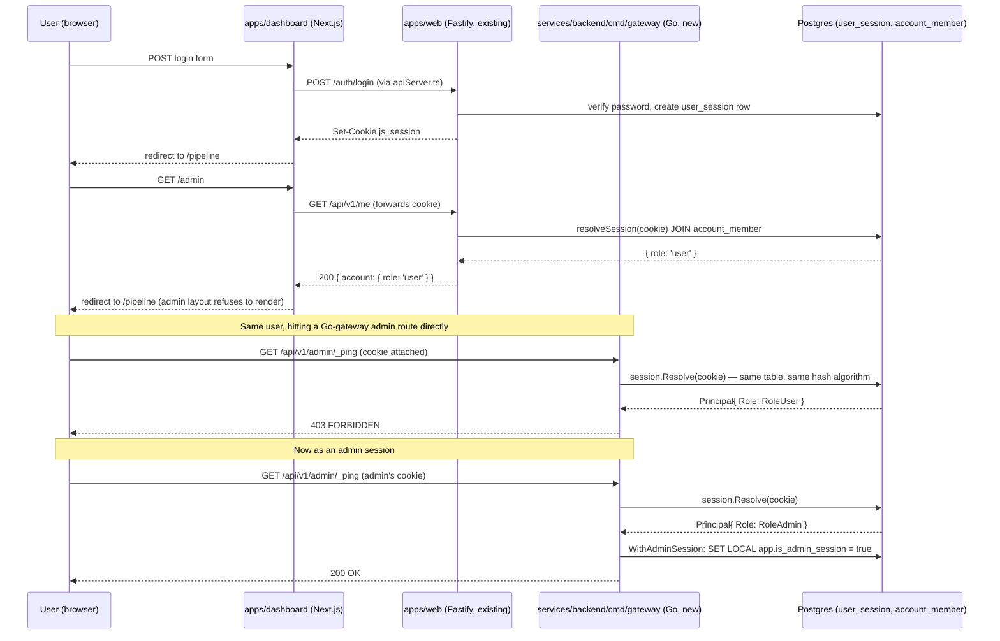

# F01 — Auth & RBAC

> First of the per-feature specs. Build order: this one first — every other feature depends on knowing who the caller is and what they're allowed to do. Supersedes `specs/05-F1-auth-rbac.md` (retired, kept only for history). Read `specs/README.md` §1 first — the backend/frontend/format decisions recorded there are load-bearing for this spec.

---

## 1. Feature Summary

F01 gives the v2 system a caller identity and a role on every request, without touching the auth code that already works. Concretely: it collapses the three-role `account_member.role` enum (`owner|admin|member`) down to the two roles the product actually has (`admin|user`); it stands up a `RequireRole` middleware and a second, admin-scoped session flag (`app_is_admin_session`) on the **Go** side, reusing session-validation code that was already ported to Go once for `services/backend` rather than writing it again; and it closes a real, self-documented gap in the existing codebase — Google OAuth sign-in has never been run against real Google credentials. Nothing about how a user logs in changes. What changes is that the system can now answer "is this caller an admin" server-side, in both languages, in a way that's provably impossible to spoof from the client.

## 2. Dependencies

**Upstream spec dependencies:** none — F01 is the foundation everything else builds on (F02, F03, F09, F11 depend on it directly per `specs/README.md` §4).

**Existing repo code this reuses, cited exactly:**

| Concern | Existing file | What it already does |
|---|---|---|
| TS session validation | [`apps/web/src/services/auth.ts`](../../apps/web/src/services/auth.ts) (`resolveSession`) | Cookie → `user_session` lookup → `Principal`. Unchanged by F01. |
| TS session repo | [`packages/db/src/repositories/sessions.ts`](../../packages/db/src/repositories/sessions.ts) | The actual SQL this all rests on. Unchanged. |
| TS tenant context | [`packages/db/src/context.ts`](../../packages/db/src/context.ts) (`withAccount`) | `SET LOCAL app.current_account_id`. Unchanged. |
| Password hashing | [`apps/web/src/services/password.ts`](../../apps/web/src/services/password.ts) | Argon2id, timing-equalized. Unchanged. |
| Google OAuth + PKCE | [`apps/web/src/services/google-oauth.ts`](../../apps/web/src/services/google-oauth.ts), [`pkce.ts`](../../apps/web/src/services/pkce.ts) | Code-complete. F01's only change here is *running it for real* (§6). |
| Current `/api/v1/me` | [`apps/web/src/routes/app.ts`](../../apps/web/src/routes/app.ts) L31-44 | Already returns `{ account: { id, role } }`. F01 changes what `role` can be, not the shape. |
| **Go session validation** | [`services/backend/internal/session/session.go`](../../services/backend/internal/session/session.go) | **Already exists.** Resolves the same `js_session` cookie against the same `user_session` table, hashed the same way. This is what `specs/05`'s draft assumed would need to be written from scratch — it doesn't. |
| Go tenant context | [`services/backend/internal/db/context.go`](../../services/backend/internal/db/context.go) (`WithAccount`) | **Already exists**, `SET LOCAL` via `set_config(..., true)`, same as the TS version. |
| Go auth middleware | [`services/backend/internal/httpx/auth.go`](../../services/backend/internal/httpx/auth.go) (`RequireAuth`) | **Already exists.** 401-on-failure HTTP middleware wrapping `session.Resolve`. |
| Go API entrypoint pattern | [`services/backend/cmd/api/main.go`](../../services/backend/cmd/api/main.go) | **Already exists**, including a `GET /api/v1/_internal/whoami` route explicitly commented as "meant to be replaced by the first real authenticated route... rather than grown into one" — exactly the pattern F01's own gateway route follows. |
| Cross-language parity test fixture | [`packages/db/test/fixtures/session-tokens.json`](../../packages/db/test/fixtures/session-tokens.json), asserted by both `packages/db/test/sessionTokenParity.test.ts` and [`services/backend/internal/session/session_test.go`](../../services/backend/internal/session/session_test.go) | **Already exists** and already proves TS/Go hash agreement. F01 doesn't touch this — role values aren't part of the hash. |

**What's genuinely new in F01**, once the above is accounted for: (a) migration 0018 (role collapse + `app_is_admin_session()`), (b) a `RequireRole` middleware next to the existing `RequireAuth`, (c) a `WithAdminSession` helper next to the existing `WithAccount`, (d) a new, minimal Go binary — `services/backend/cmd/gateway` — that is the seed of the HLD's "Go API Gateway," and (e) actually running the Google OAuth flow against real credentials.

**Architectural note, made explicit rather than silently decided:** `services/backend/internal/{session,httpx,db}` are Go `internal/` packages — importable only by code rooted at `services/backend/`. Rather than extracting them into a new shared module (a real refactor of already-tested code, for no behavior change), F01 puts the new gateway binary *inside the existing `services/backend` Go module*, as a second `cmd/` entrypoint alongside `cmd/api` and `cmd/worker`, importing `internal/session`/`internal/httpx`/`internal/db` directly. A Go module can hold several independently-built, independently-deployable binaries under one `internal/`; module boundary and deployable-service boundary are not the same thing. This is provisional for F01's own need — if a later service (F04's crawler, F10's Amatya) turns out to need a genuinely different dependency set or Go version, that's a call for that spec to make, not a reason to over-engineer an extraction now for code that has exactly one consumer today.

## 3. Complete User Journey

**Journey A — a `user` logs in and is correctly refused admin access.**

1. User visits `/login` on `apps/dashboard`. Enters email/password. Clicks "Sign in."
2. `apps/dashboard`'s `LoginForm.tsx` Server Action calls `apps/web`'s `POST /auth/login` via `apiServer.ts`. Unchanged code path.
3. `apps/web` sets the `js_session` cookie (httpOnly, sameSite=lax, secure in prod) and returns 200. Browser now holds a valid session.
4. User navigates to `/pipeline` — works exactly as before, unaffected by F01.
5. User manually types `/admin` into the address bar (curious, not malicious — but the system must behave identically either way).
6. `apps/dashboard/src/app/(admin)/layout.tsx` (new, §8) runs server-side: calls `GET /api/v1/me`, sees `account.role === 'user'`, and redirects to `/pipeline` before any admin page component renders or ships a byte of JS to the browser.
7. Separately, if the user instead hits a new Go-gateway admin route directly (e.g. via `curl`, bypassing the UI entirely) — `GET /api/v1/admin/_ping` — the `RequireRole(RoleAdmin)` middleware returns `403 {"error":"FORBIDDEN","message":"insufficient role"}`. Not 404 (the route exists, this caller can't have it), not a redirect (this is an API, not a page).

**Journey B — the admin logs in and reaches the same route successfully.**

8. Same login flow, different `account_member.role` value on the DB row.
9. `(admin)/layout.tsx`'s server check sees `role === 'admin'`, renders the admin nav + page.
10. `GET /api/v1/admin/_ping` returns `200`.

**Journey C — a tampered request cannot see another account's data (AC3), independent of the RBAC check above.**

11. A malicious/broken client sends `{"accountId": "<someone-else's-uuid>"}` in a request body to an authenticated endpoint. The handler never reads `accountId` from the body for authorization purposes — it opens `WithAccount(ctx, pool, principal.AccountID, ...)` using the account ID resolved from the *session*, not the body. Even if a handler had a bug and echoed the body's `accountId` into a query by mistake, RLS (migration 0001–0004) means the query returns zero rows for any account that isn't `app.current_account_id` — a second, independent layer that doesn't trust the handler to get it right.

**Journey D — Google OAuth, run for real (closes the flagged gap, §6).**

12. User clicks "Sign in with Google." `apps/web`'s `GET /auth/google` redirects to Google's real consent screen (previously: code-complete, never actually reachable with real credentials).
13. User approves. Google redirects back to `GET /auth/google/callback` with a real authorization code.
14. `apps/web` exchanges it server-to-server for tokens, verifies state/PKCE, upserts an `oauth_identity` row, issues a session. This is the first time this exact sequence has run against Google's real infrastructure rather than a fake token endpoint in a test.



## 4. Architecture & Flow

```mermaid
flowchart TD
    subgraph Browser
        UI[apps/dashboard<br/>Next.js App Router]
    end

    subgraph Existing_TS["Existing (unchanged)"]
        WEB[apps/web — Fastify<br/>session auth, profile, matches,<br/>applications, outreach]
    end

    subgraph New_Go["New — services/backend/cmd/gateway"]
        MW1[RequireAuth<br/>session.Resolve]
        MW2[RequireRole<br/>admin | user]
        H1["/api/v1/gateway/whoami"]
        H2["/api/v1/admin/_ping"]
    end

    PG[(Postgres<br/>user_session, account_member,<br/>app_is_admin_session)]

    UI -- "REST via apiServer.ts<br/>(existing routes)" --> WEB
    UI -- "REST via apiServer.ts<br/>(new v2 admin/gateway routes)" --> MW1
    WEB -- "resolveSession()" --> PG
    MW1 --> MW2
    MW2 --> H1
    MW2 --> H2
    MW1 -- "session.Resolve()" --> PG
    MW2 -- "WithAdminSession():<br/>SET LOCAL app.is_admin_session" --> PG

    classDef unchanged fill:#eee,stroke:#999
    class WEB unchanged
```

**Each hop, explained:**
1. **Browser → `apps/dashboard`**: no change. Server Components fetch via `apiServer.ts`, same as every existing page.
2. **`apps/dashboard` → `apps/web`**: unchanged, for every route that already exists (login, profile, matches, pipeline, etc.).
3. **`apps/dashboard` → new Go gateway**: new. Only for routes F01+ introduce (`(admin)` route group, and later F04/F07/F08/F10's new routes once they exist). Same `apiServer.ts` pattern, different base URL.
4. **`RequireAuth` → Postgres**: reuses `session.Resolve`, unchanged query, unchanged hash algorithm — this is the "already ported to Go" reuse from §2.
5. **`RequireRole` → nothing (in-process)**: pure role comparison on the already-resolved `Principal`, no extra DB round trip.
6. **`WithAdminSession` → Postgres**: new. Sets the *second*, independent session flag (migration 0018) inside the same transaction as the admin-scoped query that follows it — never a bare connection-level `SET`, for the same pooled-connection-leak reason `WithAccount` already guards against.

## 5. Data Model

### Migration 0018 — role collapse + admin-session mechanism

Supersedes `specs/02-DB-migrations.md`'s "0021" for the *mechanism* only (see `specs/README.md` §2 for why 0021 as originally drafted can't run this early — it references tables that don't exist until F03/F04). Per-table admin-`SELECT` policies are added later, colocated with whichever migration creates that table.

```sql
-- 0018 · Collapse account_member.role to admin|user; introduce the
-- admin-session flag mechanism (function only — no policies yet, see
-- specs/README.md §2 for why).
--
-- The existing owner|admin|member enum was built for org-account
-- multi-tenancy this product doesn't use (specs/00-PRD-and-HLD.md §2:
-- exactly two personas). Two roles is the honest model for what ships.

ALTER TABLE account_member DROP CONSTRAINT account_member_role_check;
UPDATE account_member SET role = 'user' WHERE role = 'member';
UPDATE account_member SET role = 'admin' WHERE role = 'owner';
ALTER TABLE account_member ADD CONSTRAINT account_member_role_check
  CHECK (role IN ('admin', 'user'));

-- A second, admin-specific session flag — deliberately separate from
-- app_current_account_id() (0001) so "which tenant" and "is this an
-- admin-privileged read" can never be conflated. No RLS policy uses this
-- yet; F03/F04/F06 add a `USING (app_is_admin_session())` SELECT policy
-- to target_company/apply_action/job_application etc. as each table is
-- created, per specs/README.md §2.
CREATE OR REPLACE FUNCTION app_is_admin_session() RETURNS boolean AS $$
  SELECT COALESCE(current_setting('app.is_admin_session', true), 'false')::boolean;
$$ LANGUAGE sql STABLE;

CREATE ROLE app_admin NOLOGIN;
GRANT USAGE ON SCHEMA public TO app_admin;
```

**RLS impact**: none on existing policies — every existing `account_id = app_current_account_id()` policy is untouched. `app_is_admin_session()` is inert (no policy references it yet) until F03+ start using it.

**Grants**: `app_admin` is created with schema `USAGE` only; it gets no table grants until a spec actually needs one (F11 is the first).

**Rows affected**: every existing `account_member` row gets rewritten (`owner→admin`, `member→user`; existing `admin` rows are untouched). At today's data volumes (<500 users per `specs/00` §6) this is instant and doesn't need batching.

## 6. API Contract

No existing endpoint's *path* changes. One existing endpoint's *response values* change, and two new endpoints are added for the new gateway.

```ts
// apps/web GET /api/v1/me — response shape unchanged, but account.role's
// possible values change from 'owner' | 'admin' | 'member' to 'admin' | 'user'.
interface MeResponse {
  user: { id: string; email: string; fullName: string | null };
  account: { id: string; role: 'admin' | 'user' }; // was: 'owner' | 'admin' | 'member'
}
```

```ts
// NEW — services/backend/cmd/gateway, GET /api/v1/gateway/whoami
// Temporary smoke-test route (same convention as cmd/api's existing
// /api/v1/_internal/whoami) — proves the RequireAuth chain on the new
// binary, meant to be replaced by the first real gateway route (F04),
// not grown into a product endpoint.
// → 200 { userId, accountId, role, sessionId }
// → 401 { error: "UNAUTHENTICATED", message: string }

// NEW — services/backend/cmd/gateway, GET /api/v1/admin/_ping
// Proves RequireRole('admin') end to end. Replaced by F11's real admin
// routes; exists purely so AC1/AC2/AC6 are independently testable before
// F11 has anything real to gate.
// → 200 { status: "ok" }
// → 401 { error: "UNAUTHENTICATED", message: string }
// → 403 { error: "FORBIDDEN", message: "insufficient role" }
```

**Migration-risk check performed, not assumed**: grepped `apps/dashboard` and `apps/web` for any code branching on the literal strings `'owner'` or `'member'` (as opposed to just displaying `role`). None found — `dashboardPage()`'s HTML shell and `ProfileForm.tsx` both just echo `role` as a string for display, they don't switch on its value. The role-collapse migration is safe to ship without a matching frontend change beyond what F01 itself adds.

## 7. Backend Implementation

### 7.1 Role model (`services/backend/internal/session/session.go`)

```go
// Before (matches the pre-0018 DB enum):
// const (
//     RoleOwner  MemberRole = "owner"
//     RoleAdmin  MemberRole = "admin"
//     RoleMember MemberRole = "member"
// )

// After 0018:
const (
	RoleAdmin MemberRole = "admin"
	RoleUser  MemberRole = "user"
)
```

The `Resolve` function itself (the query, the hash comparison, the two soft-delete checks) is untouched — it already selects `am.role` generically as `MemberRole`; only the set of valid values changes, which Postgres's own `CHECK` constraint enforces at the source. `services/backend/internal/session/session_integration_test.go`'s fixture rows using `'owner'`/`'member'` need updating to `'admin'`/`'user'` (§10).

### 7.2 `RequireRole` middleware (new — `services/backend/internal/httpx/rbac.go`)

```go
// Package httpx (extends auth.go, doesn't replace it).
package httpx

import (
	"net/http"

	"github.com/mayankmishra110/jobswitch-ai/services/backend/internal/session"
)

// RequireRole must wrap a handler already wrapped in RequireAuth — it
// reads the Principal RequireAuth attached to the context and does not
// itself touch the database. Composing two single-purpose middlewares
// (authenticate, then authorize) rather than one that does both keeps
// each independently testable and reusable: some routes need RequireAuth
// alone (any signed-in user), some need both.
func RequireRole(required session.MemberRole, next http.HandlerFunc) http.HandlerFunc {
	return func(w http.ResponseWriter, r *http.Request) {
		principal, ok := PrincipalFromContext(r.Context())
		if !ok {
			// Defensive only: reaching here without RequireAuth having run
			// first is a wiring bug, not a real caller state. Fail closed.
			Unauthenticated(w)
			return
		}
		if principal.Role != required {
			// 403, not 404: the route exists, this caller can't have it.
			// 404-to-hide-existence only earns its keep when the resource
			// ID itself is the secret — not the case for a known admin path.
			JSON(w, http.StatusForbidden, map[string]string{
				"error":   "FORBIDDEN",
				"message": "insufficient role",
			})
			return
		}
		next(w, r)
	}
}
```

Wiring (in `cmd/gateway/main.go`, §7.4) composes the two explicitly at each route registration — `RequireAuth(pool, cookieName, RequireRole(session.RoleAdmin, handler))` — rather than a route-group abstraction, because Go's stdlib `http.ServeMux` (used elsewhere in this codebase, e.g. `cmd/api/main.go`) has no native middleware-group concept; wrapping per-route keeps the composition visible at the call site instead of hidden in a router-specific API.

### 7.3 `WithAdminSession` (new — `services/backend/internal/db/admin.go`)

```go
package db

import (
	"context"
	"fmt"

	"github.com/jackc/pgx/v5"
	"github.com/jackc/pgx/v5/pgxpool"
)

// WithAdminSession sets the SECOND, independent flag from migration 0018
// (app.is_admin_session), inside its own transaction, via SET LOCAL
// (set_config's third argument, true) — never a bare SET, for the exact
// pooled-connection-leak reason WithAccount already documents.
//
// Deliberately a separate function from WithAccount, not a boolean
// parameter on it — every admin-privileged read is then grep-able in one
// search (`WithAdminSession(`), and nobody can accidentally thread
// `isAdmin: true` through three layers of call stack without it showing
// up as its own, distinctly-named call.
func WithAdminSession[T any](
	ctx context.Context,
	pool *pgxpool.Pool,
	fn func(context.Context, pgx.Tx) (T, error),
) (T, error) {
	var zero T
	tx, err := pool.Begin(ctx)
	if err != nil {
		return zero, fmt.Errorf("beginning transaction: %w", err)
	}
	defer tx.Rollback(ctx) //nolint:errcheck

	if _, err := tx.Exec(ctx, "SELECT set_config('app.is_admin_session', 'true', true)"); err != nil {
		return zero, fmt.Errorf("setting admin session flag: %w", err)
	}

	result, err := fn(ctx, tx)
	if err != nil {
		return zero, err
	}
	if err := tx.Commit(ctx); err != nil {
		return zero, fmt.Errorf("committing transaction: %w", err)
	}
	return result, nil
}
```

### 7.4 The gateway binary (new — `services/backend/cmd/gateway/main.go`)

```go
// Command gateway is the seed of the HLD's "Go API Gateway": a second
// cmd/ entrypoint in this module, sharing internal/session, internal/httpx,
// internal/db, internal/config with cmd/api and cmd/worker rather than
// duplicating any of it (see SPEC.md §2's architectural note on why this
// isn't a separate Go module yet). F01 gives it exactly two routes; F04/
// F07/F08/F10 mount their own routes onto this same binary as they ship.
package main

import (
	"context"
	"log/slog"
	"net/http"
	"os"
	"os/signal"
	"strconv"
	"syscall"
	"time"

	"github.com/mayankmishra110/jobswitch-ai/services/backend/internal/config"
	"github.com/mayankmishra110/jobswitch-ai/services/backend/internal/db"
	"github.com/mayankmishra110/jobswitch-ai/services/backend/internal/httpx"
	"github.com/mayankmishra110/jobswitch-ai/services/backend/internal/session"
)

func main() {
	logger := slog.New(slog.NewJSONHandler(os.Stdout, nil))
	slog.SetDefault(logger)

	cfg, err := config.Load()
	if err != nil {
		logger.Error("invalid configuration", "err", err)
		os.Exit(1)
	}

	ctx, stop := signal.NotifyContext(context.Background(), os.Interrupt, syscall.SIGTERM)
	defer stop()

	pools, err := db.NewPools(ctx, cfg.DatabaseURL, cfg.DatabaseURLMatcher)
	if err != nil {
		logger.Error("connecting to postgres", "err", err)
		os.Exit(1)
	}
	defer pools.Close()

	mux := http.NewServeMux()

	mux.HandleFunc("GET /healthz", func(w http.ResponseWriter, _ *http.Request) {
		httpx.JSON(w, http.StatusOK, map[string]string{"status": "ok"})
	})

	mux.HandleFunc("GET /api/v1/gateway/whoami", httpx.RequireAuth(
		pools.Web, cfg.SessionCookieName,
		func(w http.ResponseWriter, r *http.Request) {
			principal, _ := httpx.PrincipalFromContext(r.Context())
			httpx.JSON(w, http.StatusOK, map[string]any{
				"userId": principal.UserID, "accountId": principal.AccountID,
				"role": principal.Role, "sessionId": principal.SessionID,
			})
		},
	))

	mux.HandleFunc("GET /api/v1/admin/_ping", httpx.RequireAuth(
		pools.Web, cfg.SessionCookieName,
		httpx.RequireRole(session.RoleAdmin, func(w http.ResponseWriter, _ *http.Request) {
			httpx.JSON(w, http.StatusOK, map[string]string{"status": "ok"})
		}),
	))

	addr := ":" + strconv.Itoa(cfg.Port)
	srv := &http.Server{Addr: addr, Handler: mux, ReadHeaderTimeout: 5 * time.Second}

	go func() {
		logger.Info("gateway listening", "addr", addr)
		if err := srv.ListenAndServe(); err != nil && err != http.ErrServerClosed {
			logger.Error("server error", "err", err)
			stop()
		}
	}()

	<-ctx.Done()
	shutdownCtx, cancel := context.WithTimeout(context.Background(), 10*time.Second)
	defer cancel()
	_ = srv.Shutdown(shutdownCtx)
}
```

`cfg.Port` collides with `cmd/api`'s own use of `PORT` — the two binaries need distinct env values at deploy time (e.g. `PORT=8080` for `cmd/api`, `PORT=8090` for `cmd/gateway`); no code change needed, this is a deploy-config concern, noted so it isn't discovered the hard way at first dual-run.

**Concurrency/error-handling approach**: identical to every other Go entrypoint in this codebase (`cmd/api`, `cmd/worker`) — `signal.NotifyContext` for graceful shutdown, a bounded shutdown timeout, structured JSON logging, config validated once at startup with every error collected before exit rather than failing on the first. No new concurrency pattern is introduced by F01 itself; the counting-semaphore worker-pool pattern (relevant to F04's crawler, not F01) is covered in `01-LLD.md` §1.2 when that spec is written.

## 8. Frontend Implementation

```
apps/dashboard/src/app/
├── (admin)/                      # NEW — route group, no URL segment added
│   ├── layout.tsx                # Server Component — the actual gate
│   └── admin/
│       └── page.tsx               # placeholder page; F11 fills this in
├── (existing routes, unchanged)
```

```tsx
// apps/dashboard/src/app/(admin)/layout.tsx
// Server Component. Runs on every request to any (admin) route, before
// any child page component (or its JS) is sent to the browser — this is
// the actual enforcement point, not a client-side check that could be
// bypassed by disabling JS.
import { redirect } from 'next/navigation';
import { apiGetOrRedirect } from '@/lib/apiServer';

export default async function AdminLayout({ children }: { children: React.ReactNode }) {
  const me = await apiGetOrRedirect<{ account: { role: 'admin' | 'user' } }>('/api/v1/me');
  if (me.account.role !== 'admin') {
    redirect('/pipeline');
  }
  return <>{children}</>;
}
```

**Server vs Client boundary**: this is a Server Component doing a server-to-server fetch, per `04-FE-architecture.md` §1.1's existing rule — no `useEffect`, no client-side redirect flash. The one new piece of state this feature needs (which role the current user has) is already server-known on every request; there's no Redux slice for it, because Redux is for state that needs to survive client-side navigation and be read from multiple components without a refetch (F09's `unappliedCount` is the real example of that need) — a per-request server check doesn't qualify, and adding one anyway would be the "over-using Redux" mistake `00-PRD-and-HLD.md` §7.3 explicitly calls out.

**Loading/error/empty states**: none new. `apiGetOrRedirect` already handles the unauthenticated case (redirects to `/login`, existing behavior); the role check above handles the wrong-role case. There's no "loading" state to design because this is a Server Component — the page simply doesn't render until the check resolves, which is the point.

## 9. Acceptance Criteria

| # | Criterion |
|---|---|
| AC1 | A caller with `role='user'` calling `/api/v1/admin/_ping` (Go gateway) gets **403**, not 404 or 500 |
| AC2 | An admin session's cross-account-capable read sets `app.is_admin_session=true` via `SET LOCAL` inside the same transaction as the query — never a connection-level `SET` |
| AC3 | A caller with a tampered `accountId` in a request body still only ever affects/sees their own rows — enforced by RLS, not by the handler checking the body |
| AC4 | Session cookie is `httpOnly`, `sameSite=lax`, `secure` in production (unchanged, re-verified) |
| AC5 | Google sign-in completes a real round trip against real Google credentials |
| AC6 | Role is read from the DB per request (via `session.Resolve`'s live `JOIN account_member`), never cached, never trusted from a client-supplied header/claim |
| AC7 | Migration 0018 correctly maps every existing `owner→admin` and `member→user` row, verified by a row-count-preserving check, not just "the migration ran without erroring" |
| AC8 | `(admin)/layout.tsx` redirects a non-admin before any admin page component or its JS ships to the browser (verified by checking the response for `/admin` never includes the admin bundle for a `role=user` session) |
| AC9 | `GET /api/v1/me`'s `account.role` is one of exactly `'admin'` \| `'user'` after 0018 — never `'owner'` or `'member'` |

## 10. Test Plan

### Go unit (`services/backend/internal/httpx`, `internal/db`)
```
TestRequireRole_AdminPasses
TestRequireRole_UserGets403
TestRequireRole_NoPrincipalInContextFailsClosed   // the defensive branch in §7.2
TestWithAdminSession_SetsLocalNotGlobal            // assert setting is gone after commit
TestWithAdminSession_IndependentFromAccountContext // the two flags must not interact
```

### Go integration (real Postgres — extends the existing pattern)
```
TestRLS_TamperedAccountIdInBodyIsIgnored          // AC3, mirrors packages/db/test/rls.test.ts's style
TestRLS_ContextDoesNotLeakAcrossPooledConnections // concurrent SET LOCAL test, same shape as the existing TS suite
TestSessionIntegration_RoleValuesMatchNewEnum      // updates services/backend/internal/session/session_integration_test.go's
                                                     // fixture rows from owner/member to admin/user
```

### Migration test (extends `packages/db/test/`, same pattern as the existing migration suite)
```
test_0018_collapses_owner_to_admin_and_member_to_user  // AC7 — row-count-preserving assertion, not just "ran clean"
test_0018_app_is_admin_session_defaults_false_when_unset
```

### TS unit (`apps/web/test/` — extends `auth.test.ts`)
```
test_me_endpoint_returns_new_role_enum_values   // AC9
```

### E2E (Playwright, new `apps/dashboard/test/` or a shared e2e package — first Playwright suite in this repo, noted since Playwright itself isn't wired up here yet)
```
admin_logs_in_sees_admin_route
user_logs_in_admin_route_redirects_to_pipeline
google_oauth_full_round_trip_against_real_test_account   // AC5 — requires a real, dedicated test Google account; run in CI only if credentials are provisioned as a secret, otherwise documented as a manual pre-release check
```

**Honest note on AC5's test**: an automated E2E test against Google's real consent screen is brittle (Google's UI, 2FA prompts, and bot-detection heuristics are all outside this repo's control) and most teams don't fully automate it. The realistic test plan is: automate everything up to and including the redirect to Google (assert the URL/params are correct), and treat the actual consent-screen-through-callback round trip as a documented manual verification step before each release that touches this code — which is exactly what `05-F1-auth-rbac.md` §6 already budgeted a half-day for. Don't let "no automated E2E for this" read as "not tested" — it's tested, just not by CI.

## 11. Failure Modes & Edge Cases

- **Migration 0018 runs against a row with a role value outside `owner|admin|member`** (shouldn't be possible given the pre-existing CHECK constraint, but migrations should not trust that another migration's constraint was never bypassed by a manual `UPDATE`) — the `ADD CONSTRAINT` at the end of 0018 will simply fail the migration if any row doesn't map to `admin`/`user`, which is the correct failure (loud, at migration time, not a silent bad row in production).
- **`RequireRole` is added to a route but `RequireAuth` is forgotten** — `PrincipalFromContext` returns `ok=false`, and the defensive branch in §7.2 fails closed (401-equivalent), not a panic or a 200. Still: this is a wiring bug a code reviewer should catch, since it means the route has no real auth at all, just a coincidentally-safe default.
- **Two Go binaries (`cmd/api`, `cmd/gateway`) both need `PORT` from the environment** — a deploy that sets one `PORT` value and runs both processes will have one silently fail to bind or collide. Not a code bug, a deploy-config trap — flagged in §7.4, needs distinct env values per process at deploy time (relevant when `DEPLOYMENT.md` is updated, not blocking for this spec).
- **An admin's own `account_id` still gets normal RLS treatment for their *own* data** — `WithAdminSession` doesn't imply `WithAccount`; an admin viewing their own `/pipeline` still goes through the ordinary `app.current_account_id` path. Only routes that explicitly call `WithAdminSession` get cross-account visibility. Mixing the two up (e.g. calling `WithAdminSession` when `WithAccount` was meant) would be a real, dangerous bug — worth a comment at every call site, not just in this spec.
- **Google OAuth verification (AC5) surfaces real-world friction that has nothing to do with this codebase**: redirect URI mismatches, consent-screen verification status, scope-approval delays for a not-yet-verified app. None of this is a code defect; all of it is expected the first time any app runs this flow for real, per `05-F1-auth-rbac.md` §6's own estimate.
- **A session created before 0018 runs, still valid after** — `user_session` isn't touched by 0018; a session issued under the old role model keeps working, and the next `session.Resolve` simply joins against the now-updated `account_member` row and gets the new role value. No forced re-login needed, which is worth confirming explicitly rather than assuming.

## 12. Cost & Performance Notes

At the stated scale (<500 users, `specs/00` §6), F01 adds no meaningful cost or new bottleneck: `RequireRole` is a pure in-memory string comparison (no DB call), and `WithAdminSession` is one extra `set_config` call inside a transaction that's already being opened. The hot query remains what it already was — `session.Resolve`'s single indexed lookup on `user_session.token_hash` (unique index, already exists) joined to `account_member` (primary-keyed on `(account_id, user_id)`, already exists) — unchanged by this feature. Migration 0018's `UPDATE account_member` touches at most a few hundred rows at current scale; it's a one-time, sub-second operation, not something that needs batching or a background job.

## 13. What You'll Learn Building This

- **Middleware-as-default-deny vs. per-handler checks.** `RequireRole` wrapping a route at registration time means forgetting to add a new admin route to the wrapped set makes the route not exist at all — a loud failure — rather than a per-handler `if role != admin` that's one missed line away from a silent authz hole. This is a real architecture-level security principle, not a style preference, and it generalizes to every backend framework you'll touch (Spring Security filter chains work on exactly this same idea).
- **Composable middleware over inheritance.** `RequireRole` composes with `RequireAuth` by wrapping, not by RequireRole re-implementing session resolution or RequireAuth knowing about roles. Each does one thing; you get `RequireAuth`-only routes and `RequireAuth`+`RequireRole` routes for free from the same two functions. This is the actual shape of the "single responsibility" principle showing up as working code, not a slide in a design-patterns deck.
- **Two independent session flags, not one flag with two meanings.** `app.current_account_id` (which tenant) and `app.is_admin_session` (is this read admin-privileged) are separate `set_config` calls precisely so a bug in one can't accidentally imply the other. Ask yourself, next time you're tempted to add a boolean parameter to an existing function instead of a new named one: does "is this call special" deserve to be its own grep-able thing, or is it fine to bury as a flag three layers deep? This spec picked "its own thing," and §7.3 explains exactly why.
- **Why 403, not 404, for an authz failure on a known route.** 404-to-hide-existence is a real, sometimes-correct pattern (don't reveal that `/users/42` exists to someone with no access to it) — but it only earns its keep when the resource *identity* is the secret. `/api/v1/admin/_ping` existing is not a secret; who's allowed to call it is. Knowing which of these two situations you're in, and being able to say why, is a genuinely interview-relevant distinction.
- **Migration-time data backfills that fail loudly on bad data**, versus ones that silently coerce it. 0018's `ADD CONSTRAINT` after the `UPDATE`s means any row that didn't map cleanly blows up the migration instead of quietly becoming an invalid enum value in production. This is the same "constraints, not app-logic-and-hope" instinct this codebase's existing migrations (0012–0016) already demonstrate — F01 is your first chance to write one of these yourself instead of just reading about it.
- **Go's `internal/` visibility rule, and multi-binary modules.** One Go module can produce several independent binaries (`cmd/api`, `cmd/worker`, now `cmd/gateway`) that all share one `internal/` tree — deployable-service boundaries and Go-module boundaries are two different things, and conflating them is a common early mistake. §2's architectural note is a real, defensible engineering decision you should be able to explain, not a shortcut.

## 14. Definition of Done

- [ ] Migration 0018 applied: role enum collapsed, `app_is_admin_session()` created, `app_admin` role created
- [ ] `RequireRole` middleware implemented in `services/backend/internal/httpx/rbac.go`
- [ ] `WithAdminSession` implemented in `services/backend/internal/db/admin.go`
- [ ] `services/backend/cmd/gateway/main.go` builds, runs, serves `/healthz`, `/api/v1/gateway/whoami`, `/api/v1/admin/_ping`
- [ ] `session.go`'s `MemberRole` constants updated; `session_integration_test.go` fixtures updated to `admin`/`user`
- [ ] `apps/dashboard/src/app/(admin)/layout.tsx` implemented and gates correctly (AC8)
- [ ] All tests in §10 passing, including the concurrent pooled-connection test and the migration row-mapping test
- [ ] Google OAuth verified against real credentials (AC5), with the manual-verification note from §10 acknowledged, not silently skipped
- [ ] `apps/web`/`apps/dashboard` grep for `'owner'`/`'member'` literal checks re-run and still clean (§6)
- [ ] Lint + typecheck + tests green in pre-commit hook, for both the Go module and the TS workspaces touched

---

Next spec: **F02 — Profile & Resume**, once you confirm this one.
