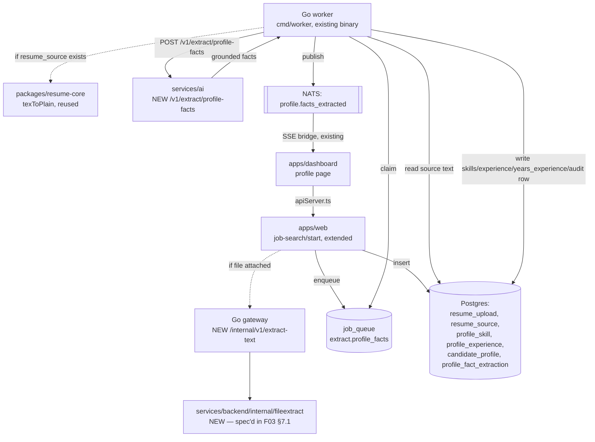

# F02 — Profile & Resume

> Second per-feature spec. Depends on F01 (needs a resolved `Principal` and RLS-scoped writes). Read `specs/README.md` §1–2 first.

---

## 1. Feature Summary

F02 turns a candidate's resume into the two structured facts F05's matcher actually needs — a skills list and years of experience — reusing the existing fact-storage model entirely and extending, rather than replacing, the existing upload mechanism. Today, `profile_skill` and `candidate_profile.years_experience` can only be populated by the user typing them into a form, and resume "upload" only accepts pasted plain text. F02 closes both gaps at once: it adds real PDF/DOCX/TXT file upload (closing a real conflict with `00-PRD-and-HLD.md` §3's locked journey step 1, "user uploads a resume (PDF/LaTeX source)" — see `specs/README.md` §2.1 for how this was resolved), and it adds an LLM extraction step that reads the resulting resume text (or, if the user maintains one, their LaTeX `resume_source`) and writes skills/experience facts into the same existing tables — tagged `ai_inference`, exactly like any other AI-derived fact this codebase already tracks (D-22's fact-provenance model, in place since Phase 4). The user sees and can edit the result through the profile UI that already exists; there's no new review screen, because the existing one already handles provenance-tagged facts generically.

## 2. Dependencies

**Spec dependency:** F01 (RBAC/session — every write below runs inside `withAccount`/`WithAccount`, resolved from the caller's session). **F03, narrowly**: the PDF/DOCX/TXT → plain-text extraction utility is specified and owned by `F03-company-ingestion/SPEC.md` §7.1, which needs identical parsing for company lists. This is a dependency on one piece of F03's *design*, not on F03 shipping first — see `specs/README.md` §2.1: because F02 ships before F03 in build order, the utility itself is implemented as part of F02's build work, and F03 reuses it once F03 ships. Nothing else in F02 depends on F03.

**Existing repo code this reuses, cited exactly — this is almost entirely a wiring feature, not a new-tables feature:**

| Concern | Existing file | What it already does |
|---|---|---|
| Resume upload (as part of starting a job search) | [`apps/web/src/routes/jobSearch.ts`](../../apps/web/src/routes/jobSearch.ts) `POST /api/v1/job-search/start` | Accepts `{ filename, rawText }` (schema: [`packages/core/src/profile.ts`](../../packages/core/src/profile.ts) L226-233 `startJobSearchInput`), stores `resume_upload`. **Extended by F02** to also accept a multipart file (§6, §7.4) — the existing JSON `{filename, rawText}` path is unchanged for any caller still using it. |
| Resume storage | `resume_upload` table (migration 0009) | `account_id` (PK), `filename`, `raw_text`, `uploaded_at`. Ephemeral — hard-deleted on job-search stop (D-31). **F02's extraction reads this table; doesn't add a column to it.** |
| Fact storage — skills | `profile_skill` table (migrations 0007, 0009) | Already has `provenance` (`self_asserted`\|`ai_inference`\|…), `confidence`, `evidence_ref`. **F02 writes rows here with `provenance='ai_inference'`. No new column, no new table.** |
| Fact storage — years of experience | `candidate_profile.years_experience` + `years_experience_provenance` (migration 0009) | Already exists, currently only ever written by the manual `PUT /api/v1/profile` path. **F02 is the first thing to populate it from an inference.** |
| Fact storage — experience entries | `profile_experience` table (migrations 0007, 0009) | Has `provenance`/`evidence_ref` already. **F02 writes AI-sourced rows here** (see §5's reasoning for why years-of-experience is computed from *these* rows deterministically, not asked of the LLM directly). |
| Provenance-tagged fact assembly | [`packages/db/src/repositories/profile.ts`](../../packages/db/src/repositories/profile.ts) `buildCandidateFacts`, mirrored in Go at [`services/backend/internal/repo/explain.go`](../../services/backend/internal/repo/explain.go) | Already assembles exactly this provenance-tagged shape for the LLM/matcher boundary. **F05's matcher will read facts through this existing path — F02 doesn't need to build a second one.** |
| LaTeX resume → plain text | [`packages/resume-core/src/parser.ts`](../../packages/resume-core/src/parser.ts) `parseResumeSource` + `texToPlain` | Already produces a clean plain-text view of a LaTeX resume for LLM context (built for the tailoring graph). **F02 reuses this directly** when a user has a `resume_source` variant, instead of writing a second LaTeX-to-text path. |
| Async-job-then-push pattern | Established by `specs/06-F3-company-ingestion.md` §3.1/3.2 for company-list parsing | Same shape reused here: enqueue → worker calls `services/ai` → SSE push on completion. Not reinvented. |
| Go worker queue-claim loop | [`services/backend/internal/worker/embed_profile.go`](../../services/backend/internal/worker/embed_profile.go) | **The direct template for F02's new handler** — same claim/call-AI/write-Postgres shape, same cost-avoidance-via-`source_hash` trick (§5). |
| services/ai LangGraph conventions | `services/ai/app/graphs/explain_graph.py`, `tailor_graph.py` | F02's new graph follows the same node/retry/gate shape (§7.2). |
| Existing profile-edit UI | `apps/dashboard/src/app/profile/` (`ProfileForm.tsx`, existing skills/experience editors) | **Reused as-is.** Provenance badges already exist elsewhere in the UI (the `/matches` page's evidence badges) — F02 doesn't need a new component to show "this skill came from AI," the existing badge styling in `globals.css` already covers `ai_inference`. |

**What's genuinely new**: real PDF/DOCX/TXT file upload for resumes, via the shared extraction utility (§7.4); a `/v1/extract/profile-facts` endpoint + small graph in `services/ai`; an `extract.profile_facts` queue kind + Go worker handler; one new, small table (`profile_fact_extraction`, migration 0019) purely for cost-avoidance and audit, mirroring `profile_embedding.source_hash` and `jd_extraction`'s existing precedents; three narrow new grants for `app_matcher`; one new SSE event type.

## 3. Complete User Journey

1. User is on `/profile`, clicks "Start job search." They either paste resume text (unchanged path) **or** drag in a `.pdf`/`.docx`/`.txt` file (new). Clicks confirm.
   - **File path (new)**: `apps/dashboard` sends the file as `multipart/form-data` to `POST /api/v1/job-search/start`. `apps/web` validates size/mime (§9 AC9-AC11), then calls the new internal extraction endpoint on the Go gateway (`fileExtractClient.ts` → `POST /internal/v1/extract-text`, §7.4) to get plain text back. From here on, the journey is identical to the paste-text path — the extracted text is stored in `resume_upload.raw_text` exactly as if the user had pasted it themselves.
   - **A malformed/corrupt/unsupported file** gets a clear `422` before `job-search/start` does anything else — no partial job-search-start, no empty `resume_upload` row (AC11).
2. `apps/web` stores the `resume_upload` row and starts the session — **unchanged from here**. It additionally enqueues `extract.profile_facts` (new), alongside the `embed.profile` job it already enqueues for the `resume` kind.
3. Dashboard shows the job-search-active state immediately — the user isn't blocked waiting on extraction. A small "Analyzing your resume…" indicator appears near the skills section (new, but trivial — a client component subscribed to one new SSE event, same wiring as `LiveProgress.tsx` already uses for tailoring events).
4. The Go worker (`cmd/worker`, already running) claims the `extract.profile_facts` job. It resolves the input text: if the account has a `resume_source` variant, `texToPlain(parseResumeSource(tex))`; otherwise `resume_upload.raw_text`.
5. It checks `profile_fact_extraction.source_hash` — if the text hasn't changed since the last extraction, it skips the AI call entirely (same trick `embed_profile.go` already uses) and the journey ends here with no visible change.
6. Otherwise, it calls `services/ai`'s new `/v1/extract/profile-facts`. The graph extracts a candidate skills list and structured experience entries (company/title/start/end), then a grounding gate strips any skill that doesn't literally appear in the source text (case-insensitive) — same fabrication-guard philosophy as `tailor_graph.py`'s `fabrication_check`.
7. The worker computes years-of-experience **itself, deterministically**, from the (already-grounded) experience date ranges — never from an LLM-reported number (§5, §7.3 explain why).
8. The worker writes new `profile_skill` rows (skipping any that already exist by name — never overwriting a user's own self-asserted entry), new `profile_experience` rows, updates `candidate_profile.years_experience`/`_provenance`, writes the `profile_fact_extraction` audit row, and publishes `profile.facts_extracted`.
9. The dashboard's SSE listener receives the event, `router.refresh()`s the profile page (same pattern `LiveProgress.tsx` already uses). The user now sees new skill chips and experience rows, each carrying the existing `ai_inference` badge style.
10. User can edit or delete any of them through the **existing** skills/experience editors — no new UI, no special "approve AI facts" flow, because provenance-tagged editing already works generically.

**Error path**: if `services/ai` is down or the call fails, the worker's existing `queue.Fail` path (exponential backoff, capped attempts, dead-letter) applies unchanged — the user's job search still works, they just don't get auto-extracted facts until the retry succeeds or they add facts manually, which was always possible anyway.

```mermaid
sequenceDiagram
    participant U as User
    participant D as apps/dashboard
    participant W as apps/web
    participant GATE as Go gateway (extract-text)
    participant PG as Postgres
    participant GW as Go worker (cmd/worker)
    participant AI as services/ai

    U->>D: choose "paste text" or attach a .pdf/.docx/.txt file, start job search
    D->>W: POST /api/v1/job-search/start (JSON or multipart)
    alt file attached
        W->>W: validate size/mime (AC9-AC11)
        W->>GATE: POST /internal/v1/extract-text (file bytes)
        GATE-->>W: { text } (or 422 unsupported/corrupt)
    end
    W->>PG: insert resume_upload; enqueue embed.profile + extract.profile_facts
    W-->>D: 200 (job search active)
    D-->>U: dashboard shows "Analyzing your resume…"

    GW->>PG: claim extract.profile_facts job
    GW->>PG: read resume_source (if any) or resume_upload.raw_text
    GW->>PG: check profile_fact_extraction.source_hash
    alt text unchanged since last run
        GW->>PG: mark job done, no AI call
    else text changed or first run
        GW->>AI: POST /v1/extract/profile-facts { text }
        AI->>AI: extract_facts node -> grounding_gate node
        AI-->>GW: { skills[], experience[], model, prompt_version }
        GW->>GW: compute yearsExperience deterministically from experience[]
        GW->>PG: insert profile_skill (ai_inference), profile_experience (ai_inference),
        GW->>PG: update candidate_profile.years_experience/_provenance
        GW->>PG: upsert profile_fact_extraction (source_hash, extraction, model)
        GW->>PG: publish profile.facts_extracted (NATS)
    end

    PG-->>D: SSE profile.facts_extracted
    D-->>U: skills/experience appear, ai_inference-badged, editable as usual
```

## 4. Architecture & Flow



**Each hop:** (1) upload path, extended to accept a file — the existing JSON path is untouched; (1a) a file is handed to the new internal extraction endpoint on the Go gateway (F01's binary, §7.4), which calls the shared `fileextract` package (in-process — F03's own upload handler will call the same package directly, no HTTP hop, since it lives in the same binary); (2) new queue kind on the existing `job_queue` table — no new queue infrastructure; (3) the existing worker binary gets one new handler function, registered next to `embed.profile`'s; (4) resume-core's plain-text conversion is called in-process by the worker if a LaTeX source exists — no new service, no new endpoint for that step; (5) one new HTTP call to `services/ai`, same internal-token auth as every other call to that service; (6) writes land in tables that already exist, through grants scoped narrowly to what this feature actually needs (§5); (7) the existing NATS→SSE bridge carries the new event type with zero new transport code.

## 5. Data Model

**No new columns on any existing table.** One new table, three narrow new grants.

```sql
-- 0019 · profile_fact_extraction: audit + cost-avoidance for F02's resume
-- fact extraction. Combines two precedents already in this schema rather
-- than inventing a new pattern: jd_extraction's (0008) raw-LLM-output
-- audit shape, and profile_embedding's (0010) source_hash skip-if-
-- unchanged trick.

CREATE TABLE profile_fact_extraction (
  account_id     uuid PRIMARY KEY REFERENCES account(id) ON DELETE CASCADE,
  source_hash    text NOT NULL,       -- sha256 of the text actually fed to the LLM
  extraction     jsonb NOT NULL,      -- raw graph output: { skills[], experience[] }
  model          text NOT NULL,
  prompt_version integer NOT NULL,
  extracted_at   timestamptz NOT NULL DEFAULT now()
);

ALTER TABLE profile_fact_extraction ENABLE ROW LEVEL SECURITY;

CREATE POLICY profile_fact_extraction_tenant_select ON profile_fact_extraction
  FOR SELECT USING (account_id = app_current_account_id());
-- No INSERT/UPDATE/DELETE policy for app_web — this table is written only
-- by the extraction worker, same "narrower than CRUD" reasoning as
-- audit_log (0004) and application_event (0008); app_web can look, not touch.

GRANT SELECT ON profile_fact_extraction TO app_web;
GRANT SELECT, INSERT, UPDATE ON profile_fact_extraction TO app_matcher;

-- Narrow, additive grants on tables app_matcher could previously only
-- read (0009's SELECT grant). Each is scoped to exactly what this feature
-- writes, mirroring 0010/0011's column-level-grant discipline:

-- Skills: INSERT only. The worker never UPDATEs or DELETEs an existing
-- skill row — a self-asserted skill the user typed themselves must never
-- be silently overwritten by an inference. Deduplication against an
-- existing skill (by lower(skill), the existing unique index from 0007)
-- happens via ON CONFLICT DO NOTHING, not by granting UPDATE.
GRANT INSERT ON profile_skill TO app_matcher;

-- Experience: same reasoning, INSERT only.
GRANT INSERT ON profile_experience TO app_matcher;

-- candidate_profile: UPDATE, but column-scoped to exactly the two fields
-- this feature computes — never headline/summary/current_title/desired_*,
-- which stay exclusively app_web's to write.
GRANT UPDATE (years_experience, years_experience_provenance)
  ON candidate_profile TO app_matcher;
```

**Why years-of-experience is computed in Go from `profile_experience` rows, not written directly by the LLM**: an LLM asked "how many years of experience does this person have" is doing arithmetic on dates it has to parse itself, silently, with no way for a grounding check to verify the *number* against the source text the way a grounding check can verify a *string* (a skill name) appears verbatim. Asking the LLM only for structured `{company, title, start, end}` entries — each of which the grounding gate can verify literally appears in the source — and then computing `years_experience = years spanned by the union of those date ranges` in ordinary, testable Go code removes an entire class of silent LLM arithmetic error from a number that directly gates F05's auto-apply matching. This is the same "don't use the LLM for the part deterministic logic does better" judgment `01-LLD.md` §2 already makes for the matcher itself and `06-F3-company-ingestion.md` §3.2 makes for list-parsing — F02 is the third place this exact tradeoff shows up, which is worth noticing rather than treating as a one-off.

**Migration-risk check**: `profile_skill`'s existing unique index is `(account_id, lower(skill))` (0007) — this is exactly what makes `ON CONFLICT (account_id, lower(skill)) DO NOTHING` race-free for the worker's insert, the same idempotency-via-constraint reasoning `06-F3-company-ingestion.md` §"What you'll learn" already calls out for `target_company`.

## 6. API Contract

```ts
// EXTENDED — apps/web, POST /api/v1/job-search/start
// Existing JSON path unchanged: { filename: string, rawText: string }.
// NEW: also accepts multipart/form-data with a single `file` part
// (.pdf | .docx | .txt, ≤5MB — same cap discipline as F03 §2 AC7 for
// company-list uploads). apps/web extracts text server-side via the
// internal extraction endpoint below before proceeding exactly as it
// does for the JSON path today.
// → 200 { session, resume: { filename, uploadedAt } }              (unchanged success shape)
// → 422 { error: "UNSUPPORTED_FILE_TYPE" | "FILE_TOO_LARGE" | "FILE_UNREADABLE", message }
```

```ts
// NEW — services/backend/cmd/gateway, POST /internal/v1/extract-text
// Internal-token gated (X-Internal-Token, same pattern as services/ai and
// apps/tailor already use), never exposed to the browser — only apps/web
// calls this over the network; F03's own upload handler, living in the
// same Go binary, calls the underlying fileextract package directly
// in-process instead.
// multipart/form-data: file (.pdf | .docx | .txt)
// → 200 { text: string }
// → 422 { error: "UNSUPPORTED_FILE_TYPE" | "FILE_UNREADABLE", message }
```

```ts
// NEW — services/ai, POST /v1/extract/profile-facts
// Same internal-token auth, same conventions as /v1/tailor/resume and
// /v1/match/explain. First endpoint under a /v1/extract/* namespace —
// F03's /v1/extract/companies (specs/06) will be a sibling in the same
// router file, added when F03 ships.
interface ExtractProfileFactsRequest {
  text: string; // plain text — either resume_upload.raw_text or texToPlain(resume_source)
}
interface ExtractProfileFactsResponse {
  skills: string[];                 // already deduped, already grounded (verified present in `text`)
  experience: Array<{
    company: string;
    title: string;
    startDate: string;   // ISO date
    endDate: string | null; // null = current
  }>;
  model: string;
  promptVersion: number;
}
```

```ts
// NEW SSE event — rides the existing GET /api/v1/events/stream bridge,
// same account-scoped NATS subject as every other event type.
interface ProfileFactsExtractedEvent {
  type: 'profile.facts_extracted';
  skillsAdded: number;
  experienceAdded: number;
  yearsExperience: number | null;
}
```

No existing endpoint's request/response shape changes. `specs/03-API-contracts.md`'s SSE catalog should gain this event type when that doc is next touched — noted here so it isn't lost, same as F01 carried forward the `app_amatya`/`app_apply` grant fix.

## 7. Backend Implementation

### 7.1 Go worker handler (new — `services/backend/internal/worker/extract_profile_facts.go`)

Mirrors `embed_profile.go`'s shape exactly — same claim loop (already generic in `cmd/worker/main.go`), same source-hash skip trick, same AI-client-call-then-write pattern.

```go
package worker

import (
	"context"
	"crypto/sha256"
	"encoding/hex"
	"fmt"
	"time"
)

type extractedExperience struct {
	Company   string
	Title     string
	StartDate time.Time
	EndDate   *time.Time // nil = current
}

// computeYearsExperience derives a single number from grounded experience
// entries by unioning overlapping date ranges before summing — two jobs
// held concurrently must not double-count. Pure function, unit-tested in
// isolation from any network call (see SPEC.md §10) precisely because it's
// the part of this feature that must never depend on what an LLM said
// about arithmetic.
func computeYearsExperience(entries []extractedExperience, now time.Time) float64 {
	if len(entries) == 0 {
		return 0
	}
	type span struct{ start, end time.Time }
	spans := make([]span, len(entries))
	for i, e := range entries {
		end := now
		if e.EndDate != nil {
			end = *e.EndDate
		}
		spans[i] = span{e.StartDate, end}
	}
	// Sort by start, then merge overlapping/adjacent spans.
	sortSpansByStart(spans) // small local helper, not shown
	merged := spans[:1]
	for _, s := range spans[1:] {
		last := &merged[len(merged)-1]
		if s.start.After(last.end) {
			merged = append(merged, s)
		} else if s.end.After(last.end) {
			last.end = s.end
		}
	}
	var total time.Duration
	for _, m := range merged {
		total += m.end.Sub(m.start)
	}
	return total.Hours() / (24 * 365.25)
}

func sourceHash(text string) string {
	sum := sha256.Sum256([]byte(text))
	return hex.EncodeToString(sum[:])
}

// HandleExtractProfileFacts is registered against the "extract.profile_facts"
// queue in cmd/worker/main.go, next to embed.profile's own registration.
func HandleExtractProfileFacts(ctx context.Context, deps WorkerDeps, accountID string) error {
	text, err := deps.Repo.ResolveProfileFactSourceText(ctx, accountID) // resume_source (via resume-core's
	if err != nil {                                                     // texToPlain, called here) or resume_upload
		return fmt.Errorf("resolving source text: %w", err)
	}
	if text == "" {
		return nil // nothing to extract from yet — not an error, a normal state
	}

	hash := sourceHash(text)
	if unchanged, err := deps.Repo.ExtractionUpToDate(ctx, accountID, hash); err != nil {
		return fmt.Errorf("checking extraction freshness: %w", err)
	} else if unchanged {
		return nil // the embed_profile.go cost-avoidance trick, reused verbatim
	}

	result, err := deps.AI.ExtractProfileFacts(ctx, text)
	if err != nil {
		return fmt.Errorf("calling extraction endpoint: %w", err)
	}

	entries := make([]extractedExperience, len(result.Experience))
	for i, e := range result.Experience {
		entries[i] = extractedExperience{Company: e.Company, Title: e.Title, StartDate: e.StartDate, EndDate: e.EndDate}
	}
	years := computeYearsExperience(entries, time.Now())

	return deps.Repo.ApplyExtractedFacts(ctx, accountID, hash, result, years)
}
```

### 7.2 `services/ai` graph (new — `services/ai/app/graphs/extract_facts_graph.py`)

```
extract_facts → grounding_gate → END
```

Two nodes, no retry loop — mirrors `06-F3-company-ingestion.md` §3.3's reasoning for company extraction (no fabrication-retry needed when the gate can simply *drop* an ungrounded item rather than needing the LLM to try again): `grounding_gate` checks each extracted skill string for a case-insensitive literal match in the source text and drops any that fail, and does the same for each experience entry's `company`/`title` strings — silently filtering, not retrying, because a partial, honest extraction (fewer skills than exist) is an acceptable outcome here in a way that a *fabricated* one is not. This is a deliberately lower-ceremony graph than `tailor_graph.py`'s, because the failure mode being guarded against (an invented skill silently entering the matcher) is caught by dropping the item, not by needing the LLM to retry until it gets it right.

### 7.3 Concurrency/error handling

No new concurrency pattern — this reuses `cmd/worker`'s existing single generic claim loop (`queue.Claim` → dispatch by `queue` name → `queue.Complete`/`queue.Fail`), the same one `embed.profile`/`embed.job_version`/`explain.match` already share. `computeYearsExperience` is pure and synchronous — no goroutines, no channels — deliberately: this is exactly the kind of small, deterministic function that doesn't need concurrency and would only get harder to unit-test if it had any. A failed AI call fails the job through the existing `queue.Fail` path (capped retries, exponential backoff — unchanged).

### 7.4 Resume file upload — the new multipart path

**`apps/web` gains one new dependency**: `@fastify/multipart`, the official Fastify plugin, registered in `server.ts` next to the existing `@fastify/cookie`/`@fastify/formbody`/`@fastify/helmet` family — not a new pattern, the same plugin-registration shape `apps/web` already uses throughout. `routes/jobSearch.ts`'s `POST /api/v1/job-search/start` handler is extended to branch on content type:

```ts
// apps/web/src/routes/jobSearch.ts — extended, not rewritten
app.post('/api/v1/job-search/start', { preHandler: app.requireAuth }, async (request) => {
  const principal = request.principal;
  if (!principal) throw Errors.unauthenticated();

  let filename: string;
  let rawText: string;

  if (request.isMultipart()) {
    const file = await request.file({ limits: { fileSize: MAX_RESUME_BYTES } }); // AC10
    if (!file) throw Errors.validation({ file: 'Missing file part' });
    if (!SUPPORTED_RESUME_MIME_TYPES.has(file.mimetype)) {
      throw Errors.unprocessable('UNSUPPORTED_FILE_TYPE', 'Only PDF, DOCX, or TXT resumes are supported.'); // AC9
    }
    const bytes = await file.toBuffer();
    rawText = await fileExtractClient.extractText(file.filename, bytes); // throws UNSUPPORTED_FILE_TYPE / FILE_UNREADABLE (AC11)
    filename = file.filename;
  } else {
    const parsed = startJobSearchInput.safeParse(request.body); // existing JSON path, byte-for-byte unchanged
    if (!parsed.success) throw Errors.validation(parsed.error.flatten());
    ({ filename, rawText } = parsed.data);
  }

  const result = await withAccount(pool, principal.accountId, (tx) =>
    jobSearchRepo.startJobSearch(tx, principal.accountId, { filename, rawText }),
  );
  return { session: result.session, resume: { filename: result.resume.filename, uploadedAt: result.resume.uploadedAt } };
});
```

`apps/web/src/services/fileExtractClient.ts` (new, mirrors the existing `aiClient.ts`/`tailorClient.ts` shape exactly — a thin internal HTTP client, `X-Internal-Token` attached, no retry logic beyond what the caller already does for the rest of this request):

```ts
// apps/web/src/services/fileExtractClient.ts
export async function extractText(filename: string, bytes: Buffer): Promise<string> {
  const form = new FormData();
  form.append('file', new Blob([bytes]), filename);

  const res = await fetch(`${config.GATEWAY_URL}/internal/v1/extract-text`, {
    method: 'POST',
    headers: { 'X-Internal-Token': config.INTERNAL_TOKEN },
    body: form,
  });
  if (!res.ok) {
    const body = await res.json();
    throw Errors.unprocessable(body.error, body.message); // AC11 — propagates the gateway's own 422 verbatim
  }
  return (await res.json()).text;
}
```

**Why the extraction call happens synchronously inside `job-search/start`, unlike `extract.profile_facts`'s own async job**: file→text extraction is fast, local, and has no external paid-API cost (it's a Go library parsing bytes, not an LLM call) — there's no latency or cost reason to defer it to a background job, and doing it synchronously means a malformed file fails the request immediately with a clear error (§3, AC11) instead of the user seeing a fake "success" that silently produces no facts later. Contrast with `extract.profile_facts` itself (§7.1), which *is* async, because that step really does call a paid, slower LLM.

## 8. Frontend Implementation

No new route, no new page. Two small additions to the existing `apps/dashboard/src/app/profile/` folder:

```
apps/dashboard/src/app/profile/
├── page.tsx                    # existing — no change needed to its data fetch
├── ProfileForm.tsx              # existing — unchanged
├── JobSearchToggle.tsx          # existing — EXTENDED: adds a file-or-paste toggle
└── ExtractionStatus.tsx         # NEW — small Client Component
```

**`JobSearchToggle.tsx`'s extension**: adds a simple tab/radio between "paste text" (existing `<textarea>`, unchanged) and "upload a file" (new `<input type="file" accept=".pdf,.docx,.txt">`). The Server Action (`actions.ts`, existing) that currently `POST`s a JSON body branches on which mode is active — file mode builds a `FormData` and posts multipart instead, calling the same `startJobSearch` action with a different payload shape. No new page, no new route — this is strictly additive to a form that already exists.

```tsx
// apps/dashboard/src/app/profile/ExtractionStatus.tsx
'use client';
import { useEffect, useState } from 'react';
import { useRouter } from 'next/navigation';

// Subscribes to the same EventSource the existing LiveProgress.tsx already
// opens against /api/events/stream — not a second connection. In practice
// this listens on the same stream applications/[id]'s LiveProgress uses;
// sharing one SSE connection per tab, filtered by event type client-side,
// is the existing pattern (see lib/sse.ts once F09 formalizes it — until
// then, each page's listener filters for the event types it cares about).
export function ExtractionStatus() {
  const router = useRouter();
  const [status, setStatus] = useState<'idle' | 'analyzing' | 'done'>('idle');

  useEffect(() => {
    const es = new EventSource('/api/events/stream');
    es.addEventListener('message', (e) => {
      const evt = JSON.parse(e.data);
      if (evt.type === 'profile.facts_extracted') {
        setStatus('done');
        router.refresh();
      }
    });
    return () => es.close();
  }, [router]);

  if (status !== 'analyzing') return null;
  return <p className="analyzing-badge">Analyzing your resume…</p>;
}
```

**Server vs Client boundary**: `page.tsx` stays a Server Component fetching profile data as it already does; only the live-status sliver is a Client Component, for the same reason `LiveProgress.tsx` already is — it needs `useEffect`/browser `EventSource`, which Server Components can't do. **Loading/error/empty states**: "idle" (nothing shown — the common case once extraction has already run once) is the default; "analyzing" only appears in the brief window between job-search-start and the SSE event; there's no error state to design here specifically, because a failed extraction is silent by design (§3's error path) — the user's existing manual-entry fields are always the fallback, not a broken UI state.

## 9. Acceptance Criteria

| # | Criterion |
|---|---|
| AC1 | Starting a job search enqueues `extract.profile_facts` in addition to the existing `embed.profile` enqueue |
| AC2 | A skill extracted by the worker never appears in `profile_skill` unless it's a case-insensitive literal substring of the source text (the grounding gate held) |
| AC3 | `years_experience` is never written directly from the LLM's response — only from `computeYearsExperience`'s deterministic output over grounded experience entries |
| AC4 | An extraction never overwrites or deletes an existing `profile_skill`/`profile_experience` row a user entered themselves — only inserts new, non-conflicting rows |
| AC5 | Running extraction twice against unchanged resume text results in exactly one `services/ai` call, not two (the `source_hash` skip) |
| AC6 | `app_matcher` cannot write any `candidate_profile` column other than `years_experience`/`years_experience_provenance` — verified by attempting a write to another column and expecting a permission error |
| AC7 | A failed `services/ai` call degrades to "job search still works, no extracted facts yet" — never a failed job-search-start |
| AC8 | If a `resume_source` LaTeX variant exists, extraction runs against `texToPlain(parseResumeSource(...))`, not `resume_upload.raw_text` |
| AC9 | `POST /api/v1/job-search/start` rejects a file whose mime type isn't PDF/DOCX/TXT with `422 UNSUPPORTED_FILE_TYPE`, before creating any `resume_upload` row |
| AC10 | A file over the size cap (5MB) is rejected with `422 FILE_TOO_LARGE` before the full body is even buffered (streaming size check, not read-then-reject) |
| AC11 | A corrupt/unreadable file (valid mime type, unparseable content) is rejected with `422 FILE_UNREADABLE` — never a silent empty `resume_upload.raw_text`, never a 500 |
| AC12 | The existing JSON `{filename, rawText}` path produces byte-identical behavior to before F02 shipped — no regression for any caller still using it |

## 10. Test Plan

### Go unit (`services/backend/internal/worker`)
```
TestComputeYearsExperience_SingleContinuousJob
TestComputeYearsExperience_OverlappingJobsNotDoubleCounted   // the union-of-spans case
TestComputeYearsExperience_CurrentJobUsesNow                  // EndDate == nil
TestComputeYearsExperience_EmptyInputReturnsZero
TestHandleExtractProfileFacts_SkipsCallWhenSourceHashUnchanged
TestHandleExtractProfileFacts_PrefersResumeSourceOverResumeUpload
```

### Python unit (`services/ai/tests`)
```
test_extract_facts_grounding_gate_drops_ungrounded_skill
test_extract_facts_grounding_gate_keeps_grounded_skill
test_extract_facts_empty_text_returns_empty_lists
```

### Go integration (real Postgres)
```
TestApplyExtractedFacts_NeverOverwritesSelfAssertedSkill      // AC4
TestApplyExtractedFacts_GrantsEnforceColumnScope               // AC6, attempt-and-expect-permission-error
TestApplyExtractedFacts_DedupesAgainstExistingSkillCaseInsensitively
```

### Go unit (`apps/web`, `services/backend/cmd/gateway`, and the shared `fileextract` package — package itself defined/tested in F03 §10)
```
TestExtractTextEndpoint_RejectsUnsupportedMimeType   // AC9
TestExtractTextEndpoint_RejectsOversizeFile            // AC10, streaming check
TestExtractTextEndpoint_RejectsCorruptPdf              // AC11
```

### TS integration (`apps/web/test/`, extends `jobSearch.test.ts`)
```
test_job_search_start_accepts_multipart_pdf_and_stores_extracted_text
test_job_search_start_json_path_unchanged                              // AC12, regression guard
test_job_search_start_propagates_gateway_422_as_own_422
```

### E2E (Playwright)
```
paste_resume_text_start_job_search_sees_extracted_skills_appear
upload_pdf_resume_start_job_search_sees_extracted_skills_appear    // new
upload_unsupported_file_type_sees_clear_error_not_partial_start   // new
resume_source_variant_takes_precedence_over_resume_upload_text
```

## 11. Failure Modes & Edge Cases

- **A resume with no parseable experience dates** (e.g. "5+ years of freelance work," no structured entries) — `computeYearsExperience` correctly returns based on whatever entries the extraction *did* produce; if it produced none, `years_experience` simply isn't updated, which is honest (no worse than today's "user never filled it in" state) rather than guessing.
- **The grounding gate strips every skill** (a low-signal or heavily formatted resume defeats the literal-substring check) — the job still completes successfully with zero new skills, not a failure; `profile_fact_extraction`'s audit row still records what the raw LLM output was, so this is diagnosable later without being a user-facing error.
- **A user re-uploads a materially different resume mid-job-search** — a new `extract.profile_facts` job is enqueued (same trigger as job-search start), `source_hash` differs, extraction re-runs and adds any new skills; it does not remove skills that no longer appear in the new resume, by design (§5, AC4) — a person's actual skill set doesn't shrink just because a new resume draft omits something, and silently deleting user-relevant data based on an LLM re-read is exactly the kind of "AI quietly edits your data" behavior this codebase's provenance model exists to avoid.
- **Two extraction jobs for the same account race** (a fast double-start, or a retry overlapping a fresh run) — `ON CONFLICT DO NOTHING` on the skill insert and the `profile_fact_extraction` primary key (`account_id`) make a duplicate run idempotent, not a source of duplicate rows or a constraint-violation crash.
- **`services/ai`'s extraction model hallucinates a plausible-but-wrong years-of-experience-relevant date** (e.g. a start date one year off) — the grounding gate only checks that `company`/`title` strings appear in the source; it does **not** currently verify dates against the source text (dates are harder to literal-match than proper nouns — "2019" appearing in the text doesn't prove it's *this* job's start date). This is a real, acknowledged limitation, not a silently ignored one: F02 ships with date-string grounding out of scope, and a wrong date only affects the derived `years_experience` number, which the user can always see and correct via the existing manual profile edit — it never silently gates an auto-apply decision without being visible and editable first.
- **A scanned/image-only PDF** (no embedded text layer, e.g. a photographed resume) — the PDF library extracts empty or near-empty text. Same handling as any other thin extraction: `HandleExtractProfileFacts` sees `text == ""` and returns without calling the LLM (§7.1), not an error. OCR is explicitly out of scope for F02 — flagged here rather than silently producing a confusing "zero skills found" experience with no explanation; a future spec could add OCR to the shared `fileextract` utility if this turns out to matter in practice.
- **The Go gateway is unreachable when `job-search/start` tries to call `/internal/v1/extract-text`** (deploy skew, gateway restart) — `fileExtractClient.ts`'s `fetch` failure surfaces as a `502`-equivalent `FILE_UNREADABLE`-shaped error to the user (honest: "we couldn't read your file right now," not a stack trace), rather than a generic 500. The job search itself never half-starts — the whole request fails atomically before any `resume_upload` row is written, same all-or-nothing shape the existing JSON path already has.

## 12. Cost & Performance Notes

At <500 users (`specs/00` §6), the dominant cost lever is the same one `06-F3-company-ingestion.md` already identified for its own LLM call: **the `source_hash` skip is what keeps this cheap.** Without it, every profile edit or job-search restart would re-run a paid LLM call over the full resume text; with it, the call only fires when the actual input text changed. The hot query is `profile_fact_extraction`'s single-row lookup by `account_id` (primary key, O(1)) — not a bottleneck at any realistic scale here. `computeYearsExperience` is O(n log n) over experience entries (the sort), and n is bounded by how many jobs a human resume plausibly lists (tens, not thousands) — not a performance concern worth optimizing further. File extraction itself (§7.4) is free (no paid API, a local Go library) and fast (a resume-sized PDF parses in low single-digit milliseconds) — synchronous-in-request is the right call precisely because it costs nothing to do eagerly.

## 13. What You'll Learn Building This

- **Grounding as filtering, not retrying.** F02's grounding gate drops ungrounded items instead of asking the LLM to try again (contrast with `tailor_graph.py`'s retry-then-give-up loop). Knowing which failure mode a piece of AI-adjacent code is guarding against — "this output might be wrong, ask again" vs. "this output might be fabricated, just don't use the bad part" — changes the right shape of the guard. This is a genuinely different design decision from F01/F03's patterns, worth being able to articulate the difference between in an interview.
- **Why you don't ask an LLM to do arithmetic you can verify deterministically.** §5/§7.1's split (LLM extracts *verifiable strings*; ordinary code computes the *number*) is a specific instance of a general principle: push an LLM's output boundary back to the smallest unverifiable claim, and compute everything downstream of that in code you can unit test with 100% confidence. `computeYearsExperience`'s test suite (§10) can be exhaustive in a way "does the LLM get date math right" testing never can be.
- **Interval merging.** Computing years-of-experience without double-counting concurrent jobs is the classic "merge overlapping intervals" problem — one of the most commonly asked whiteboard problems there is, and here it's not an exercise, it's the actual correct implementation of a real product number.
- **Additive-only grants as a data-integrity control, not just a security one.** Granting `app_matcher` `INSERT`-only (never `UPDATE`/`DELETE`) on `profile_skill`/`profile_experience` isn't primarily about attackers — it's a database-enforced guarantee that an AI pipeline *cannot* silently destroy a fact a human typed in themselves, even if the application code above it has a bug. This is the same instinct as `0010`'s column-scoped grant, applied to a new axis (operation, not column) — recognizing when to scope by column vs. by operation is worth being able to explain.
- **Cost-aware caching via a content hash**, the third time this exact trick appears in this codebase (`profile_embedding.source_hash`, then here). Once you've implemented it twice, you should be able to say precisely when it's the right tool: whenever a downstream expensive call is a pure function of some upstream text, and that text usually doesn't change between the operations that would otherwise re-trigger it.
- **Sync vs. async isn't about "is this a file operation," it's about cost and latency.** §7.4 does file→text extraction synchronously in the request, while §7.1's LLM fact-extraction is async via a queue — both touch a freshly-uploaded resume, but one is a cheap local computation and the other is a paid, slower external call. The right question when deciding sync-vs-async for a new piece of work isn't "does this feel like it should be a background job," it's "what does this actually cost, and does the caller need to wait to know if it failed."
- **A dependency that crosses spec-writing order isn't a design smell** — F02 depends on a utility whose *design document* is F03, because build order and spec-writing order aren't required to match once you have a project this size. Recognizing that a shared piece of infrastructure should be "pulled forward" to whichever consumer needs it first (§2, `specs/README.md` §2.1), rather than either duplicating it or blocking on document order, is a real project-sequencing skill — the kind of call a tech lead makes on a multi-team roadmap constantly.

## 14. Definition of Done

- [ ] Migration 0019 applied: `profile_fact_extraction` table, RLS, and the three narrow `app_matcher` grants
- [ ] `services/ai/app/graphs/extract_facts_graph.py` implemented: `extract_facts → grounding_gate`
- [ ] `POST /v1/extract/profile-facts` endpoint wired, internal-token gated, matching existing `services/ai` conventions
- [ ] `services/backend/internal/worker/extract_profile_facts.go` implemented and registered in `cmd/worker/main.go` next to `embed.profile`
- [ ] `computeYearsExperience` implemented and unit-tested per §10, with zero dependency on network/DB in its own tests
- [ ] `apps/web`'s `jobSearch.ts` `POST /job-search/start` enqueues `extract.profile_facts`
- [ ] `ExtractionStatus.tsx` wired to the existing SSE bridge; `profile.facts_extracted` event added to the catalog in `03-API-contracts.md`
- [ ] `@fastify/multipart` added to `apps/web`; `POST /job-search/start` accepts both JSON and multipart (AC9-AC12)
- [ ] `POST /internal/v1/extract-text` implemented on the Go gateway, internal-token gated, calling the shared `fileextract` package (owned/tested in F03 §7.1/§10)
- [ ] `fileExtractClient.ts` implemented in `apps/web/src/services/`, mirroring `aiClient.ts`/`tailorClient.ts`'s conventions
- [ ] `JobSearchToggle.tsx` extended with a paste-text/upload-file mode toggle
- [ ] All tests in §10 passing
- [ ] Lint + typecheck + tests green in pre-commit hook, for both the Go module and the Python/TS workspaces touched

---

Next spec: **F03 — Company List Ingestion** (upgrading `specs/06-F3-company-ingestion.md` to the 14-section format). F03 owns the `fileextract` package's actual design and test suite (§7.1/§10 there) — F02's implementation work includes building it, per `specs/README.md` §2.1's dependency-edge resolution, and F03 reuses it as a settled dependency once F03 ships.
