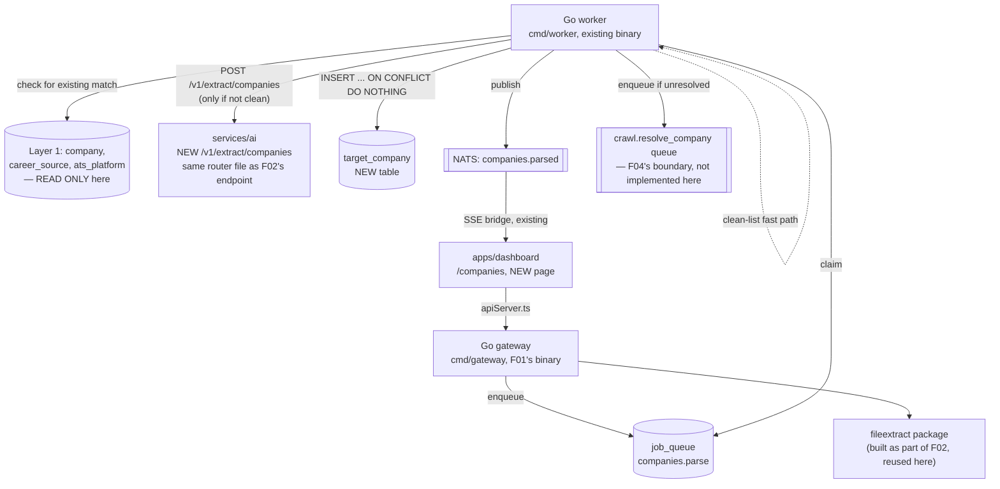

# F03 — Company List Ingestion

> Third per-feature spec. Depends on F01. Shares a file-extraction utility with F02 — see `specs/README.md` §2.1 and §2 before reading this: F02 ships first and implements this utility as part of its own build, even though this document is where it's designed. Supersedes `specs/06-F3-company-ingestion.md` (retired, kept only for history).

---

## 1. Feature Summary

F03 turns a user-supplied list of target companies — pasted text or an uploaded PDF/DOCX/TXT/CSV file — into `target_company` rows the crawler (F04) can act on. It owns two genuinely new pieces: a shared file→text extraction utility (also consumed by F02 for resumes) and an LLM-assisted company-name parser that only spends a paid API call when the input actually needs one — a clean, already-comma-separated list skips the LLM entirely. F03 stops at "here are the companies we found, and which ones we could already resolve to a known job board" — the actual career-page crawling that resolution implies is F04's job, not this one.

## 2. Dependencies

**Spec dependency:** F01 (RBAC/session — the upload endpoint lives on F01's Go gateway, `RequireAuth`-gated, any signed-in user).

**Reverse dependency, recorded once already in `specs/README.md` §2.1 — not repeated in full here**: F02 implements this spec's §7.1 utility as part of its own build (F02 ships first), since F02 also needs PDF/DOCX/TXT extraction for resumes. F03, once it ships, reuses that already-built utility in-process (same Go binary) rather than building it twice.

**Existing repo code this reuses, cited exactly:**

| Concern | Existing file | What it already does |
|---|---|---|
| Go gateway, `RequireAuth` | [`services/backend/internal/httpx/auth.go`](../../services/backend/internal/httpx/auth.go), `cmd/gateway` (established by F01) | F03's upload/list/delete routes mount here, next to F01's `/api/v1/gateway/whoami` and `/api/v1/admin/_ping` — exactly the extension F01 §2 anticipated. |
| Go worker queue-claim loop | [`services/backend/internal/worker/embed_profile.go`](../../services/backend/internal/worker/embed_profile.go), extended in F02 by `extract_profile_facts.go` | Third consumer of the same generic claim/call-AI/write-Postgres shape. |
| Shared job-queue table | `job_queue` (migration 0006) | New queue kind `companies.parse` — no new queue infrastructure, same table `apps/worker`/`cmd/worker` already share. |
| Layer-1 shared job index | `company`, `career_source`, `ats_platform` tables (migration 0005) | **Read, not written, by F03.** Resolution-order cost lever (§5, §7.3): check these *before* assuming a company needs a fresh crawl. |
| `services/ai` internal-token + router conventions | `services/ai/app/routers/extract.py`, established by F02 for `/v1/extract/profile-facts` | F03 adds `POST /v1/extract/companies` as a **sibling route in the same file** — the second consumer of the `/v1/extract/*` namespace F02 opened, not a new router. |
| Async-job-then-push pattern | `specs/F02-profile-resume/SPEC.md` §3 (`profile.facts_extracted`) | Same shape: 202 + job id, SSE push on completion. Third time this exact pattern appears (after F02, after the existing `resume.tailoring.*` events) — a codebase convention now, not a one-off. |
| Idempotency via constraint, not check-then-insert | `profile_skill`'s `ON CONFLICT DO NOTHING` pattern, `specs/F02-profile-resume/SPEC.md` §5 | Same technique, applied to `target_company`'s own unique index (§5). |

**What's genuinely new**: the shared `fileextract` Go package (§7.1, implemented as part of F02's build per the dependency note above); the Go gateway's upload/list/delete routes; a `companies.parse` queue kind + worker handler; a `/v1/extract/companies` graph in `services/ai`; the `target_company` table (migration 0020).

## 3. Complete User Journey

1. User is on `/companies` (new page, `apps/dashboard`). They either paste comma/newline-separated company names into a textarea, or upload a `.pdf`/`.docx`/`.txt`/`.csv` file. Clicks "Add companies."
2. `apps/dashboard` `POST`s to the Go gateway's `POST /api/v1/companies/upload` (multipart or JSON, mirroring F02's dual-path shape). The gateway validates size (≤5MB, AC7) and mime type, extracts plain text via `fileextract` if a file was sent (synchronous — same reasoning as F02 §7.4: this step is free and fast), and returns `202 { jobId }` immediately. The page shows "Processing your list…" without blocking.
3. The gateway enqueues `companies.parse` with the extracted/pasted text in the job payload.
4. The Go worker claims the job. It first runs the **clean-list fast path** (§7.3): a cheap, local check for whether the text is already a comma/newline-separated list of short, sentence-free tokens.
   - **If clean**: split directly into names, skip the LLM call entirely.
   - **If not clean** (prose, a "top 100 startups" PDF with descriptions, messy export): calls `services/ai`'s `POST /v1/extract/companies`.
5. For each extracted name, the worker inserts a `target_company` row (`status='pending'`) via `ON CONFLICT (account_id, lower(raw_name)) DO NOTHING` — race-free by construction, not by a check-then-insert (§5, §7.4; explicitly watched, per your own note before this spec was written).
6. For each **new** row (not a pre-existing duplicate), the worker checks the existing `company`/`career_source` tables (Layer 1, already populated by ATS ingestion) for a known match. A hit sets `status='resolved_ats'` immediately, with **zero crawl work required** — this is the single biggest cost lever in the whole feature (§12), preserved unchanged from the original draft. A miss leaves `status='pending'` and enqueues `crawl.resolve_company` — **F04's job to consume, not F03's** (§4's boundary note).
7. The worker publishes `companies.parsed` over SSE.
8. The dashboard's listener refreshes `/companies`, showing each company with a status badge: pending (grey, spinner), resolved_ats (green, "watching"), resolved_generic (blue, "watching" — only appears once F04 ships and starts setting it), dead (red, hover for `dead_reason` — likewise only appears once F04 ships).

**Error paths**: an unsupported file type or oversize file is rejected at step 2, synchronously, before any job is enqueued (AC6, AC7 — mirrors F02's AC9-AC11 exactly). A company name that never resolves stays `status='pending'` until F04 ships and either resolves or dead-letters it — F03 alone cannot produce a `dead` row, since dead-marking requires the crawl attempt F04 owns.

```mermaid
sequenceDiagram
    participant U as User
    participant D as apps/dashboard
    participant GW as Go gateway (cmd/gateway)
    participant PG as Postgres
    participant W as Go worker (cmd/worker)
    participant AI as services/ai

    U->>D: paste list or upload file, click "Add companies"
    D->>GW: POST /api/v1/companies/upload
    GW->>GW: validate size/mime; extract text via fileextract if file
    GW->>PG: enqueue companies.parse { accountId, text }
    GW-->>D: 202 { jobId }
    D-->>U: "Processing your list…"

    W->>PG: claim companies.parse job
    W->>W: looksLikeCleanList(text)?
    alt clean list
        W->>W: split directly, no AI call
    else needs LLM
        W->>AI: POST /v1/extract/companies { text }
        AI-->>W: { companies: string[] }
    end
    loop each company name
        W->>PG: INSERT target_company ON CONFLICT DO NOTHING
        alt new row AND matches existing company/career_source
            W->>PG: UPDATE status = 'resolved_ats' (no crawl needed)
        else new row, no match
            W->>PG: enqueue crawl.resolve_company (F04 consumes this)
        end
    end
    W->>PG: publish companies.parsed (NATS)
    PG-->>D: SSE companies.parsed
    D-->>U: company list updates with status badges
```

## 4. Architecture & Flow



**Each hop:** (1) new page, existing server-to-server `apiServer.ts` pattern; (2) new gateway routes mounted per F01's established extension point; (3) file extraction reuses F02's utility in-process — no HTTP hop, since both live in the same Go binary; (4) new queue kind on the existing `job_queue` table; (5) the clean-list check is pure Go, no network call, and is the primary cost control (§12); (6) the LLM call only happens for prose/messy input, on the same internal-token-gated conventions as every other `services/ai` call; (7) the `target_company` insert is race-free by unique-index constraint, not by locking; (8) the Layer-1 read is the *other* major cost control — resolving against data already collected by unrelated ATS ingestion means most target companies cost zero crawl work; (9) the handoff to `crawl.resolve_company` is a clean boundary — F03 enqueues, F04 consumes, and F03's own tests (§10) never assert on what happens after that enqueue.

## 5. Data Model

**One new table.** `crawl_run` and the `app_crawler` role — both referenced by the original planning doc (`specs/02-DB-migrations.md`, its old "0018"/"0019" sections) — are deliberately **not** created here: F03 never writes to either. `crawl_run` records an actual crawl attempt (F04's activity); `app_crawler` is the role that performs one. Creating them now, unused, would repeat the exact "batch roles nobody needs yet" mistake F01's migration already corrected once (`specs/README.md` §2). They move to F04's migration instead, created there, where they're first needed.

```sql
-- 0020 · target_company (Feature F3). Tenant-scoped (a user's own list of
-- companies to watch) but resolves to the SHARED company/career_source
-- rows (Layer 1, migration 0005) once resolved — many users can target
-- the same company; the underlying crawl happens once, not once per user
-- (see §7.3's resolution-order cost lever).

CREATE TABLE target_company (
  id              uuid PRIMARY KEY DEFAULT gen_random_uuid(),
  account_id      uuid NOT NULL REFERENCES account(id) ON DELETE CASCADE,
  raw_name        text NOT NULL,               -- exactly what the user typed/uploaded
  company_id      uuid REFERENCES company(id) ON DELETE SET NULL, -- set once resolved
  status          text NOT NULL DEFAULT 'pending'
    CHECK (status IN ('pending', 'resolved_ats', 'resolved_generic', 'dead')),
  dead_reason     text,
  created_at      timestamptz NOT NULL DEFAULT now(),
  resolved_at     timestamptz
);

-- The race-free dedup this spec was specifically asked to get right:
-- concurrent uploads of overlapping lists must never create duplicate
-- rows for the same (account, company name). A unique index + ON
-- CONFLICT DO NOTHING at the call site (§7.4) is race-free; a
-- SELECT-then-INSERT in the handler is not — two concurrent requests can
-- both see "not there yet" and both insert.
CREATE UNIQUE INDEX target_company_account_name_key
  ON target_company (account_id, lower(raw_name));

ALTER TABLE target_company ENABLE ROW LEVEL SECURITY;

CREATE POLICY target_company_tenant_select ON target_company
  FOR SELECT USING (account_id = app_current_account_id());
CREATE POLICY target_company_tenant_insert ON target_company
  FOR INSERT WITH CHECK (account_id = app_current_account_id());
CREATE POLICY target_company_tenant_update ON target_company
  FOR UPDATE USING (account_id = app_current_account_id())
  WITH CHECK (account_id = app_current_account_id());
CREATE POLICY target_company_tenant_delete ON target_company
  FOR DELETE USING (account_id = app_current_account_id());

-- app_web only. The gateway's own request-path connection already uses
-- this role (F01 §2/§7 — services/backend's request-path pool is granted
-- app_web, same as apps/web's own connection), and the companies.parse
-- worker handler also runs its writes through WithAccount on the SAME
-- pool/role — no app_crawler grant needed here, because F03 never
-- performs the operations app_crawler exists for (§ above).
GRANT SELECT, INSERT, UPDATE, DELETE ON target_company TO app_web;

-- Admin cross-account visibility, colocated with the table's own
-- creation rather than centralized in one far-away migration — the fix
-- specs/README.md §2 already made once for the *mechanism*
-- (app_is_admin_session(), live since 0018); this is that same fix
-- applied for real, for the first table that needs it.
CREATE POLICY target_company_admin_select ON target_company
  FOR SELECT USING (app_is_admin_session());
GRANT SELECT ON target_company TO app_admin;

-- Deferred to F04's migration, not granted here: app_crawler's
-- SELECT + UPDATE(status, company_id, dead_reason, resolved_at) — added
-- when app_crawler is created, alongside crawl_run.
```

**Why the worker's inserts go through `app_web`/`WithAccount`, not a separate role**: unlike F02's `extract_profile_facts` handler (which needed `app_matcher`'s narrow, additive grants specifically because it writes *inferred* facts into tables a human also writes to, and needed to be provably unable to overwrite a self-asserted value), `target_company` has exactly one writer class before F04 exists — the user's own upload, mediated by a worker acting on their behalf. `app_web` already has full CRUD on it. Introducing a second role here would be access-control theater, not a real isolation boundary — there's nothing yet to isolate the worker *from*.

## 6. API Contract

```ts
// NEW — Go gateway, POST /api/v1/companies/upload
// RequireAuth (any signed-in user — company lists aren't admin-scoped).
// Accepts EITHER application/json { text: string } (pasted list) OR
// multipart/form-data with a `file` part (.pdf | .docx | .txt | .csv),
// same dual-path shape as F02's job-search/start.
// → 202 { jobId: string }
// → 422 { error: "UNSUPPORTED_FILE_TYPE" | "FILE_TOO_LARGE" | "FILE_UNREADABLE" | "EMPTY_INPUT", message }

// NEW — Go gateway, GET /api/v1/companies
// → 200 { companies: TargetCompany[] }

// NEW — Go gateway, DELETE /api/v1/companies/:id
// → 204

interface TargetCompany {
  id: string;
  rawName: string;
  status: 'pending' | 'resolved_ats' | 'resolved_generic' | 'dead';
  deadReason?: string;
  resolvedAt?: string;
}
```

```ts
// NEW — services/ai, POST /v1/extract/companies
// Second endpoint in the SAME router file as F02's
// /v1/extract/profile-facts (services/ai/app/routers/extract.py).
interface ExtractCompaniesRequest {
  text: string;
}
interface ExtractCompaniesResponse {
  companies: string[];
  model: string;
  promptVersion: number;
}
```

```ts
// NEW SSE event — same account-scoped bridge every other event uses.
interface CompaniesParsedEvent {
  type: 'companies.parsed';
  jobId: string;
  companies: Array<{ rawName: string; status: TargetCompany['status'] }>;
}
```

## 7. Backend Implementation

### 7.1 `fileextract` — the shared utility (Go package, `services/backend/internal/fileextract`)

**Built as part of F02's implementation** (F02 needs it first, per the dependency note in §2), specified here because F03's own needs (identical formats, same size discipline) shaped its design equally. Dispatches by extension, not by sniffing content — the multipart handler already validated mime type before calling this.

```go
package fileextract

import (
	"archive/zip"
	"bytes"
	"errors"
	"fmt"
	"io"
	"strings"

	"github.com/ledongthuc/pdf" // chosen for a small, pure-Go dependency footprint —
	                             // no cgo, no external binary, consistent with this
	                             // codebase's existing preference (fastembed over a
	                             // heavier torch stack, services/ai/app/embed.py)
)

var ErrUnreadable = errors.New("fileextract: file could not be parsed")

// Extract dispatches on filename extension. Returns ErrUnreadable for any
// file that fails to parse — callers map this to 422 FILE_UNREADABLE,
// never a 500, because a malformed upload is a normal, expected client
// error, not a server fault.
func Extract(filename string, data []byte) (string, error) {
	switch ext := strings.ToLower(extensionOf(filename)); ext {
	case ".txt", ".csv":
		return string(data), nil // already text — no parsing needed
	case ".pdf":
		return extractPDF(data)
	case ".docx":
		return extractDOCX(data)
	default:
		return "", fmt.Errorf("%w: unsupported extension %q", ErrUnreadable, ext)
	}
}

func extractPDF(data []byte) (string, error) {
	r, err := pdf.NewReader(bytes.NewReader(data), int64(len(data)))
	if err != nil {
		return "", fmt.Errorf("%w: %v", ErrUnreadable, err)
	}
	var sb strings.Builder
	for i := 1; i <= r.NumPage(); i++ {
		text, err := r.Page(i).GetPlainText(nil)
		if err != nil {
			continue // one bad page shouldn't fail the whole document
		}
		sb.WriteString(text)
		sb.WriteString("\n")
	}
	return sb.String(), nil
}

// extractDOCX exploits the fact that a .docx file IS a zip archive — this
// is worth understanding once, not just using: rename any .docx to .zip
// and open it, and word/document.xml is right there in plain sight.
func extractDOCX(data []byte) (string, error) {
	zr, err := zip.NewReader(bytes.NewReader(data), int64(len(data)))
	if err != nil {
		return "", fmt.Errorf("%w: not a valid docx/zip: %v", ErrUnreadable, err)
	}
	for _, f := range zr.File {
		if f.Name != "word/document.xml" {
			continue
		}
		rc, err := f.Open()
		if err != nil {
			return "", fmt.Errorf("%w: %v", ErrUnreadable, err)
		}
		defer rc.Close()
		raw, err := io.ReadAll(rc)
		if err != nil {
			return "", fmt.Errorf("%w: %v", ErrUnreadable, err)
		}
		return stripXMLTags(string(raw)), nil // small local helper, not shown — strips
	}                                            // <w:*> markup, keeps text runs
	return "", fmt.Errorf("%w: word/document.xml not found in archive", ErrUnreadable)
}
```

### 7.2 Go gateway upload handler (new — `services/backend/cmd/gateway`, extends F01's `main.go`)

```go
mux.HandleFunc("POST /api/v1/companies/upload", httpx.RequireAuth(
	pools.Web, cfg.SessionCookieName,
	func(w http.ResponseWriter, r *http.Request) {
		principal, _ := httpx.PrincipalFromContext(r.Context())

		text, filename, err := readTextOrFile(r, MaxUploadBytes) // JSON {text} or multipart {file};
		if err != nil {                                            // wraps fileextract.Extract for the file case
			writeUploadError(w, err) // maps ErrUnreadable/size/mime to the 422 codes in §6
			return
		}
		if strings.TrimSpace(text) == "" {
			httpx.JSON(w, http.StatusUnprocessableEntity, map[string]string{"error": "EMPTY_INPUT"})
			return
		}

		jobID, err := db.WithAccount(r.Context(), pools.Web, principal.AccountID,
			func(ctx context.Context, tx pgx.Tx) (string, error) {
				return queue.Enqueue(ctx, tx, "companies.parse",
					map[string]any{"accountId": principal.AccountID, "text": text, "filename": filename}, nil)
			})
		if err != nil {
			httpx.Internal(w)
			return
		}
		httpx.JSON(w, http.StatusAccepted, map[string]string{"jobId": jobID})
	},
))
```

### 7.3 Worker: clean-list fast path + resolution-order cost lever (new — `services/backend/internal/worker/companies_parse.go`)

```go
// looksLikeCleanList is the cost control this spec was specifically asked
// to preserve: a cheap, local, pre-LLM check. Company names are short and
// sentence-free; a "part" with a period-space or more than ~5 words is
// prose, not a list entry — that single heuristic is enough to route the
// large majority of real inputs (a pasted comma-separated list, a
// single-column CSV export) away from a paid API call entirely.
func looksLikeCleanList(text string) bool {
	parts := splitOnCommasAndNewlines(text)
	if len(parts) == 0 {
		return false
	}
	for _, p := range parts {
		p = strings.TrimSpace(p)
		if p == "" {
			continue
		}
		if len(strings.Fields(p)) > 5 || strings.Contains(p, ". ") {
			return false
		}
	}
	return true
}

func HandleCompaniesParse(ctx context.Context, deps WorkerDeps, payload CompaniesParsePayload) error {
	var names []string
	if looksLikeCleanList(payload.Text) {
		names = splitOnCommasAndNewlines(payload.Text) // no AI call
	} else {
		result, err := deps.AI.ExtractCompanies(ctx, payload.Text)
		if err != nil {
			return fmt.Errorf("calling extraction endpoint: %w", err)
		}
		names = result.Companies
	}

	return db.WithAccount(ctx, deps.WebPool, payload.AccountID, func(ctx context.Context, tx pgx.Tx) (struct{}, error) {
		for _, name := range names {
			inserted, err := deps.Repo.InsertTargetCompany(ctx, tx, payload.AccountID, name) // ON CONFLICT DO NOTHING;
			if err != nil {                                                                    // reports whether a row was
				return struct{}{}, err                                                          // actually inserted (AC3)
			}
			if !inserted {
				continue // already targeted — the race-free dedup doing its job
			}
			// The resolution-order cost lever: check the shared Layer-1
			// index BEFORE assuming this needs a fresh crawl. If 200 users
			// all target Stripe, and Stripe is already a known Greenhouse
			// board, that's 200 resolved_ats rows and zero crawls.
			if companyID, ok, err := deps.Repo.FindKnownCompany(ctx, tx, name); err != nil {
				return struct{}{}, err
			} else if ok {
				if err := deps.Repo.MarkResolvedATS(ctx, tx, payload.AccountID, name, companyID); err != nil {
					return struct{}{}, err
				}
			} else {
				// Company-level, NOT account-level: dedupKey is keyed by the
				// normalized name alone, exactly the pattern
				// packages/ingest/src/tasks.ts already uses for ingest.source
				// (`${queue}:${sourceId}:${hourKey}`). 200 accounts targeting
				// "Stripe" in the same hour produce ONE crawl.resolve_company
				// row, not 200 — queue.Enqueue's own ON CONFLICT DO NOTHING
				// on dedup_key (migration 0006) makes this race-free the same
				// way target_company's own insert is (§5), not by locking.
				// account_id is deliberately absent from the payload:
				// resolution is about the company, not any one user's search.
				if err := deps.Repo.EnqueueResolveCompany(ctx, tx, normalize(name)); err != nil { // F04's queue
					return struct{}{}, err
				}
			}
		}
		return struct{}{}, nil
	})
}
```

### 7.4 Concurrency/error handling

No new concurrency pattern — the same generic `cmd/worker` claim loop F02 already extended. The race-free guarantee (§5) comes entirely from the unique index + `ON CONFLICT DO NOTHING`, not from any locking in application code — two workers (or two retries of the same job) processing overlapping company lists concurrently produce the same final `target_company` rows either way, with `InsertTargetCompany`'s `inserted` return value telling each caller whether *it* was the one that created the row, without needing a `SELECT` first.

## 8. Frontend Implementation

```
apps/dashboard/src/app/companies/
├── page.tsx                  # NEW — Server Component: initial list via apiServer.ts
├── actions.ts                # NEW — Server Actions: uploadCompanyList, deleteCompany
├── CompanyUploadForm.tsx     # NEW — Client: paste-or-file toggle (same pattern as F02's JobSearchToggle.tsx)
└── CompanyList.tsx           # NEW — Client: subscribes to SSE companies.parsed, status badges
```

Status badges map directly to the enum: `pending` (grey, spinner), `resolved_ats`/`resolved_generic` (green/blue, "watching"), `dead` (red, `dead_reason` on hover — only ever appears once F04 ships). `CompanyUploadForm.tsx` reuses the exact paste-vs-file toggle pattern `JobSearchToggle.tsx` establishes in F02, rather than inventing a second version of the same UI idea.

## 9. Acceptance Criteria

| # | Criterion |
|---|---|
| AC1 | Upload accepts `.pdf`, `.docx`, `.txt`, `.csv`, and raw pasted text |
| AC2 | Upload is async — returns `202 {jobId}` immediately, results arrive via SSE `companies.parsed` |
| AC3 | Duplicate company names within one account are deduped case-insensitively via the unique index + `ON CONFLICT DO NOTHING` — never a check-then-insert race |
| AC4 | Every extracted name produces a `target_company` row with `status='pending'`, even before resolution runs |
| AC5 | A clean, already-comma-separated input never triggers a `services/ai` call (the fast path holds) |
| AC6 | A malformed/empty/garbage file returns a clear `422`, not a partial silent import |
| AC7 | File size cap (5MB) enforced before parsing, same discipline as F02's AC10 |
| AC8 | A company matching an existing `company`/`career_source` row resolves to `resolved_ats` with zero `crawl.resolve_company` enqueue — the cost lever is real, not aspirational |
| AC9 | F03's own code never sets `status='dead'` or `status='resolved_generic'` — those transitions belong to F04; F03's tests assert this boundary, not just the happy path |
| AC10 | `crawl.resolve_company` is enqueued once per normalized company name, never once per account — N accounts targeting the same unresolved company in the same window produce exactly one queued job, verified by the `dedup_key` mechanism, not by accident |

## 10. Test Plan

### Go unit (`services/backend/internal/fileextract`, `internal/worker`)
```
TestExtract_TXT_CSV_PassthroughUnchanged
TestExtract_PDF_MultiPage
TestExtract_DOCX_ExtractsDocumentXML
TestExtract_UnsupportedExtension_ReturnsErrUnreadable
TestExtract_CorruptZip_ReturnsErrUnreadable                    // AC6
TestLooksLikeCleanList_CleanCSV_ReturnsTrue                    // AC5
TestLooksLikeCleanList_ProseDocument_ReturnsFalse               // AC5
TestLooksLikeCleanList_MixedInput_ReturnsFalse
```

### Python unit (`services/ai/tests`, extends the `extract.py` router's suite F02 started)
```
test_extract_companies_from_prose
test_extract_companies_empty_text_returns_empty_list
```

### Go integration (real Postgres)
```
TestInsertTargetCompany_DedupesCaseInsensitively_ConcurrentInserts   // AC3, run with real concurrency, not just sequential calls
TestInsertTargetCompany_RLS_UserSeesOnlyOwnCompanies
TestHandleCompaniesParse_KnownATS_SkipsCrawlEnqueue                    // AC8 — assert zero crawl.resolve_company rows
TestHandleCompaniesParse_UnknownCompany_EnqueuesResolveCompany_NeverSetsDeadOrResolvedGeneric  // AC9, the F04 boundary
TestHandleCompaniesParse_ConcurrentAccountsSameCompany_EnqueuesExactlyOneResolveJob  // AC10 — the company-level-not-per-user guarantee, run with real concurrent accounts
```

### E2E (Playwright)
```
upload_txt_with_three_companies_sees_pending_then_resolved_badges
paste_clean_comma_list_never_calls_ai_extraction   // AC5, asserted via a request-count spy in the test harness
upload_oversize_file_sees_clear_error_not_partial_import
```

## 11. Failure Modes & Edge Cases

- **A user uploads the exact same list twice** — the unique index makes the second upload a no-op for every already-present name (AC3); genuinely new names in the second list still get processed normally.
- **`services/ai` is down when the LLM path is needed** — the job fails through the existing `queue.Fail` path (capped retries, backoff), same degradation as F02 §3's error path; `target_company` simply doesn't gain new rows until the retry succeeds, and nothing already-resolved is affected.
- **A company name is ambiguous** (e.g. "Meta" matching multiple `company` rows, or a name that's a substring of another) — out of scope for F03's exact-match resolution lookup; a mismatch here just means the row stays `pending` and falls through to F04's crawl path instead of `resolved_ats`, which is the safe default, not a silent wrong match.
- **The extracted text from a file is empty** (e.g. a scanned PDF with no text layer — same class of problem as F02 §11) — the `EMPTY_INPUT` 422 fires before a job is even enqueued, consistent handling with F02's equivalent case, not a silently-created job that produces zero companies with no explanation.
- **A user deletes a `target_company` row while its `companies.parse` job is still in flight** — the job's insert is `ON CONFLICT DO NOTHING` keyed by `(account_id, lower(raw_name))`; if the user deleted the row between enqueue and processing, the insert simply recreates it. This is an acceptable, rare race — F03 doesn't attempt to cancel in-flight jobs on delete, the same "eventually consistent, not perfectly synchronized" tradeoff the rest of this queue-based system already accepts elsewhere.

## 12. Cost & Performance Notes

Two real cost levers, both preserved unchanged from the original draft and both explicitly worth calling out because they're not obvious from the code alone: **(1) the clean-list fast path** — a plain comma-separated paste or CSV export, the most common real input, never touches the LLM at all; **(2) the resolution-order check** — because `company`/`career_source` are shared, Layer-1 tables already populated by unrelated ATS ingestion, a popular company (Stripe, Vercel, any company already indexed) resolves for *every* user who targets it at zero additional crawl cost, not once per user. At <500 users (`specs/00` §6), these two levers together are the difference between "an LLM call and a crawl job per company per user" and "an LLM call only for messy input, a crawl only for genuinely novel companies." The hot query is the unique-index lookup backing `ON CONFLICT DO NOTHING` (O(1), already indexed) and the Layer-1 match lookup (`company.normalized_domain`, already indexed by migration 0005) — neither is a bottleneck at this scale.

## 13. What You'll Learn Building This

- **Container formats vs. text formats.** `.docx` is literally a ZIP of XML — unzip one and look, it demystifies the whole "office document" format family at once. `.pdf` is messier: a graphics format that happens to contain text runs, with no guaranteed reading order, which is *why* `Extract`'s PDF path tolerates a page failing without failing the whole document. Knowing which category a format falls into changes how much error tolerance you build around parsing it.
- **Idempotency via a database constraint, not application logic.** §5/§7.4's `ON CONFLICT DO NOTHING` is the correct, race-free answer to "how do you prevent duplicate submissions" — one of the most commonly asked backend interview questions, and here it's the actual shipped implementation, not a hypothetical.
- **Cost-aware architecture as a first-class design input**, not an afterthought optimization. Both levers in §12 were decided *before* any code was written, because "will this cost 10x what it needs to at scale" is a question worth asking at spec time, not during a later profiling pass.
- **When NOT to call an LLM**, the second time this exact judgment shows up in this spec set (after F02's deterministic years-of-experience computation) — `looksLikeCleanList` is a five-line heuristic that eliminates the majority of paid API calls for the most common real input shape. Interviewers ask "would you use an LLM for X, why or why not" specifically to probe for this instinct.
- **A shared utility that crosses a spec-writing boundary** (§2, §7.1) — this doc *designs* `fileextract`, but F02 *builds* it first, because F02 needs it earlier. Recognizing that documentation order and implementation order don't have to match, and handling the resulting cross-reference cleanly instead of either duplicating work or awkwardly blocking, is a real coordination skill worth naming explicitly.

## 14. Definition of Done

- [ ] Migration 0020 applied: `target_company`, RLS, `app_web` grants (no `crawl_run`, no `app_crawler` — deferred to F04, §5)
- [ ] `fileextract` package implemented and tested (owned here, built as part of F02 — confirm it lands in `services/backend/internal/fileextract` regardless of which spec's PR it ships under)
- [ ] Go gateway routes: `POST /api/v1/companies/upload`, `GET /api/v1/companies`, `DELETE /api/v1/companies/:id`
- [ ] `POST /v1/extract/companies` added to `services/ai/app/routers/extract.py`, alongside F02's endpoint
- [ ] `services/backend/internal/worker/companies_parse.go` implemented: `looksLikeCleanList`, `HandleCompaniesParse`, registered in `cmd/worker/main.go`
- [ ] `apps/dashboard/src/app/companies/` implemented: page, actions, upload form, list with SSE-driven status badges
- [ ] `companies.parsed` event added to the catalog in `03-API-contracts.md`
- [ ] All tests in §10 passing, including the concurrent-insert race test
- [ ] Lint + typecheck + tests green in pre-commit hook, for the Go module and the Python/TS workspaces touched

---

Next spec: **F04 — Career-Page Crawler**, once you confirm this one. F04 owns: `crawl_run` + `app_crawler` (deferred here, §5), the `resolveCompany()`/`fetchPostings()` handlers consuming `crawl.resolve_company` (enqueued but not implemented here, §4/§9 AC9), the browser-pool concurrency pattern from `01-LLD.md` §1.2, and setting `target_company.status` to `resolved_generic`/`dead` for the first time.
