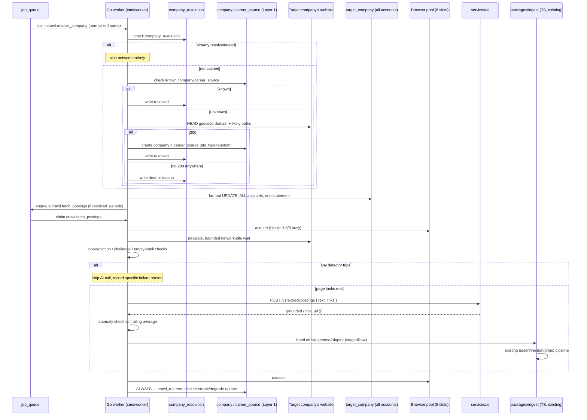
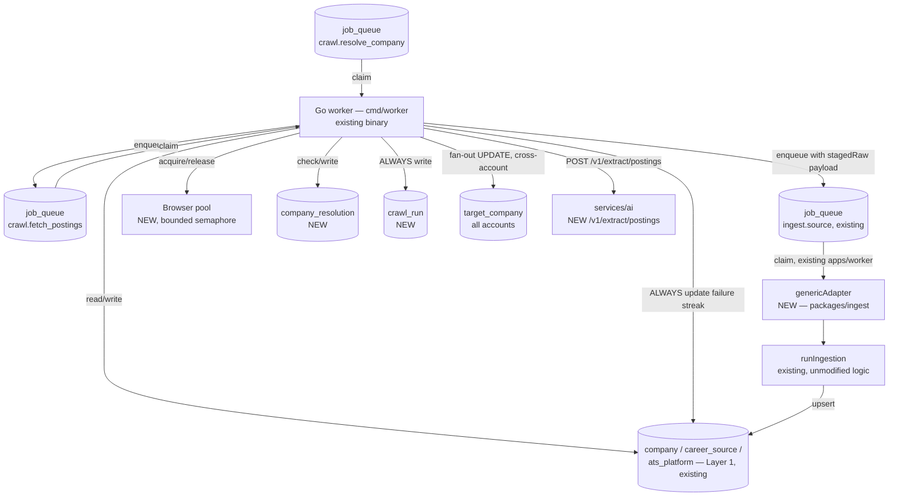

# F04 — Career-Page Crawler

> Fourth per-feature spec. Depends on F03 (consumes `crawl.resolve_company`, resolves the `target_company` rows F03 created). This is the hardest, highest-risk feature in the product — silent breakage here is indistinguishable from "this company has no jobs" from the user's side, which is exactly the failure `00-PRD-and-HLD.md` §"non-goals"/CURRENT_STATE's own scraping-risk framing exists to prevent. §11 is written pessimistically on purpose; treat it as load-bearing, not boilerplate.

---

## 1. Feature Summary

F04 resolves each `target_company` row F03 created to an actual, crawlable career-page source — reusing the existing ATS index where possible, falling back to a generic Playwright+LLM crawl only when nothing already known matches — and then periodically fetches and extracts job postings from the generic sources it discovers. Two structurally separate concerns, two structurally separate guarantees: **resolution** happens once per company, never once per user (F03's non-negotiable, enforced here by a company-level resolution cache, not just a queue dedup key), and **every fetch attempt is recorded**, success or failure, because a career page that silently stops yielding postings must be detectable, not indistinguishable from a company that genuinely has no open roles. Extracted postings are handed off to the existing, proven TS ingestion pipeline for upsert/versioning rather than re-implementing that logic in Go — F04's own new work is scoped tightly to what doesn't already exist: resolving a company to a source, and safely operating a browser against an arbitrary, adversarial-by-default third-party page.

## 2. Dependencies

**Spec dependency:** F03 (`crawl.resolve_company` is enqueued there, consumed here; `target_company.status` transitions to `resolved_generic`/`dead` happen here for the first time, per F03 §4/§9 AC9's explicit boundary).

**Existing repo code this reuses, cited exactly:**

| Concern | Existing file | What it already does |
|---|---|---|
| Bounded browser-pool concurrency pattern | `01-LLD.md` §1.2 | Counting-semaphore-via-buffered-channel `Pool` — cited verbatim in §7.2, not redesigned. |
| Failure-streak / degrade-then-self-heal logic | [`packages/db/src/repositories/jobs.ts`](../../packages/db/src/repositories/jobs.ts) `recordSourceOutcome` (L117-146) + `scheduleNextRun` (L94-115) | **Already fully built and proven** for the ATS tier — three consecutive failures degrades a source, a success resets the counter and self-heals `degraded → active`. F04 ports this exact logic (same threshold, same reasoning, quoted directly: *"not disabled: transient outages recover, and silently dropping a company would be worse than a noisy flag"*) to Go for the generic tier, rather than inventing new failure-handling semantics. |
| "Always record the run, success or failure" structural guarantee | `packages/ingest/src/run.ts` `runIngestion` (L58-120, `failRun` L243-276) | The exact shape F04's own guarantee (§7.4) is ported from: every exit path — success, adapter error, timeout — routes through one shared recording step, not three copy-pasted ones. |
| Layer-1 shared job index | `company`, `career_source`, `ats_platform` tables (migration 0005) | Read (existing ATS match) and written (new `career_source` rows, `ats_type='custom'`) by resolution (§5, §7.1). |
| ATS adapter interface | [`packages/ingest/src/adapter.ts`](../../packages/ingest/src/adapter.ts) `AtsAdapter`, [`registry.ts`](../../packages/ingest/src/registry.ts) | F04 adds a **fourth adapter** (`genericAdapter`) fitting this existing interface, rather than building a second, parallel upsert/versioning/grouping pipeline in Go (§7.4). |
| Existing upsert/versioning/grouping/closing pipeline | `packages/ingest/src/run.ts` `runIngestion`, `RunOptions` | **Reused wholesale** for generic-crawl postings, via the adapter trick above — this is the single biggest reuse decision in this spec. |
| `services/ai` router conventions | `services/ai/app/routers/extract.py`, opened by F02, extended by F03 | F04 adds `POST /v1/extract/postings` as the third sibling route. |
| Grounding-gate pattern | `explain_graph.py`'s `provenance_gate`, `tailor_graph.py`'s `fabrication_check`, F02's `extract_facts_graph.py`, F03's `/v1/extract/companies` | Fourth instance of the same "LLM extracts verifiable strings, a gate drops anything not literally present in the source" discipline (§7.5). |
| Layer-0 no-tenant-context helper | [`services/backend/internal/db/context.go`](../../services/backend/internal/db/context.go) `WithoutTenantContext` | Every write in this spec targets Layer-1 tables — this existing helper is the right one, not `WithAccount`. |

**What's genuinely new**: `company_resolution` + `crawl_run` tables (migration 0021); the `app_crawler` role; the Go `resolveCompany`/`fetchPostings` handlers; the bounded browser pool wired into `cmd/worker`; the `genericAdapter` + a small, explicit extension point in `runIngestion`; the `/v1/extract/postings` graph; every detection mechanism in §11.

## 3. Complete User Journey

This feature has no direct UI of its own — its "user" is the rest of the system (F05's matcher, and indirectly the candidate via `/companies`' status badges, F03 §8). The journey is the resolve→fetch pipeline itself.

1. `crawl.resolve_company` is claimed for a normalized company name (e.g. "acme corp"), enqueued once regardless of how many accounts targeted it (F03 §7.3, AC10).
2. `resolveCompany` checks `company_resolution` first — if this exact name was already resolved or marked dead recently, it skips straight to the fan-out step (7) with the cached outcome. This is what makes "company-level, never per-user" a *guarantee* rather than a best-effort dedup: even a `target_company` row created *after* the company was already resolved (a second account targeting a now-known company, arriving after the cache exists) never triggers a second resolution attempt.
3. If not cached: check `ats_platform`/`career_source` (Layer 1) for a domain match — if Stripe is already a known Greenhouse board (from unrelated ATS ingestion), this resolves for free, no network call.
4. If not already known: guess a domain (`{slug}.com` — flagged explicitly as fragile, §11), HTTP HEAD a small set of likely careers paths.
5. A 200 creates a `company` row (if none existed) and a `career_source` row (`ats_type='custom'`), writes `company_resolution(status='resolved')`. No 200 anywhere writes `company_resolution(status='dead', dead_reason=...)`.
6. **Fan-out** (the other half of "company-level, never per-user"): one `UPDATE target_company SET status = ... WHERE lower(raw_name) = $1 AND status = 'pending'` touches every account's row for this company in one statement — not a loop over accounts, not a second per-account job.
7. For a `resolved_generic` company, `crawl.fetch_postings` is enqueued against the new `career_source`, on the same cadence pattern (`next_run_at`, jittered) `career_source` already uses for ATS sources — just a longer default interval (12-24h vs. hourly), since a headless browser run is the expensive resource here, not an API call.
8. `fetchPostings` acquires a browser-pool slot (blocks if all 8 are busy — §7.2), navigates, and runs the full detection gauntlet from §11 *before* ever calling the LLM: bot-detection/challenge signatures, a bounded network-idle wait, an empty-shell check. Anything that trips a detector short-circuits to a failure `crawl_run` row with a specific reason — no LLM call spent on a page that was never going to yield anything real.
9. A page that passes all detectors gets its text + links sent to `services/ai`'s `/v1/extract/postings`; the grounding gate drops anything not literally present in the source; a trailing-average anomaly check flags a suspiciously low count without blocking it outright.
10. Grounded, enriched postings hand off to the **existing TS ingestion pipeline** (`runIngestion`, via the `genericAdapter` extension point, §7.4) for upsert/versioning/grouping — F04 never writes `job_posting` directly.
11. **Unconditionally** (defer-guaranteed, §7.4): a `crawl_run` row is written (success or failure, with a specific reason on failure) and `career_source`'s failure-streak/degrade logic runs — the exact ported `recordSourceOutcome` behavior. Three consecutive failures flips the source `degraded`; a success resets the streak and self-heals `degraded → active`.



## 4. Architecture & Flow



**Each hop:** (1) resolution and fetch are separate queue kinds with separate cost profiles — HTTP HEAD vs. a headless browser — deliberately not merged into one job type; (2) the browser pool gates only the fetch path, never resolution, since resolution never opens a browser; (3) the fan-out UPDATE is the mechanism, not a side effect, of "company-level, never per-user" — it's the one place in this spec that legitimately crosses account boundaries, and it's narrow and explicit about it (§5); (4) the handoff to `ingest.source`/`genericAdapter` is a deliberate reuse boundary — F04 stops being responsible for a posting the moment it's hand-off-ready, and the existing pipeline's own tested upsert/versioning/grouping/`scrape_run` logic takes over from there, meaning F04's own `crawl_run` table only ever needs to audit the parts of this pipeline that don't already have an audit trail (the browser/extraction phase, not the upsert phase).

## 5. Data Model

```sql
-- 0021 · app_crawler role, company_resolution, crawl_run (Feature F4).
-- Continues the just-in-time discipline specs/README.md §2 already
-- established twice: create exactly what this feature needs, not a
-- pre-batched set "for convenience" — crawl_run and app_crawler were
-- deferred here from F03's migration specifically because F03 never
-- touched either.

CREATE ROLE app_crawler NOLOGIN BYPASSRLS;
GRANT USAGE ON SCHEMA public TO app_crawler;

-- BYPASSRLS is deliberate and narrow in intent, same precedent as
-- app_matcher (migration 0001): the fan-out UPDATE on target_company
-- (§7.1) is EXPLICITLY, by design, a cross-account operation — a
-- company's resolution outcome legitimately applies to every account
-- that targeted it. This is not a blanket convenience bypass; every
-- query app_crawler issues against target_company filters explicitly by
-- lower(raw_name), never "all rows this connection can see."

-- ---------------------------------------------------------------------------
-- company_resolution: the account-independent memory that makes
-- "resolve once per company, ever" a real guarantee rather than a
-- best-effort queue dedup. Keyed by normalized name because a `company`
-- row (which needs a NOT NULL normalized_domain, migration 0005) doesn't
-- exist yet for a name that fails to resolve — this table is the only
-- place a "we tried and found nothing" outcome can be recorded.
-- ---------------------------------------------------------------------------

CREATE TABLE company_resolution (
  normalized_name        text PRIMARY KEY,
  status                 text NOT NULL CHECK (status IN ('resolved', 'dead')),
  company_id             uuid REFERENCES company(id) ON DELETE SET NULL, -- set only when resolved
  -- 'high': matched an existing Layer-1 company/career_source — a real,
  -- previously-verified board, nothing guessed. 'low': resolved only via
  -- guessDomain()+probeCareerPaths() (§7.1, §11) — a guess that happened
  -- to return a 200, not a verified identity match. NULL when status='dead'
  -- (confidence isn't meaningful for a resolution that didn't happen).
  -- Domain-guessing is this feature's named weakest link (§11); this
  -- column is what turns "weakest link, acknowledged" into "weakest link,
  -- surfaced to the one person who can actually tell it's wrong."
  resolution_confidence  text CHECK (resolution_confidence IN ('high', 'low')),
  dead_reason            text,
  checked_at             timestamptz NOT NULL DEFAULT now()
);

-- No RLS: Layer 1, account-independent by definition (same reasoning as
-- company/career_source themselves).
GRANT SELECT, INSERT, UPDATE ON company_resolution TO app_crawler;
GRANT SELECT ON company_resolution TO app_web; -- lets a future admin/debug view answer "why is this dead" without a second role

-- ---------------------------------------------------------------------------
-- target_company gains one column here, in F04's migration rather than
-- F03's already-shipped 0020 — normal for a later feature to extend an
-- earlier table it doesn't own, same as any ALTER TABLE in a real
-- migration history. Set true by the fan-out (§7.1) whenever
-- company_resolution.resolution_confidence = 'low' for that company;
-- cleared by the new confirm action (§6) once the user's looked at it.
-- ---------------------------------------------------------------------------
ALTER TABLE target_company ADD COLUMN needs_confirmation boolean NOT NULL DEFAULT false;
-- app_crawler already has UPDATE on a fixed column list for target_company
-- (below) — extend it to include the new column, same grant statement
-- semantics as the original, not a second GRANT.

-- ---------------------------------------------------------------------------
-- crawl_run: audits the browser/extraction phase specifically — the part
-- of this pipeline that has no existing audit trail. The upsert phase
-- (did this posting change) is already audited by scrape_run once
-- handoff to runIngestion happens (§7.4) — this table is not a duplicate
-- of that, it's the other half.
-- ---------------------------------------------------------------------------

CREATE TABLE crawl_run (
  id               uuid PRIMARY KEY DEFAULT gen_random_uuid(),
  career_source_id uuid NOT NULL REFERENCES career_source(id) ON DELETE CASCADE,
  tier             text NOT NULL CHECK (tier IN ('generic', 'tier_c')), -- 'ats' intentionally excluded:
                                                                          -- the ATS tier's own scrape_run
                                                                          -- already covers it; adding 'ats'
                                                                          -- here would invite a second,
                                                                          -- driftable audit trail for work
                                                                          -- this table was never meant to cover
  status           text NOT NULL CHECK (status IN ('success', 'failure', 'skipped')),
  failure_reason   text, -- one of: bot_detected, cloudflare_challenge, network_idle_timeout,
                          -- empty_shell, rate_limited, anomalous_drop, extraction_error — §11's
                          -- detection mechanisms are only useful if each one is a distinguishable value here
  postings_found   integer NOT NULL DEFAULT 0,
  duration_ms      integer,
  started_at       timestamptz NOT NULL,
  finished_at      timestamptz
);

CREATE INDEX crawl_run_source_idx ON crawl_run (career_source_id, started_at DESC);

-- No RLS: Layer 1 operational data, same reasoning as scrape_run.
GRANT SELECT ON crawl_run TO app_web, app_admin; -- app_admin: F11's crawl-health view, per 00-HLD's own plan
GRANT SELECT, INSERT ON crawl_run TO app_crawler;

-- app_crawler's remaining grants — Layer 1 tables it must read and
-- sometimes write to actually perform resolution:
GRANT SELECT, INSERT ON company TO app_crawler;              -- create a company row on first resolution
GRANT SELECT, INSERT, UPDATE ON career_source TO app_crawler; -- create resolved_generic sources; update
                                                                -- failure-streak/status/next_run_at (§7.3)
GRANT SELECT ON ats_platform TO app_crawler;                   -- reference the seeded 'custom' row

-- target_company: narrow, column-scoped, same discipline as 0010/0011's
-- precedent — app_crawler can only ever move a row out of 'pending' with
-- a resolution outcome, nothing else. needs_confirmation included here
-- (not a separate GRANT) since it's written by the same fan-out statement
-- that writes status/company_id.
GRANT SELECT, UPDATE (status, company_id, dead_reason, resolved_at, needs_confirmation) ON target_company TO app_crawler;
```

**The BYPASSRLS scope containment test this migration needs, stated here because a grant list without a test proving its own boundary is exactly the risk flagged before this spec proceeded**: `app_crawler`'s `BYPASSRLS` means Postgres RLS policies don't apply to it at all — for this role specifically, the *only* thing standing between it and every tenant's private data is this grant list being narrow and correct. §10 adds the equivalent of `match_integration_test.go`'s existing cross-tenant isolation test for `app_matcher`, scoped to what actually matters for a `BYPASSRLS` role: not "can it see account A's data from account B's context" (meaningless for a role with no tenant context at all), but "does `app_crawler`'s connection get a hard permission-denied on every table it wasn't explicitly granted" — `resume_upload`, `candidate_profile`, `profile_skill`, `user_session`, `job_application`, all of it — verified by an exhaustive grant-set assertion, not a handful of spot checks.

**Why `ats_type='custom'`, not a new enum value**: `ats_platform` was already seeded (migration 0005) with a `custom` row precisely for non-ATS-API career pages — using it is reuse, not a new concept. `career_source.board_identifier` for a `custom` row holds the resolved domain/URL rather than an ATS board slug.

**Why the fan-out is one `UPDATE ... WHERE lower(raw_name) = $1`, not a loop**: an N-account loop would be O(accounts targeting this company) round trips for what is structurally one fact becoming true for many rows at once — the same reasoning that makes a single `UPDATE` the right tool whenever "this condition changed, propagate it" is the actual shape of the problem, rather than reaching for application-level iteration out of habit.

## 6. API Contract

```ts
// NEW — services/ai, POST /v1/extract/postings
// Third sibling route in services/ai/app/routers/extract.py (after F02's
// profile-facts and F03's companies). Note what's DELIBERATELY absent:
// apply_form_detected and email_found are NOT part of this response —
// they're computed deterministically in Go from the grounded {title,url}
// list (§7.5), not asked of the LLM, for the same reason F02 doesn't ask
// an LLM to compute years-of-experience: a URL-pattern match and a regex
// are both fully verifiable; whether a posting is real is not, which is
// exactly the part worth spending the LLM call on.
interface ExtractPostingsRequest {
  text: string;                              // rendered page text, not raw HTML
  links: Array<{ href: string; text: string }>; // anchor tags found on the page
}
interface ExtractPostingsResponse {
  postings: Array<{ title: string; url: string }>; // already grounded — verified present in text/links
  model: string;
  promptVersion: number;
}
```

```ts
// EXTENDED — Go gateway, F03's GET /api/v1/companies
// TargetCompany gains one field:
interface TargetCompany {
  id: string;
  rawName: string;
  status: 'pending' | 'resolved_ats' | 'resolved_generic' | 'dead';
  deadReason?: string;
  resolvedAt?: string;
  needsConfirmation: boolean; // true only for a 'low'-confidence generic resolution — see §5
}

// NEW — Go gateway, POST /api/v1/companies/:id/confirm
// RequireAuth, account-scoped via the normal WithAccount path (this is
// NOT a cross-account operation like the fan-out — a user confirming
// their own row only ever touches their own row).
// → 200 { company: TargetCompany }  (needsConfirmation now false)
```

Everything else is queue-internal (`crawl.resolve_company`, `crawl.fetch_postings`, the `ingest.source` handoff).

## 7. Backend Implementation

### 7.1 `resolveCompany` (new — `services/backend/internal/worker/resolve_company.go`)

```go
func HandleResolveCompany(ctx context.Context, deps WorkerDeps, normalizedName string) error {
	return db.WithoutTenantContext(ctx, deps.WebPool, func(ctx context.Context, tx pgx.Tx) (struct{}, error) {
		if cached, ok, err := deps.Repo.GetCompanyResolution(ctx, tx, normalizedName); err != nil {
			return struct{}{}, err
		} else if ok {
			return struct{}{}, fanOut(ctx, tx, deps, normalizedName, cached) // §"fan-out" below — even a cache hit fans out,
		}                                                                     // covering the "second account, already resolved" case

		if companyID, ok, err := deps.Repo.FindKnownCompany(ctx, tx, normalizedName); err != nil {
			return struct{}{}, err
		} else if ok {
			// 'high' confidence: this matched a REAL, previously-verified
			// Layer-1 career_source (an actual ATS board), not a guess.
			outcome := ResolutionOutcome{Status: "resolved", CompanyID: &companyID, Confidence: "high"}
			if err := deps.Repo.WriteCompanyResolution(ctx, tx, normalizedName, outcome); err != nil {
				return struct{}{}, err
			}
			return struct{}{}, fanOut(ctx, tx, deps, normalizedName, outcome)
		}

		// Domain guessing: fragile by construction (§11) — this is the
		// single biggest source of both false negatives (a real company
		// marked dead because {slug}.com isn't its domain) and, more
		// dangerously, false positives (a guess that happens to resolve to
		// an unrelated site). Every outcome that reaches here is tagged
		// 'low' confidence unconditionally — not "usually right, occasionally
		// wrong and undetectable." A 200 on a guessed domain proves a page
		// exists there; it proves nothing about whether it's the RIGHT
		// company, which is exactly why this can't be silently trusted the
		// way a Layer-1 match can.
		domain := guessDomain(normalizedName)
		outcome := probeCareerPaths(ctx, deps.HTTPClient, domain) // tries /careers, /jobs, /careers/, HEAD only
		if outcome.Status == "resolved" {
			outcome.Confidence = "low" // unconditional for this branch — see the comment above
			companyID, err := deps.Repo.UpsertCompany(ctx, tx, normalizedName, domain)
			if err != nil {
				return struct{}{}, err
			}
			careerSourceID, err := deps.Repo.UpsertCustomCareerSource(ctx, tx, companyID, outcome.ResolvedURL)
			if err != nil {
				return struct{}{}, err
			}
			outcome.CompanyID = &companyID
			outcome.CareerSourceID = &careerSourceID
		}
		if err := deps.Repo.WriteCompanyResolution(ctx, tx, normalizedName, outcome); err != nil {
			return struct{}{}, err
		}
		if err := fanOut(ctx, tx, deps, normalizedName, outcome); err != nil {
			return struct{}{}, err
		}
		if outcome.CareerSourceID != nil {
			return struct{}{}, deps.Repo.EnqueueFetchPostings(ctx, tx, *outcome.CareerSourceID)
		}
		return struct{}{}, nil
	})
}

// fanOut is the OTHER half of "company-level, never per-user" (§5) — one
// statement, every account, no loop. needs_confirmation is set in the
// SAME UPDATE as status/company_id — outcome.Confidence == "low" is the
// only thing that flips it true; a 'high'-confidence (Layer-1) match or
// any 'dead' outcome leaves it false.
func fanOut(ctx context.Context, tx pgx.Tx, deps WorkerDeps, normalizedName string, outcome ResolutionOutcome) error {
	return deps.Repo.FanOutTargetCompanyStatus(ctx, tx, normalizedName, outcome) // sets needs_confirmation = (outcome.Confidence == "low")
}

// HandleConfirmCompany backs POST /api/v1/companies/:id/confirm (§6) — the
// user has looked at a low-confidence resolution and confirmed it's the
// right company. Unlike resolveCompany's fan-out, this is a normal,
// single-account, RLS-scoped write: confirming YOUR OWN row never touches
// anyone else's, so it runs through WithAccount like any other apps/web-
// style mutation, not through app_crawler's BYPASSRLS path at all.
func HandleConfirmCompany(ctx context.Context, deps GatewayDeps, accountID, targetCompanyID string) error {
	_, err := db.WithAccount(ctx, deps.WebPool, accountID, func(ctx context.Context, tx pgx.Tx) (struct{}, error) {
		return struct{}{}, deps.Repo.ClearNeedsConfirmation(ctx, tx, accountID, targetCompanyID)
	})
	return err
}
```

### 7.2 Browser pool — cited, not redesigned

```go
// services/backend/internal/crawler/pool.go — verbatim from 01-LLD.md §1.2.
type Pool struct {
	sem chan struct{}
}

func NewPool(maxConcurrent int) *Pool {
	return &Pool{sem: make(chan struct{}, maxConcurrent)}
}

func (p *Pool) Acquire(ctx context.Context) error {
	select {
	case p.sem <- struct{}{}:
		return nil
	case <-ctx.Done():
		return ctx.Err()
	}
}

func (p *Pool) Release() { <-p.sem }
```

`cmd/worker/main.go` constructs one package-level `crawler.NewPool(8)` at startup (8 concurrent browser contexts — tunable by available RAM, each Playwright context running ~100-300MB) and every `crawl.fetch_postings` claim acquires it before touching Playwright, releasing via `defer` immediately after — the non-negotiable this spec was asked to hold: **an unbounded goroutine-per-job here would OOM the box the first time 200 companies come due together**, which is exactly the scenario a bursty daily/weekly re-crawl cadence produces.

Playwright itself is driven via `github.com/playwright-community/playwright-go` — a real, operational new dependency worth naming plainly: this requires Playwright's browser binaries installed wherever `cmd/worker` actually runs, not just the Go module. Flagged in §12/§14, not silently assumed.

### 7.3 `fetchPostings` — the guaranteed-recording shape (new — `services/backend/internal/worker/fetch_postings.go`)

Ports `runIngestion`'s exact "every exit path records the run" structure (§2) into Go's idiom for it — a named return plus `defer`, rather than TS's try/catch-to-shared-function shape, same guarantee either way.

```go
func HandleFetchPostings(ctx context.Context, deps WorkerDeps, careerSourceID string) (err error) {
	startedAt := time.Now()
	var result crawlResult // zero value = failure, "unknown reason" — see the comment below

	// This defer is the whole point of §"non-negotiable #1": no exit path
	// from this function — an early return, a panic recovered elsewhere in
	// the call stack, a context cancellation — can skip writing crawl_run
	// or updating the failure streak. If result was never set to success,
	// it's recorded as a failure with whatever reason was captured, or
	// "unknown" if even that didn't happen (which itself is a signal worth
	// seeing in the data, not something to paper over with a default).
	defer func() {
		recordErr := db.WithoutTenantContext(context.Background(), deps.WebPool, func(ctx context.Context, tx pgx.Tx) (struct{}, error) {
			if writeErr := deps.Repo.WriteCrawlRun(ctx, tx, careerSourceID, result, time.Since(startedAt)); writeErr != nil {
				return struct{}{}, writeErr
			}
			// The ported jobs.ts logic (§2), unchanged in substance:
			return struct{}{}, deps.Repo.RecordSourceOutcome(ctx, tx, careerSourceID, result.Status == "success")
		})
		if recordErr != nil {
			slog.Error("failed to record crawl_run — the failure streak may now be stale", "careerSourceId", careerSourceID, "err", recordErr)
		}
		if err == nil && result.Status != "success" {
			err = fmt.Errorf("crawl failed: %s", result.FailureReason)
		}
	}()

	if err := deps.Pool.Acquire(ctx); err != nil {
		result = crawlResult{Status: "failure", FailureReason: "pool_acquire_failed"}
		return err
	}
	defer deps.Pool.Release()

	result = runCrawlAttempt(ctx, deps, careerSourceID) // §11's full detection gauntlet lives inside here
	return nil
}
```

### 7.4 Handoff to the existing ingestion pipeline (extends `packages/ingest`)

**New, small extension point** in `packages/ingest/src/run.ts`'s `RunOptions`/`runIngestion` — additive, doesn't change behavior for any existing ATS adapter call site:

```ts
export interface RunOptions {
  // ...existing fields, unchanged...
  /** When present, skip adapter.fetch()'s HTTP call entirely and use this
   *  as the raw posting array — the generic-crawl handoff point (F04).
   *  Everything downstream (normalize, upsert, version, group, scrape_run)
   *  is completely unaware this run didn't make its own HTTP call. */
  stagedRaw?: unknown[];
}

export async function runIngestion(options: RunOptions): Promise<RunOutcome> {
  // ...
  let raw: unknown[];
  let httpStatus: number;
  if (options.stagedRaw) {
    raw = options.stagedRaw;
    httpStatus = 200; // the "fetch" already happened, in Go, before this call
  } else {
    // ...existing adapter.fetch() try/catch, unchanged...
  }
  // ...rest of the function, completely unchanged...
}
```

**New `genericAdapter`** (`packages/ingest/src/adapters/generic.ts`), the fourth entry in `registry.ts`, registered against `ats_type='custom'`:

```ts
export const genericAdapter: AtsAdapter = {
  atsType: 'custom',
  async fetch() {
    throw new Error('genericAdapter.fetch() should never be called directly — always invoked with stagedRaw');
  },
  normalize(raw: unknown) {
    const posting = raw as { title: string; url: string; applyFormDetected: boolean; emailFound: boolean };
    return {
      sourceJobId: posting.url, // the URL is the natural stable identifier for a generic-crawl posting —
                                  // there's no ATS-assigned job id to key on the way the other three adapters have
      title: posting.title,
      applyUrl: posting.url,
      // applyFormDetected/emailFound ride along for F07/F08's later use,
      // stored wherever the normalized-posting shape already has room for
      // adapter-specific metadata (existing field, not a new one).
    };
  },
};
```

`services/backend`'s `HandleFetchPostings` enqueues the existing `ingest.source` queue (unchanged queue name, unchanged consumer — `apps/worker`) with a payload carrying `stagedRaw`; `apps/worker`'s existing dispatch code passes it through to `runIngestion` when present. **This is the single largest reuse decision in F04**: zero new upsert/versioning/grouping/closing logic, zero new posting-audit table beyond what `scrape_run` already provides for that phase — the entire, proven pipeline runs unmodified.

### 7.5 `services/ai` graph (new — `services/ai/app/graphs/extract_postings_graph.py`)

```
extract_postings → grounding_gate → END
```

Fourth instance of the grounding-gate pattern (§2). `grounding_gate` drops any `{title, url}` pair where `title` isn't a literal (case-insensitive) substring of `text` or `url` isn't a literal substring of one of the supplied `links[].href` values — an LLM cannot invent a job posting that passes this gate, only fail to find a real one, which is the correct asymmetry for data that eventually gates F05's matching and, downstream, F07/F08's auto-apply decisions.

## 8. Frontend Implementation

Almost none — one small, genuinely necessary addition to F03's existing `CompanyList.tsx` (`apps/dashboard/src/app/companies/`): a `needsConfirmation` row renders its usual `resolved_generic` badge plus a distinct "Is this the right company? [confirm] [remove]" affordance — confirm calls the new `POST /api/v1/companies/:id/confirm`, remove calls F03's existing `DELETE /api/v1/companies/:id` unchanged. No new page, no new component beyond a small conditional block in an existing one — this is deliberately the cheapest possible UI for the highest-value signal (§9's domain-guessing risk), not a general review queue (that shape belongs to F06, if it turns out to be needed more broadly). Beyond this, F03's `resolved_generic`/`dead` badges simply start populating for real instead of never appearing (F03 §8's styles were already built anticipating this).

## 9. Acceptance Criteria

| # | Criterion |
|---|---|
| AC1 | Every `crawl.fetch_postings` attempt writes exactly one `crawl_run` row — success, failure, or (source disabled) skipped — with no code path that returns without one |
| AC2 | Three consecutive `crawl_run` failures for the same `career_source` flips its `status` to `degraded`; a subsequent success resets `consecutive_failures` to 0 and self-heals `degraded → active` |
| AC3 | N accounts targeting the same unresolved company produce exactly one `crawl.resolve_company` job and exactly one resolution attempt — verified by `company_resolution` having exactly one row, not by counting queue jobs alone (AC10 in F03 verifies the enqueue side; this verifies the outcome side) |
| AC4 | The fan-out step updates every matching `target_company` row across every account in one statement, verified by seeding multiple accounts targeting the same company and asserting all update together |
| AC5 | `fetchPostings` never runs more than 8 concurrent browser contexts, verified under a burst of 50+ simultaneous due sources |
| AC6 | A bot-detection or Cloudflare-challenge signature short-circuits before any `services/ai` call — verified by a spy/counter on the AI client in the test harness |
| AC7 | An empty-shell page (200, near-empty text, no "no openings" phrase match) is recorded as `failure_reason='empty_shell'`, not silently accepted as zero postings |
| AC8 | A 429 response does not count toward `consecutive_failures` — it retries via the existing `queue.Fail` backoff path and only becomes a real failure after retries are exhausted |
| AC9 | A `{title, url}` pair not literally present in the source page never reaches `job_posting` — the grounding gate holds |
| AC10 | Tier C is not implemented anywhere in this feature — no `crawler-tier-c` binary, no `app_crawler_tier_c` role, no code path reachable from F04's queues touches it |
| AC11 | A Layer-1 (known ATS) resolution always writes `resolution_confidence='high'`; a domain-guess resolution always writes `'low'` — never the reverse, never unset for a `'resolved'` outcome |
| AC12 | `needs_confirmation` is `true` on every `target_company` row fanned out from a `'low'`-confidence outcome, and `false` on every row fanned out from `'high'` confidence or a `dead` outcome |
| AC13 | `POST /api/v1/companies/:id/confirm` clears `needs_confirmation` for the caller's own row only — verified by attempting to confirm another account's row and asserting it has no effect (RLS-scoped, not `app_crawler`'s path) |
| AC14 | `app_crawler`'s live grant set (queried from `information_schema`/`pg_catalog`, not just read from this spec) contains no privilege on `resume_upload`, `candidate_profile`, `profile_skill`, `profile_experience`, `user_session`, `job_application`, or any other tenant-private table — exhaustively, not spot-checked |

## 10. Test Plan

### Go unit (`services/backend/internal/worker`, `internal/crawler`)
```
TestPool_BoundsConcurrencyAt8                                    // AC5
TestPool_AcquireRespectsContextCancellation
TestGuessDomain_SimpleNameLowercased
TestDetectBotChallenge_KnownCloudflareMarkers                    // AC6
TestDetectBotChallenge_KnownGenericWAFMarkers
TestDetectEmptyShell_ShortTextNoOpeningsPhraseFlagsEmptyShell     // AC7
TestDetectEmptyShell_ShortTextWithNoOpeningsPhraseIsHonestZero    // the nuance in §11 — not every short page is a failure
TestAnomalyCheck_SharpDropVsTrailingAverageFlags
TestAnomalyCheck_ConsistentLowCountDoesNotFlag                    // a company that's always had 2 postings isn't an anomaly
TestApplyFormDetected_MatchesKnownATSUrlPatterns
TestEmailFound_RegexOverPageText
```

### Go integration (real Postgres)
```
TestHandleResolveCompany_KnownATS_ZeroNetworkCalls                // reuses F03's cost-lever test at the resolution layer
TestHandleResolveCompany_CachedOutcome_SkipsReResolution           // AC3
TestHandleResolveCompany_ConcurrentAccountsFanOutTogether          // AC4, real concurrency, not sequential
TestHandleResolveCompany_KnownATS_WritesHighConfidence              // AC11
TestHandleResolveCompany_DomainGuess_WritesLowConfidenceAndNeedsConfirmation  // AC11, AC12
TestHandleResolveCompany_Dead_LeavesConfidenceNullAndNeedsConfirmationFalse   // AC12, the negative case
TestHandleConfirmCompany_ClearsOwnRowOnly_OtherAccountRowUnaffected  // AC13

// The BYPASSRLS scope-containment tests this migration specifically
// needed, per review — mirrors match_integration_test.go's existing
// cross-tenant isolation suite, adapted for a role RLS doesn't apply to
// at all (the grant list IS the boundary):
TestAppCrawler_GrantSetExactlyMatchesAllowlist        // AC14 — queries information_schema.role_table_grants
                                                         // WHERE grantee='app_crawler', asserts the exact
                                                         // (table, privilege) set, fails on ANY drift — new
                                                         // grant added anywhere in the schema included
TestAppCrawler_CannotSelectResumeUpload               // AC14, concrete: connect as app_crawler, attempt
                                                         // SELECT, assert permission denied
TestAppCrawler_CannotSelectCandidateProfile           // AC14
TestAppCrawler_CannotSelectUserSession                // AC14 — the highest-stakes one: session tokens
TestHandleFetchPostings_AlwaysWritesCrawlRun_EvenOnPanic           // AC1 — the defer guarantee, tested by actually forcing a panic mid-attempt
TestHandleFetchPostings_ThreeFailuresDegradesSource                // AC2
TestHandleFetchPostings_SuccessAfterDegraded_SelfHeals             // AC2
TestHandleFetchPostings_RateLimited_DoesNotCountTowardStreak       // AC8
TestGenericAdapter_StagedRawSkipsHTTPFetch                          // §7.4
TestRunIngestion_StagedRawProducesIdenticalUpsertBehaviorToRealFetch // regression guard on the existing pipeline
```

### Python unit (`services/ai/tests`)
```
test_extract_postings_grounding_gate_drops_ungrounded_title       // AC9
test_extract_postings_grounding_gate_drops_url_not_in_links
test_extract_postings_empty_text_returns_empty_list
```

### E2E (Playwright, against fixture pages — never against a real third-party site in CI)
```
generic_career_page_fixture_resolves_and_extracts_postings
cloudflare_challenge_fixture_short_circuits_before_ai_call
infinite_scroll_fixture_flags_anomalous_drop_not_silent_success
empty_react_shell_fixture_flags_empty_shell_not_silent_zero
```

**Explicit test-scope note**: `guessDomain`/`probeCareerPaths` are tested against local fixture servers, never live third-party domains, in both unit and E2E — the whole point of §11's pessimism is that real career pages are adversarial and unpredictable, which makes them unsuitable as a CI dependency, not just slow.

## 11. Failure Modes & Edge Cases

This is the section you asked to be held to. Each item names its detection mechanism explicitly — "acknowledged" alone doesn't appear below without one.

- **Bot detection / generic WAF block.** *Detection*: response status 403 on an otherwise-valid navigation, or a 200 whose page title/body matches a small set of known challenge-page markers ("Access Denied", "Pardon Our Interruption," common WAF interstitial strings). *Recorded as*: `failure_reason='bot_detected'`, counts toward the failure streak (a source that's permanently blocked *should* eventually degrade and stop burning worker slots).
- **Cloudflare challenge specifically.** *Detection*: `cf-mitigated: challenge` response header, or a page title matching "Just a moment...", or a `cf-chl-*` cookie being set without the expected content following. *Recorded as*: `failure_reason='cloudflare_challenge'` — kept distinguishable from generic bot detection because it's diagnosable and common enough to warrant its own signal in an ops view (F11) rather than being buried in a generic "blocked" bucket.
- **Infinite-scroll job lists.** F04's basic network-idle wait does not trigger scroll-loaded content — this is a genuine, acknowledged gap, not fully solved here. *Detection, not a fix*: the trailing-average anomaly check (§7.3, §9 AC) compares this run's `postings_found` against this same `career_source`'s own historical average from prior successful `crawl_run` rows; a sharp, sudden drop (e.g., below 20% of trailing average) is recorded as `failure_reason='anomalous_drop'` even though the crawl technically "succeeded" — this surfaces the problem in the ops view instead of silently feeding a truncated posting list into the matcher. A real fix (scroll simulation, or detecting a "load more" pattern) is out of scope for F04 and named as a likely F04.1 follow-up, not silently deferred without a trace.
- **Client-rendered SPAs where network-idle never fires** (persistent polling, websockets, analytics beacons). *Detection*: a hard timeout on the network-idle wait (15s, tunable) — after which the crawler proceeds with whatever DOM state exists rather than holding a browser-pool slot indefinitely. *Recorded as*: `failure_reason='network_idle_timeout'` if the resulting extracted text is also suspiciously short (compounds with the empty-shell check below); otherwise treated as a normal (if late) success, since many real pages settle their visible content well before every background request finishes.
- **A 200 that renders an empty React shell** (JS didn't execute, or genuinely is client-only content the timeout above didn't wait long enough for). *Detection*: extracted plain-text length under a threshold (e.g. 200 characters) on a 200 response. *The nuance genuinely worth getting right*: a short page isn't automatically a failure — a company that legitimately has zero open roles often renders a short, explicit "No current openings" page. The check therefore only fires `failure_reason='empty_shell'` when the text is short **and** doesn't match a small set of explicit no-openings phrases; a short page that *does* match is recorded as a normal success with `postings_found=0`, which is the honest outcome, not a suppressed one.
- **Rate limiting.** *Detection*: HTTP 429, with or without a `Retry-After` header. *Handling*: does **not** immediately count as a `crawl_run` failure — the job fails through the existing `queue.Fail` path (capped retries, exponential backoff, §7.3/AC8), and only becomes a real, streak-counted failure if retries are exhausted. Treating a 429 the same as a genuine content failure would degrade healthy sources purely for being popular/frequently-crawled, which is the wrong signal.
- **The LLM extraction returns plausible-but-wrong postings** (a hallucinated title, a misattributed URL, a stale cached-training-data guess about the page). *Detection*: the grounding gate (§7.5) — a title or URL not literally present in the source text/links is dropped before it ever reaches `job_posting`. This doesn't catch every error class (a grounded-but-misleading title, e.g. correctly extracted text that happens to describe something that isn't really a job posting) — flagged as a residual risk, mitigated but not eliminated, same honesty standard F02's "no date grounding" limitation was held to.
- **Domain guessing is fundamentally unreliable** (`{slug}.com` fails for "J.P. Morgan," collides for common-word company names, or — worse — resolves to an unrelated real site that happens to own that domain). *Detection/mitigation, now real rather than aspirational*: `probeCareerPaths` only treats a 200 on a *careers-shaped path* (`/careers`, `/jobs`) as a positive signal, not a bare 200 on the root domain, reducing (not eliminating) false-positive risk. More importantly, **every** domain-guessed resolution is unconditionally tagged `resolution_confidence='low'` (§5, §7.1) and fans out with `target_company.needs_confirmation=true` — the one person positioned to actually know whether "Stripe" resolved to the right stripe.com is the user who typed "Stripe," and F04 surfaces the question to them (§6, §8) instead of silently trusting a HEAD-probe's word for it. This was flagged as F04's weakest link and reviewed specifically before this spec was considered done — a wrong low-confidence resolution is now a one-click user correction, not a silent, undetectable wrong match feeding F05's matcher and, eventually, an auto-apply decision.
- **A career-page crawl and an unrelated `crawl.resolve_company` job for the *same* company race** (a second account's upload triggers a resolution attempt for a company whose crawl already changed its career page structure since the original resolution). Out of scope for F04 as a re-resolution trigger — `company_resolution` doesn't expire on its own; a stale `career_source.board_identifier` degrades naturally through the existing failure-streak mechanism instead (§9 AC2), which is an acceptable, already-built detection path rather than a new one.
- **Tier C is explicitly, structurally absent from this feature.** Not a gap — a boundary. `01-LLD.md` §1.3's isolation design (separate binary, separate Postgres role with zero grants beyond its own table, separate egress) is recorded as the plan for a future spec; F04 contains no code path, no config flag, no partial scaffolding that reaches it. `account.tier_c_enabled` stays `false` with nothing in this feature capable of flipping it (AC10).

## 12. Cost & Performance Notes

**Browser instances are the real resource constraint**, not CPU or a typical DB query: 8 concurrent Playwright contexts at ~100-300MB each is 0.8-2.4GB of RAM committed whenever the pool is saturated — this is the number to watch when sizing whatever box `cmd/worker` runs on, not request throughput. **Cost levers, in order of impact**: (1) the resolution cache (§5) means a popular company is resolved once, ever, regardless of how many accounts target it — the same "biggest lever" F03 already established, now extended past the upload step into the actual crawl; (2) the detection gauntlet (§11) short-circuits before the LLM call on bot-detected/challenged/empty-shell pages, so a blocked or broken source costs one browser navigation, not one navigation plus one wasted LLM call; (3) the generic-crawl interval (12-24h, vs. hourly for cheap ATS API calls) reflects that a headless browser run is meaningfully more expensive than an HTTP GET — this cadence difference is a deliberate cost decision, not an oversight. **A real, new operational cost**: Playwright's browser binaries themselves need to be present wherever `cmd/worker` runs — this is a deployment/image-size concern worth surfacing to whoever owns `docker-compose.yml`/eventual k8s manifests, not something that disappears by ignoring it (per the earlier audit finding that `services/backend` currently has no Dockerfile of its own at all).

## 13. What You'll Learn Building This

- **Guaranteed cleanup/recording via `defer` + named returns**, the idiomatic Go answer to what TS expresses as try/catch-to-a-shared-function (§7.3, ported from `run.ts`'s exact shape). Both languages are solving the identical problem — "this side effect must happen regardless of how the function exits" — with each language's own idiom; being able to translate the *pattern*, not just the syntax, across a polyglot codebase is a real, transferable skill.
- **Detecting silent failure is a harder, more valuable problem than detecting loud failure.** A 500 or a thrown exception is easy — the interesting, product-critical work in this spec is distinguishing "this page has zero jobs" from "this page is broken and *looks like* zero jobs" (empty-shell, infinite-scroll, a wrong domain guess). This is the practical shape of the PRD's own stated #1 risk, not an abstract concern — you're building the actual detector for it.
- **A counting semaphore is the concurrency primitive for "bound access to an expensive external resource,"** distinct from bounding CPU-parallel work — the browser pool exists because each Playwright context is a real OS process/memory commitment, not because Go goroutines themselves are expensive (they aren't). Knowing *which* resource you're actually bounding changes whether a semaphore, a worker pool, or a rate limiter is the right tool.
- **A cross-language adapter trick as a reuse strategy** (§7.4): rather than porting a proven, complex pipeline (upsert/version/group/close) to a second language, F04 reshapes its own output to fit an *existing* interface in the *first* language. Recognizing when "make my new thing look like an old thing" beats "build a parallel new thing" is a real architectural judgment call, not a hack — though knowing when it stops being appropriate (if the interfaces genuinely diverge) matters just as much.
- **Reciprocal rank / trailing-average anomaly detection as a cheap, deterministic guard** against a class of failure (silently degraded extraction quality) that has no clean binary success/failure signal — a small, explainable heuristic here does real work a bare pass/fail check structurally cannot.
- **Why a 429 must not be treated like other failures** — conflating "you're asking too fast" with "this is broken" is a subtle, easy-to-miss correctness bug in any system that both retries transient failures and tracks failure streaks for a different purpose (health signaling); getting this distinction right is a genuinely senior-level instinct.

## 14. Definition of Done

- [ ] Migration 0021 applied: `app_crawler` role (`BYPASSRLS`), `company_resolution` (with `resolution_confidence`), `crawl_run`, `target_company.needs_confirmation`, all grants
- [ ] `TestAppCrawler_GrantSetExactlyMatchesAllowlist` and the concrete per-table denial tests (§10) passing **before** this migration is considered mergeable, not as a follow-up — a `BYPASSRLS` role's test is part of shipping it, not an afterthought
- [ ] `resolution_confidence`/`needs_confirmation` wired end to end: `resolveCompany` sets confidence correctly (AC11), fan-out propagates `needs_confirmation` (AC12), `POST /api/v1/companies/:id/confirm` clears it RLS-scoped (AC13), `CompanyList.tsx` renders the confirm/remove affordance
- [ ] `resolveCompany` implemented: cache check, Layer-1 match, domain-guess+probe fallback, `company_resolution` write, fan-out — all in `services/backend/internal/worker/resolve_company.go`
- [ ] Browser pool (`internal/crawler/pool.go`) implemented per `01-LLD.md` §1.2 verbatim, wired into `cmd/worker` at startup, size 8 (configurable)
- [ ] `fetchPostings` implemented with the defer-guaranteed `crawl_run`/failure-streak recording (§7.3), including the forced-panic test proving the guarantee holds
- [ ] Every detector in §11 implemented with its own `failure_reason` value, each independently unit-tested
- [ ] `packages/ingest/src/run.ts`'s `stagedRaw` extension point added, `genericAdapter` implemented and registered against `ats_type='custom'`, regression test proving identical upsert behavior to a real-fetch run
- [ ] `POST /v1/extract/postings` + `extract_postings_graph.py` implemented, grounding gate tested against both a good and a fabricated case
- [ ] Playwright (`playwright-community/playwright-go`) added as a dependency; deployment note added wherever `docker-compose.yml`/deploy docs live, flagging the browser-binary requirement (§12)
- [ ] Tier C confirmed absent: no binary, no role, no reachable code path (AC10) — an explicit review step, not just "didn't build it"
- [ ] All tests in §10 passing, including the concurrency-bound and forced-panic tests
- [ ] Lint + typecheck + tests green in pre-commit hook, for the Go module, the Python workspace, and the TS `packages/ingest` change

---

Next spec: **F05 — Matching Engine**, once you confirm this one. F05 consumes `job_posting` rows this feature (via the existing pipeline) and F02's extracted resume facts, computing the deterministic 2-axis match `01-LLD.md` §2 already specified — worth re-confirming against F02's actual `profile_skill`/`years_experience` shape before treating that draft as final.
