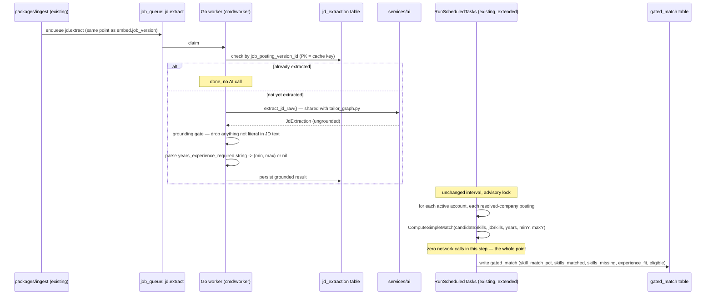
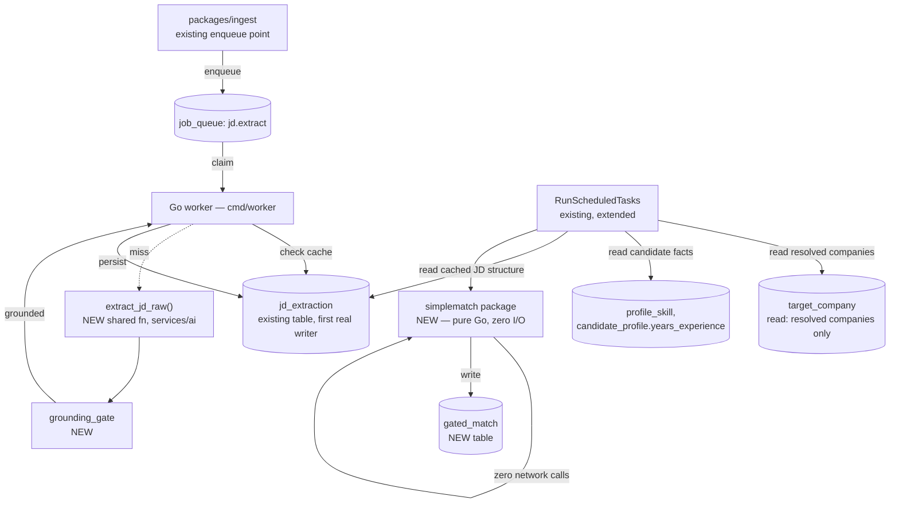

# F05 — Matching Engine

> Fifth per-feature spec. Depends on F02 (candidate skills/years) and F04 (job postings, resolved companies). The discipline this spec is held to, stated once, up front, because it governs every design choice below: **the match decision itself is 100% deterministic — no embeddings, no LLM call, no network call of any kind at match time.** The one LLM call this feature needs (structuring a job description's prose into a skills list) is a data-preparation step, run once per posting, cached forever, and never in the same code path as the actual eligibility decision. This split is the whole spec.

---

## 1. Feature Summary

F05 decides whether a candidate is eligible to apply to a job posting, on exactly two axes — skill overlap ≥ 50%, years-of-experience fit — and the decision has to be reconstructable by a human from a literal list of matched/missing skill strings, because it's what gates F07/F08 acting on someone's behalf without asking first. That determinism requirement forces a real architectural split: a job description is prose, and turning prose into a skills list genuinely needs an LLM — but that step happens **once per job posting version, cached, audited, and grounded**, entirely separate from the **per-candidate match computation**, which is pure set intersection and range comparison, testable with plain unit tests and no network access at all. F05 also discovers that the JD-structuring half isn't new work in spirit — `services/ai`'s existing resume-tailoring graph already does an ungrounded, ephemeral version of it — and turns that into a shared, grounded, persisted extraction instead of building a second one from scratch.

## 2. Dependencies

**Spec dependencies:** F02 (`profile_skill`, `candidate_profile.years_experience` — the candidate side of both axes), F04 (`job_posting`/`job_posting_version` via the existing, reused ingestion pipeline; `target_company.status` — F05 only matches against companies the account has actually resolved, never the whole job index).

**Existing repo code this reuses, cited exactly:**

| Concern | Existing file | What it already does |
|---|---|---|
| JD structuring shape + prompt | [`services/ai/app/graphs/tailor_graph.py`](../../services/ai/app/graphs/tailor_graph.py) `extract_jd` node (L103-111), `EXTRACT_JD_SYSTEM` (L62-64) | **Already extracts** `hard_skills`, `tools`, `required_keywords`, `years_experience_required` (free text), `seniority_level` from a JD — but ephemerally (in-graph state only, never persisted) and **ungrounded** (no check that extracted terms actually appear in the JD). F05 doesn't rebuild this; it extracts the LLM-call portion into a shared function (§7.1) and adds what's missing: grounding and persistence. |
| The extraction's own output shape | [`services/ai/app/models.py`](../../services/ai/app/models.py) `JdExtraction` (L108-119) | Reused as-is — its own doc comment already says it mirrors a prior pipeline's proven shape. Not reinvented. |
| The persistence table, unused until now | `jd_extraction` (migration 0008, L211-233) | **Already exists, already has the exact right shape and reasoning** — its own comment: *"a job description's extracted structure... does not depend on who is reading it, so it is cached once per job_posting_version and read by every candidate matched against that posting."* This is F05's caching strategy, written down two migration-sets ago, never yet acted on. Current grants (`SELECT, INSERT` to `app_web` only) assumed apps/web would do this — F05 does it from the Go worker instead (§5 explains why), which needs a grant this migration adds. |
| Deterministic 2-axis match logic | `01-LLD.md` §2, `ComputeSimpleMatch`/`SimpleMatchResult` | Ported into real code (§7.2) with one real bug fixed in the porting (§5 — a divide-by-zero the original draft didn't guard against) and one real question resolved (company-scoping, absent from the original sketch). |
| Scheduled sweep infrastructure | [`services/backend/internal/worker/schedule.go`](../../services/backend/internal/worker/schedule.go) `RunScheduledTasks` | Already runs on an advisory-locked interval for the existing v1 matcher. F05 adds a step to this **same** loop rather than standing up a second scheduler. |
| `app_matcher`'s BYPASSRLS batch-write pattern | `services/backend/internal/repo/postings.go` `UpsertMatches` (v1's own `job_match` writer) | Direct precedent for how F05's `gated_match` writer should work — same role, same "explicit account_id filter always, BYPASSRLS never used as a blanket scope" discipline already established. |
| Grounding-gate pattern | F02's `extract_facts_graph.py`, F03's `/v1/extract/companies`, F04's `extract_postings_graph.py` | **Fifth instance.** By now a load-bearing codebase convention, not a one-off — worth naming as such (§13). |

**What's genuinely new**: the shared, grounded `extract_jd_raw` extraction path + its persistence to `jd_extraction`; a `jd.extract` queue kind; the deterministic `simplematch` Go package (ported + corrected); a `gated_match` table (migration 0022); one new step in the existing scheduled sweep.

## 3. Complete User Journey

No direct UI — F05's "user" is F06, which reads its output.

1. F04's pipeline lands a new `job_posting_version` for a company an account has resolved (`target_company.status IN ('resolved_ats', 'resolved_generic')`). The same enqueue call that already schedules `embed.job_version` for this version (`packages/ingest/src/run.ts`) also enqueues `jd.extract` — one new line, same trigger point, not a new watcher.
2. The Go worker claims `jd.extract`. It checks `jd_extraction` by `job_posting_version_id` (the primary key **is** the cache key — no hash needed, since a version's content is already immutable once captured, per ADR D-09's own reasoning cited in the table's comment). A cache hit ends the job immediately.
3. A cache miss calls the shared `extract_jd_raw` function (§7.1) — same prompt, same LLM call shape `tailor_graph.py` already makes — then runs a **new** grounding gate: any `hard_skill`/`tool`/`required_keyword` not literally present in the JD text is dropped before anything is persisted.
4. The grounded result, plus a **deterministically parsed** years-of-experience range (§7.2 — the free-text `years_experience_required` string is never compared to a candidate's years directly; it's parsed into `(min, max)` integers first, and an unparseable string means "no stated range," not an error), is written to `jd_extraction`.
5. Independently, the existing scheduled tick (`RunScheduledTasks`, unchanged interval/lock) gains a new step: for each account with an active job search, for each `job_posting` from a **resolved** `target_company` whose `job_posting_version`/`jd_extraction` pair has changed since the account's facts were last matched against it, compute `SimpleMatchResult` (§7.2) — pure Go, zero calls out, and write `gated_match`.
6. Nothing downstream happens automatically from a `gated_match` row becoming eligible — that decision (turning an eligible match into an `apply_action` proposal) is F06's, not F05's, same clean-handoff discipline as every other queue boundary in this spec set.



## 4. Architecture & Flow



**Each hop:** (1) JD extraction is triggered by the same event F04's pipeline already produces — no new watcher; (2) the cache check is a primary-key lookup, not a hash comparison, because `job_posting_version_id` is already an immutable content address; (3) the grounding gate is the only thing standing between an LLM's word and a persisted "requirement" — same discipline, fifth application; (4) the scheduled sweep is the *only* place matching actually happens, and it is deliberately isolated from anything network-shaped — `simplematch`'s own package boundary (§7.2) has no HTTP client, no DB handle, nothing to call out to, which is what makes "no LLM in the match decision" a property the code structure enforces, not just a design intent.

## 5. Data Model

```sql
-- 0022 · gated_match (Feature F5) + the jd_extraction grant its
-- extraction step needs, since 0008 only ever granted app_web.

-- jd_extraction (0008) is extended, not recreated: the original comment
-- assumed "app_web for now, since apps/web routes call out to services/ai
-- and persist the result itself in Phase 5" — F05 instead runs this from
-- the Go worker (services/backend), consistent with where every other
-- extraction job in this spec set already runs (F02's extract.profile_facts,
-- F03's companies.parse, F04's crawl.resolve_company), not apps/web. That's
-- a deliberate deviation from the 0008-era assumption, not an oversight —
-- named here so the grant addition below has a reason attached to it.
GRANT SELECT, INSERT ON jd_extraction TO app_matcher;

-- app_matcher already reads company/career_source (0009) but never
-- target_company — the sweep (§7.3) needs to know which companies an
-- account has actually resolved, so this is a real, necessary grant, not
-- a defensive extra.
GRANT SELECT ON target_company TO app_matcher;

-- ---------------------------------------------------------------------------
-- gated_match: the deterministic v2 match result. Deliberately NOT
-- job_match (0011) — that table is v1's 7-signal RRF model, still valid,
-- still used by /matches, and semantically a different thing (a relevance
-- RANKING vs. an ELIGIBILITY decision that gates autonomous action). Same
-- shape discipline as job_match where it overlaps (account-scoped, RLS,
-- one row per (account, posting)), different columns where the concept
-- actually differs.
-- ---------------------------------------------------------------------------

CREATE TABLE gated_match (
  id                      uuid PRIMARY KEY DEFAULT gen_random_uuid(),
  account_id              uuid NOT NULL REFERENCES account(id) ON DELETE CASCADE,
  job_posting_id          uuid NOT NULL REFERENCES job_posting(id) ON DELETE CASCADE,
  job_posting_version_id  uuid NOT NULL REFERENCES job_posting_version(id) ON DELETE CASCADE,

  -- The literal, explainable decision — every field here must be
  -- reconstructable by a human reading this row alone, per this spec's
  -- own non-negotiable.
  skill_match_pct   real NOT NULL CHECK (skill_match_pct BETWEEN 0 AND 1),
  skills_matched    text[] NOT NULL DEFAULT '{}',
  skills_missing    text[] NOT NULL DEFAULT '{}',
  experience_fit    boolean NOT NULL,
  eligible          boolean NOT NULL, -- skill_match_pct >= 0.5 AND experience_fit, computed once, stored,
                                        -- not recomputed ad hoc by every reader

  computed_at       timestamptz NOT NULL DEFAULT now()
);

-- One decision per (account, posting) — a re-sweep updates in place,
-- never accumulates history the way append-only tables in this schema do,
-- because "is this candidate currently eligible" has no need for a past.
CREATE UNIQUE INDEX gated_match_account_posting_key
  ON gated_match (account_id, job_posting_id);

-- The hot query: an account's currently-eligible, not-yet-actioned matches.
CREATE INDEX gated_match_eligible_idx
  ON gated_match (account_id, eligible) WHERE eligible = true;

ALTER TABLE gated_match ENABLE ROW LEVEL SECURITY;

CREATE POLICY gated_match_tenant_select ON gated_match
  FOR SELECT USING (account_id = app_current_account_id());

GRANT SELECT ON gated_match TO app_web; -- future dashboard/Amatya read path
GRANT SELECT, INSERT, UPDATE ON gated_match TO app_matcher; -- BYPASSRLS, explicit
                                                                -- account_id filter always
                                                                -- (same discipline as job_match)
```

**The bug fixed in porting `01-LLD.md` §2's draft, not silently carried forward**: `ComputeSimpleMatch`'s original formula, `pct := float64(len(matched)) / float64(len(jdSkills))`, divides by zero whenever a posting's `jd_extraction` yields an empty skills list (a real, not-rare case — a badly-written JD, or a JD that's all soft requirements). §7.2's ported version special-cases `len(jdSkills) == 0` to `pct = 1.0, matched = [], missing = []` — vacuously satisfied, not a crash and not silently treated as automatic ineligibility either, since "we found nothing to require" isn't the same claim as "you're missing everything."

**Why company-scoped, not site-wide** (absent from the original LLD sketch, resolved here): the sweep only ever considers `job_posting` rows whose `company_id` is in the account's own `target_company` (status resolved) — matching a candidate against the *entire* job index would silently reintroduce the "general job board" behavior `00-PRD-and-HLD.md` §4 explicitly lists as a non-goal.

## 6. API Contract

```ts
// NEW — services/ai, POST /v1/extract/jd
// Fourth sibling in services/ai/app/routers/extract.py.
interface ExtractJdRequest {
  text: string; // job_posting_version.description_text
}
interface ExtractJdResponse {
  hardSkills: string[];
  tools: string[];
  requiredKeywords: string[];
  yearsExperienceRequired: string; // free text, e.g. "3-5 years" — parsed
                                     // deterministically downstream (§7.2),
                                     // never compared as a string
  seniorityLevel: string;
  model: string;
  promptVersion: number;
}
```

No REST/public API surface — everything else is queue-internal (`jd.extract`) or the existing scheduled tick. `gated_match` is read directly by F06's own repository code when that spec is written, the same "next spec reads this table" handoff as every prior boundary in this set.

## 7. Backend Implementation

### 7.1 Shared JD extraction (extends `services/ai`)

**Refactor, not a new prompt**: `tailor_graph.py`'s `extract_jd` node currently inlines its LLM call. Pulled out into `services/ai/app/jd_extraction.py`:

```python
# services/ai/app/jd_extraction.py — the LLM-call portion of tailor_graph.py's
# extract_jd node, unchanged in substance, given a name so it has exactly
# one owner instead of being duplicated for F05's use.
async def extract_jd_raw(llm: LLMClient, text: str) -> JdExtraction:
    raw = await llm.complete_json(EXTRACT_JD_SYSTEM, text[:6000])
    return JdExtraction.model_validate(raw)
```

`tailor_graph.py`'s `extract_jd` node becomes a one-line call to this function — same behavior, same tests, not touched otherwise. **F05's own graph** (`services/ai/app/graphs/extract_jd_graph.py`, new) adds what tailoring never needed:

```
extract_jd_raw → grounding_gate → parse_years_range → END
```

```python
def grounding_gate(state: ExtractJdGraphState) -> dict:
    text_lower = state["text"].lower()
    jd = state["jd_extraction"]
    grounded = jd.model_copy(update={
        "hard_skills": [s for s in jd.hard_skills if s.lower() in text_lower],
        "tools": [t for t in jd.tools if t.lower() in text_lower],
        "required_keywords": [k for k in jd.required_keywords if k.lower() in text_lower],
        # soft_skills/seniority_level/years_experience_required are NOT
        # substring-gated: they're not extracted as a list of discrete
        # verifiable strings the way skills/tools/keywords are — years is
        # gated differently, by parse_years_range failing closed instead.
    })
    return {"jd_extraction": grounded}
```

### 7.2 `simplematch` — the deterministic core (new — `services/backend/internal/simplematch/simplematch.go`)

**No import in this file reaches outside the standard library plus this module's own plain types.** That's not a style note — it's the property that makes "no LLM, no network call in the match decision" true by construction rather than by convention. Ported from `01-LLD.md` §2, with the divide-by-zero fix (§5) and case-insensitive matching added:

```go
package simplematch

import "strings"

type Result struct {
	SkillMatchPct float64
	SkillsMatched []string
	SkillsMissing []string
	ExperienceFit bool
	Eligible      bool
}

const EligibilityThreshold = 0.5 // 00-PRD-and-HLD.md §3 step 4's own stated number

func Compute(candidateSkills, jdSkills []string, candidateYears int, jdMinYears, jdMaxYears *int) Result {
	matched, missing := intersect(candidateSkills, jdSkills)

	var pct float64
	if len(jdSkills) == 0 {
		// Nothing was required, so nothing can be missing — vacuously
		// satisfied, not a divide-by-zero and not automatic ineligibility.
		pct = 1.0
	} else {
		pct = float64(len(matched)) / float64(len(jdSkills))
	}

	fit := true // no stated range = no filter, same as the original draft
	if jdMinYears != nil && candidateYears < *jdMinYears {
		fit = false
	}
	if jdMaxYears != nil && candidateYears > *jdMaxYears {
		fit = false
	}

	return Result{
		SkillMatchPct: pct,
		SkillsMatched: matched,
		SkillsMissing: missing,
		ExperienceFit: fit,
		Eligible:      pct >= EligibilityThreshold && fit,
	}
}

// intersect is case-insensitive, exact-match only — deliberately no fuzzy/
// synonym matching (that's embeddings/LLM territory, out of bounds for
// this file by design, §13). "React.js" and "React" are different strings
// here; a known, accepted limitation, not an oversight.
func intersect(candidate, required []string) (matched, missing []string) {
	have := make(map[string]bool, len(candidate))
	for _, s := range candidate {
		have[strings.ToLower(strings.TrimSpace(s))] = true
	}
	for _, req := range required {
		if have[strings.ToLower(strings.TrimSpace(req))] {
			matched = append(matched, req)
		} else {
			missing = append(missing, req)
		}
	}
	return matched, missing
}
```

**Years-range parsing** (`services/backend/internal/simplematch/years.go`) — the deterministic counterpart to F02's own `computeYearsExperience`, same "don't trust free text as a number, parse it in code you can unit test exhaustively" instinct:

```go
// ParseYearsRange handles the handful of shapes real JDs actually use:
// "3-5 years" -> (3, 5); "5+ years" -> (5, nil); "up to 3 years" -> (nil, 3);
// anything else, including an empty string, -> (nil, nil) — "no stated
// range" is the safe, honest default, never an error and never a silent 0.
func ParseYearsRange(text string) (min, max *int) {
	// regex-based, small, exhaustively tested against real-world phrasing
	// variants (§10) — implementation omitted here, behavior is the contract.
}
```

### 7.3 The sweep step (extends `services/backend/internal/worker/schedule.go`)

```go
// Added to RunScheduledTasks's existing per-account loop, after the
// existing v1 match.RunForAccount call — additive, not a replacement.
func runSimpleMatchSweep(ctx context.Context, deps WorkerDeps, accountID string) error {
	resolvedPostings, err := deps.Repo.PostingsForResolvedCompanies(ctx, accountID) // JOINs target_company
	if err != nil {                                                                  // (status resolved) -> company -> job_posting
		return err
	}
	facts, err := deps.Repo.LoadCandidateSimpleFacts(ctx, accountID) // profile_skill + years_experience,
	if err != nil {                                                    // the SAME buildCandidateFacts-adjacent
		return err                                                      // read path F01's table already cited
	}

	for _, posting := range resolvedPostings {
		jd, ok, err := deps.Repo.GetJdExtraction(ctx, posting.VersionID)
		if err != nil {
			return err
		}
		if !ok {
			continue // extraction hasn't run yet — this posting is skipped
		}           // this sweep, picked up automatically next tick once it has
		minY, maxY := simplematch.ParseYearsRange(jd.YearsExperienceRequired)
		result := simplematch.Compute(facts.Skills, jd.RequiredSkills(), facts.YearsExperience, minY, maxY)
		if err := deps.Repo.UpsertSimpleMatch(ctx, accountID, posting, result); err != nil {
			return err
		}
	}
	return nil
}
```

**Concurrency/error handling**: no new pattern — this runs inside the existing per-account loop `RunScheduledTasks` already has, under the same advisory lock, same "one account's error doesn't abort the whole tick" isolation the v1 matcher already provides.

## 8. Frontend Implementation

None — same as F04. `gated_match` is read by F06, not rendered directly by this spec.

## 9. Acceptance Criteria

| # | Criterion |
|---|---|
| AC1 | `simplematch.Compute` and `ParseYearsRange` make zero network/database calls — enforced by a test that constructs these functions' inputs entirely in-memory and would fail to compile/link against any HTTP or DB client if one were introduced |
| AC2 | A posting with zero required skills yields `skill_match_pct = 1.0`, not a divide-by-zero panic and not automatic ineligibility |
| AC3 | `jd.extract` never re-calls `services/ai` for a `job_posting_version_id` already present in `jd_extraction` — the cache check is a primary-key lookup, verified by a call-count assertion |
| AC4 | A `hard_skill`/`tool`/`required_keyword` not literally present in the JD text never reaches persisted `jd_extraction` |
| AC5 | The sweep only ever considers postings from companies with `target_company.status IN ('resolved_ats', 'resolved_generic')` for that account — never the full `job_posting` table |
| AC6 | `ParseYearsRange` returns `(nil, nil)` for an empty or unparseable string — never an error, never a silent `0` |
| AC7 | `gated_match.eligible` is always exactly `skill_match_pct >= 0.5 AND experience_fit`, recomputed and stored on every sweep, never read stale from a previous version's row after the job posting changes |
| AC8 | `tailor_graph.py`'s existing tests pass unmodified after the `extract_jd_raw` refactor — behavior-preserving, not a rewrite |

## 10. Test Plan

### Go unit (`services/backend/internal/simplematch`) — the core of this spec's test plan
```
TestCompute_ZeroRequiredSkills_ReturnsFullPctNotDivideByZero   // AC2
TestCompute_PartialSkillOverlap_MatchedAndMissingCorrect
TestCompute_CaseInsensitiveMatching
TestCompute_ExactSkillMatchPctThreshold_EligibleAtExactly50Percent
TestCompute_ExperienceBelowMin_NotEligible
TestCompute_ExperienceAboveMax_NotEligible
TestCompute_NoStatedRange_AlwaysFits
TestParseYearsRange_SimpleRange_35Years
TestParseYearsRange_PlusNotation_5PlusYears
TestParseYearsRange_UpToNotation
TestParseYearsRange_EmptyString_ReturnsNilNil                 // AC6
TestParseYearsRange_UnparseableGarbage_ReturnsNilNil_NotError  // AC6
```

### Python unit (`services/ai/tests`)
```
test_extract_jd_grounding_gate_drops_ungrounded_skill          // AC4
test_extract_jd_grounding_gate_keeps_grounded_skill
test_extract_jd_raw_unchanged_behavior_for_tailor_graph          // AC8, regression guard on the refactor
```

### Go integration (real Postgres)
```
TestJdExtract_CacheHit_ZeroAICallsOnSecondRun                   // AC3
TestSimpleMatchSweep_OnlyConsidersResolvedCompanyPostings        // AC5
TestSimpleMatchSweep_RLS_AccountSeesOnlyOwnMatches
TestSimpleMatchSweep_ReSweepAfterJobChangesRecomputesNotStale    // AC7
TestSimpleMatchSweep_AppMatcherGrant_CannotWriteBeyondSimpleMatchAndJdExtraction  // same BYPASSRLS-scope
                                                                                     // discipline F04's review established
```

### E2E
```
none — F05 has no user-facing surface; F06's E2E suite is where this feature's output first becomes observable end to end
```

## 11. Failure Modes & Edge Cases

- **A JD is genuinely skill-free prose** ("join our mission-driven team") — `jd_extraction` legitimately comes back with empty lists across the board. Handled honestly by AC2's fix, not specially flagged as an error; a posting like this is maximally easy to be "eligible" for on the skill axis, which is the correct, if slightly unsatisfying, consequence of extracting nothing to require.
- **`years_experience_required` is present but ambiguous** ("several years," "significant experience") — `ParseYearsRange` doesn't attempt fuzzy numeric inference from vague language; it returns `(nil, nil)`, same as an empty string. Getting this wrong in the direction of a wrong number would be worse than getting it right in the direction of "no filter" — a false ineligibility silently hides a real opportunity from the candidate with no way for them to notice, whereas "no filter" just means the skill axis alone decides.
- **A candidate's `years_experience` is `null`** (F02's extraction never ran, or found nothing) — `Compute` receives `0` as a safe default at the call site (never a Go nil-pointer-shaped surprise inside the pure function itself), which means a candidate with no recorded years will fail any JD with a stated minimum above zero — an honest, if blunt, outcome; the fix is populating the profile (F02), not softening the matcher.
- **A job posting closes between extraction and the next sweep** — `PostingsForResolvedCompanies` filters on `job_posting.closed_at IS NULL` (existing column, existing convention from the v1 matcher's own prefilter), so a closed posting simply stops being reconsidered; its last-computed `gated_match` row is left as-is rather than deleted, since "was this ever eligible" remains a true historical fact even after the posting closes.
- **The scheduled sweep and a `jd.extract` job for the same posting race** — a sweep that runs before extraction completes simply skips that posting for this tick (§7.3's `!ok { continue }`) and picks it up automatically on the next one; no coordination needed, because the sweep is idempotent and re-runs on a fixed interval regardless.
- **`extract_jd_raw`'s shared refactor breaks tailor_graph.py's own behavior** — this is the one genuine regression risk in this spec, called out explicitly rather than assumed safe: AC8's test exists specifically because a refactor touching code another feature depends on needs its own regression guard, not just "the diff looks equivalent."

## 12. Cost & Performance Notes

**JD extraction is the cheapest of this spec set's caching stories**, not merely a repeat of one: `job_posting_version_id` is a primary key, not a computed hash, because content-addressing already exists at the schema level (a version is immutable once captured — ADR D-09) — there's no hashing cost at all, just a lookup. A popular company crawled once (F04's own cost lever) has its postings' JDs extracted once, regardless of how many accounts later match against them, for the same "shared, not per-account" reasoning threaded through F03/F04. **The match computation itself is effectively free**: `simplematch.Compute` is O(skills-per-posting), no I/O, and the sweep's real cost is the read fan-out (postings × active accounts), bounded tightly by company-scoping (§5) rather than growing with the full job index — at <500 users (`specs/00` §6) this is not a tuning concern.

## 13. What You'll Learn Building This

- **Separating "prepare the data" from "make the decision," and enforcing the boundary in code, not just in a design doc.** `simplematch`'s package has no way to reach the network even if someone tried — that's a stronger guarantee than a comment saying "this should be deterministic." When a decision needs to be provably explainable (here: because it gates autonomous action on someone's behalf), making the guarantee structural instead of conventional is the actual senior-level move, not the theory alone.
- **Refactor-to-share vs. build-a-second-copy**, the concrete case this spec makes it: `extract_jd_raw` already existed, inline, inside `tailor_graph.py`. Recognizing "this is the same extraction, just missing grounding and persistence" and pulling out a shared function — with a regression test proving the original caller's behavior didn't change — is a different, more disciplined move than copy-pasting the prompt into a new file, even though both would have worked for F05 alone.
- **Divide-by-zero and "no stated value" are two different kinds of missing data, and conflating them is a real bug class.** §5/§7.2's fix distinguishes "nothing was required" (vacuously satisfied) from "we don't know what was required" (which doesn't arise here, but would deserve different handling again) — the discipline is noticing which one you actually have before picking a default.
- **Caching by immutable content-address vs. by computed content-hash** are subtly different tools: F02/F03 hash text because the "same" input can arrive as different byte sequences (a re-paste, a re-upload); F05 keys on a primary key because the schema already guarantees the version is immutable once created. Knowing which guarantee you actually have changes whether you need a hash at all.
- **A pure function's test suite can be exhaustive in a way a network-calling one never can be** — `simplematch`'s entire test plan (§10) runs with zero setup, zero mocks, zero flakiness surface, and that's a direct, earned consequence of the architectural split this spec is built around, not a coincidence of "unit tests are easy."

## 14. Definition of Done

- [ ] Migration 0022 applied: `gated_match` (RLS, grants), `jd_extraction`'s `app_matcher` grant added
- [ ] `extract_jd_raw` extracted from `tailor_graph.py` into `services/ai/app/jd_extraction.py`; `tailor_graph.py` updated to call it; AC8's regression test passing
- [ ] `extract_jd_graph.py` implemented: `extract_jd_raw → grounding_gate → parse_years_range`; `POST /v1/extract/jd` wired
- [ ] `jd.extract` queue handler implemented in `cmd/worker`, cache-checked by primary key (AC3)
- [ ] `simplematch` package implemented with zero non-stdlib, non-local imports (AC1) — a lint rule or import-boundary test enforcing this, not just code review
- [ ] `ParseYearsRange` implemented and exhaustively tested against real-world phrasing (§10)
- [ ] `runSimpleMatchSweep` added to `RunScheduledTasks`'s existing per-account loop, company-scoped (AC5)
- [ ] All tests in §10 passing, including the zero-network-call enforcement test and the divide-by-zero fix's test
- [ ] Lint + typecheck + tests green in pre-commit hook, for the Go module and the Python workspace touched

---

**Note on this spec's own history**: `F06-dryrun-approval-queue/SPEC.md` (and F07–F11) already exist on disk, written in an earlier part of this session that a failed `/compact` lost from working context. They already depend on this feature's output table by the name `gated_match` — this version of F05 was rewritten from scratch without that context and originally used `simple_match`; renamed to `gated_match` (and one missing grant added, `SELECT` on `target_company` for `app_matcher`) specifically to reconcile with F06/F10's existing, real references rather than requiring six already-written files to change. See the conversation for the full discovery — flagged there rather than silently fixed.
