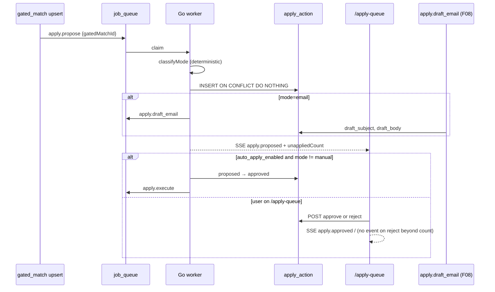

# F06 — Dry-Run & Approval Queue

> Sixth per-feature spec. Depends on F05 (`gated_match.eligible = true` is the only input). Does not re-score. Does not execute form-fill or send email. F07/F08 consume `approved` rows. F09 consumes the events this feature publishes.

---

## 1. Feature Summary

F06 is the human gate the product actually promised: every eligible target-company posting becomes an `apply_action` in `proposed`, the user reviews it, and nothing executes until they approve (or until they flip `auto_apply_enabled`, which still writes `proposed` first so the audit trail is honest). It copies the 2-axis explanation off `gated_match` at proposal time so "why was this queued" survives a later resume edit. It classifies each action into `form_fill`, `email`, or `manual` (the PRD's third path: LinkedIn-only / no form / no address — notify, do not auto-anything). Approve/reject/bulk-approve are the only mutations. Execution is someone else's job.

## 2. Dependencies

**Spec dependency:** F05. Ineligible gated matches never become actions. Unconfirmed companies never became gated matches, so they never appear here.

**Existing repo code this reuses:**

| Concern | Existing file | What it already does |
|---|---|---|
| Eligibility + explanation snapshot | F05 `gated_match` | `skill_match_pct`, `skills_matched`/`missing`, `experience_fit`. **Copied, not recomputed.** |
| Apply URL | `job_posting.apply_url` (0005) | Already required. |
| ATS capability | `ats_platform` seed (0005) `autofillable` | Greenhouse/Lever/Ashby are autofillable. Classification uses this, not an LLM. |
| Queue + worker | `cmd/worker`, `internal/queue` | New `apply.propose` / `apply.draft_email` kinds. |
| Event bus | `internal/events` + `apps/web` SSE bridge | New `apply.*` events; `unappliedCount` rides every one (`03-API-contracts.md`). |
| Session/RBAC | F01 `RequireAuth` | Approve is the caller's own account via `WithAccount`. |
| Matches UI (do not put Approve here) | F05 `GatedMatchList` | F05 explicitly has no Approve button. This feature owns `/apply-queue`. |

**F04 patch this feature requires (F04 dropped the bits on the floor):** `genericAdapter.normalize` currently comments that `applyFormDetected`/`emailFound` "ride along" but does not persist them. F06's migration adds `job_posting.apply_form_detected` and `job_posting.contact_email`; F04's Go enricher + `genericAdapter` must write them. ATS ingest sets `apply_form_detected=true` when the source's `ats_platform` is autofillable. Without this patch, every generic posting would classify as `manual`.

**What's genuinely new:** `apply_action` + `app_apply` role (migration 0023 — **fixes `02-DB-migrations.md`'s `app_amatya` copy-paste**, which is not used here); `candidate_profile.auto_apply_enabled` / `daily_email_cap`; classify + propose worker; `/apply-queue`; approve/reject/bulk.

**Conflict with `01-LLD.md` §3 / `03-API-contracts.md`:** both only name `form_fill | email`. The locked PRD journey step 5 has a third path. Mode set is `form_fill | email | manual`. LLD's "skip `proposed` when auto_apply_enabled" is rejected: always insert `proposed`, then auto-transition in the same transaction if the toggle is on. Skipping the row would make F09/F10/F11 lie about what happened.

## 3. Complete User Journey

1. F05 upserts `gated_match` with `eligible=true`. Same handler enqueues `apply.propose {gatedMatchId}` (dedup keyed on account+posting).
2. Worker loads the gated row + posting + `career_source.ats_type`. `classifyMode`:
   - autofillable ATS or `apply_form_detected` → `form_fill`
   - else `contact_email` present → `email`
   - else `manual`
3. `INSERT apply_action ... ON CONFLICT (account_id, job_posting_id) DO NOTHING`. Conflict means this posting was already proposed (or later approved/applied) — leave it. Copy skill snapshot from gated_match.
4. If `mode=email`, enqueue `apply.draft_email` (F08 fills `draft_subject`/`draft_body`; Approve stays disabled until both are non-null). If `mode=form_fill` or `manual`, the row is reviewable immediately.
5. Publish `apply.proposed` with `unappliedCount = COUNT(*) WHERE account_id=$1 AND status='proposed'`.
6. If `auto_apply_enabled` and mode is `form_fill` or `email` (never `manual`): `CanTransition(proposed, approved)` then `approved`, enqueue `apply.execute`, publish `apply.approved`. Manual never auto-executes.
7. User opens `/apply-queue`. Tabs: Needs review (`proposed`), Manual apply (`manual`+`proposed`), History (the rest). Each card shows company, title, mode, skill %, matched/missing chips, experience badge. Email cards show the draft. Manual cards show the apply URL and "Open & apply yourself" — no Approve-to-bot.
8. Approve → `proposed→approved`, enqueue `apply.execute` (F07 or F08 by mode). Reject → `proposed→rejected`. Bulk approve: per-id, partial failure `{approved, failed[]}` for stale/closed/already-decided rows (`APPLY_ACTION_STALE`).
9. Closed posting at approve time: 409 `APPLY_ACTION_STALE`, row stays `proposed` with `last_error` set, not silently approved.



## 4. Architecture & Flow

```mermaid
flowchart TD
    GM[(gated_match eligible=true)]
    Q1[(apply.propose)]
    CLS[classifyMode<br/>pure Go]
    AA[(apply_action)]
    Q2[(apply.draft_email<br/>F08)]
    Q3[(apply.execute<br/>F07/F08)]
    API[GET/POST apply-actions]
    UI[/apply-queue]
    NATS[[apply.* + unappliedCount]]

    GM --> Q1 --> CLS --> AA
    CLS -->|email| Q2
    AA -->|auto_apply or user approve<br/>mode != manual| Q3
    API --> AA
    AA --> NATS --> UI
    UI --> API
```

**Each hop:** (1) F05 decides *whether*; F06 decides *how* and *whether a human must click*; (2) classification is URL/ATS/regex, not an LLM; (3) `manual` is a first-class mode, not a dropped row — F10's "apply yourself" list is this set; (4) `unappliedCount` is computed in SQL at publish time, never incremented in process memory.

## 5. Data Model

```sql
-- 0023 · apply_action, app_apply, profile settings, posting apply-channel
-- (Feature F6). Fixes 02-DB-migrations.md's app_amatya grant on this table.

CREATE ROLE app_apply NOLOGIN;
GRANT USAGE ON SCHEMA public TO app_apply;

ALTER TABLE candidate_profile
  ADD COLUMN auto_apply_enabled boolean NOT NULL DEFAULT false,
  ADD COLUMN daily_email_cap integer NOT NULL DEFAULT 25
    CHECK (daily_email_cap BETWEEN 1 AND 50),
  ADD COLUMN daily_form_fill_cap integer NOT NULL DEFAULT 20
    CHECK (daily_form_fill_cap BETWEEN 1 AND 50);

-- F04 patch target. Defaults keep existing rows honest (unknown).
ALTER TABLE job_posting
  ADD COLUMN apply_form_detected boolean NOT NULL DEFAULT false,
  ADD COLUMN contact_email text;

CREATE TABLE apply_action (
  id                uuid PRIMARY KEY DEFAULT gen_random_uuid(),
  account_id        uuid NOT NULL REFERENCES account(id) ON DELETE CASCADE,
  job_posting_id    uuid NOT NULL REFERENCES job_posting(id) ON DELETE CASCADE,
  gated_match_id    uuid REFERENCES gated_match(id) ON DELETE SET NULL,
  mode              text NOT NULL CHECK (mode IN ('form_fill', 'email', 'manual')),
  status            text NOT NULL DEFAULT 'proposed'
    CHECK (status IN ('proposed', 'approved', 'rejected', 'executing', 'applied', 'failed')),
  skill_match_pct   real NOT NULL,
  skills_matched    text[] NOT NULL DEFAULT '{}',
  skills_missing    text[] NOT NULL DEFAULT '{}',
  experience_fit    boolean NOT NULL,
  draft_subject     text,
  draft_body        text,
  target_email      text,
  gmail_message_id  text,
  form_field_map    jsonb,
  confirmation_screenshot bytea,
  attempts          integer NOT NULL DEFAULT 0,
  last_error        text,
  proposed_at       timestamptz NOT NULL DEFAULT now(),
  decided_at        timestamptz,
  executed_at       timestamptz,
  created_at        timestamptz NOT NULL DEFAULT now(),
  updated_at        timestamptz NOT NULL DEFAULT now(),
  UNIQUE (account_id, job_posting_id)
);

CREATE INDEX apply_action_pending_idx
  ON apply_action (account_id, status)
  WHERE status IN ('proposed', 'approved', 'executing');

ALTER TABLE apply_action ENABLE ROW LEVEL SECURITY;
CREATE POLICY apply_action_tenant_select ON apply_action
  FOR SELECT USING (account_id = app_current_account_id());
CREATE POLICY apply_action_tenant_insert ON apply_action
  FOR INSERT WITH CHECK (account_id = app_current_account_id());
CREATE POLICY apply_action_tenant_update ON apply_action
  FOR UPDATE USING (account_id = app_current_account_id())
  WITH CHECK (account_id = app_current_account_id());

GRANT SELECT, INSERT, UPDATE ON apply_action TO app_web;
-- No DELETE: rejected/failed stay as the audit trail.

GRANT SELECT, INSERT ON apply_action TO app_matcher; -- propose worker (same binary, matcher pool)
GRANT SELECT,
  UPDATE (status, attempts, last_error, executed_at, updated_at,
          gmail_message_id, confirmation_screenshot, form_field_map,
          draft_subject, draft_body, target_email, decided_at)
  ON apply_action TO app_apply;

CREATE POLICY apply_action_admin_select ON apply_action
  FOR SELECT USING (app_is_admin_session());
GRANT SELECT ON apply_action TO app_admin;

GRANT UPDATE (auto_apply_enabled, daily_email_cap, daily_form_fill_cap) ON candidate_profile TO app_web;
```

`app_apply` is **not** `BYPASSRLS`. Execute workers set `WithAccount` (or filter `account_id` explicitly if they must use the matcher pool — prefer a dedicated apply pool bound to `app_apply` with RLS on, same shape as `app_web`). Do not hand this table to `app_matcher`'s BYPASSRLS beyond INSERT of proposals.

## 6. API Contract

```
GET    /api/v1/apply-actions?status=proposed&mode=
  → 200 { actions: ApplyAction[], unappliedCount: number }

POST   /api/v1/apply-actions/:id/approve
  → 200 { action } | 409 APPLY_ACTION_STALE | 409 DRAFT_NOT_READY (email, body null)

POST   /api/v1/apply-actions/:id/reject
  → 200 { action }

POST   /api/v1/apply-actions/approve-bulk
  body: { ids: string[] }
  → 200 { approved: number, failed: { id: string, error: string }[] }

POST   /api/v1/apply-actions/:id/mark-applied   // mode=manual only
  → 200 { action }  // proposed → applied, no execute job

PATCH  /api/v1/profile/settings
  body: { autoApplyEnabled?: boolean, dailyEmailCap?: number }
  → 200 { settings }  // dailyEmailCap cannot exceed 50, cannot be 0
```

`ApplyAction.mode` includes `'manual'`. `unappliedCount` counts `status='proposed'` of every mode.

SSE: `apply.proposed | apply.approved | apply.rejected | apply.executing | apply.applied | apply.failed` each with `{ actionId, unappliedCount, mode, status }`.

## 7. Backend Implementation

### 7.1 `classifyMode` — `internal/apply/classify.go` (pure)

```go
func ClassifyMode(atsType string, autofillable, formDetected bool, contactEmail, applyURL string) string {
    if autofillable || formDetected || isKnownATSApplyURL(applyURL) {
        return "form_fill"
    }
    if strings.TrimSpace(contactEmail) != "" {
        return "email"
    }
    return "manual"
}
```

`isKnownATSApplyURL` matches `boards.greenhouse.io`, `jobs.lever.co`, `jobs.ashbyhq.com`, `*.workable.com`. No LLM.

### 7.2 State machine — `internal/apply/status.go`

LLD's `CanTransition` plus: `proposed → applied` only when `mode=manual` (mark-applied). `proposed → executing` is **not** a public transition; auto_apply goes `proposed → approved →` enqueue, and F07/F08 do `approved → executing`. Illegal transitions return a typed error, not a 500.

### 7.3 Propose handler

Uses `ON CONFLICT DO NOTHING`. Does not overwrite a `rejected`/`applied` row if the posting is recrawled — unique key is the product rule "one decision per posting per account." A later *version* of the same posting does not create a second action (same `job_posting_id`). If we ever want re-propose-after-reject, that's a new endpoint, not a silent upsert.

`unappliedCount` query:

```sql
SELECT count(*) FROM apply_action WHERE account_id = $1 AND status = 'proposed'
```

Published after commit, best-effort, same as `match.computed`.

## 8. Frontend Implementation

```
apps/dashboard/src/app/apply-queue/
├── page.tsx
├── actions.ts              # approve, reject, approveBulk, markApplied, patchSettings
├── ApplyActionCard.tsx
├── ApplyQueueList.tsx      # SSE-backed via F09 slice; until F09 ships, router.refresh on events
└── AutoApplyToggle.tsx     # PATCH settings; warning copy once
```

NavBar gains Apply queue link. F05 gated list stays Approve-free. Email card: Approve disabled with "Drafting…" while body is null. Manual card: primary button is an `<a target=_blank>` to `applyUrl`, secondary is mark-applied.

Settings toggle copy: "Applications will send without asking. Daily email cap still applies."

## 9. Acceptance Criteria

| # | Criterion |
|---|---|
| AC1 | `eligible=false` gated_match never produces an apply_action |
| AC2 | Unique (account, posting): second propose is a no-op, not a second row |
| AC3 | Greenhouse/Lever/Ashby posting classifies `form_fill` even if `contact_email` is also set |
| AC4 | No form, no known ATS URL, no email → `manual`; auto_apply does not execute it |
| AC5 | Email Approve while `draft_body` IS NULL → 409 `DRAFT_NOT_READY` |
| AC6 | Closed posting at approve → 409 `APPLY_ACTION_STALE` |
| AC7 | Bulk: 10 ids, 2 stale → `{approved:8, failed:[{id,error}…]}` not 500 |
| AC8 | `CanTransition` rejects `rejected→approved`, `applied→proposed` |
| AC9 | `auto_apply_enabled` writes `proposed` then `approved` in one txn; a row always exists for F09 |
| AC10 | Account B cannot approve account A's action (RLS) |
| AC11 | `daily_email_cap` 0 or >50 rejected at PATCH; default 25 |
| AC12 | `GRANT` on `apply_action` for execute is to `app_apply`, not `app_amatya` |

## 10. Test Plan

Go unit: `TestClassifyMode_*` (ATS wins over email, empty → manual, known URL). `TestCanTransition_*` table.  
Go integration: unique conflict, RLS approve isolation, auto_apply trail, stale closed posting, count on SSE payload.  
TS ingest: genericAdapter persists `apply_form_detected`/`contact_email`.  
E2E: approve one form_fill row enqueues `apply.execute`; manual has no execute job.

## 11. Failure Modes

- **F04 never wrote the new columns** — everything classifies `manual`. Detection: metric `apply_action_mode` ratio; alert if `manual` > 80% of proposals after ATS volume. Named as the F04 patch's production signature.
- **Draft job dead-letters** — email row stuck with null body; Approve stays 409; user sees "draft failed, retry" which re-enqueues. Don't send a blank email.
- **auto_apply + manual** — skipped by AC4. A bug that enqueues execute for manual is a DoD-failing test.
- **Recrawl of an applied job** — unique key prevents a second send. Correct.
- **Toggle flipped mid-bulk** — each approve reads current status; already-approved ids land in `failed[]`.

## 12. Cost & Performance

Propose is a SQL insert + one count. The expensive part is F08's draft LLM, async. `/apply-queue` hot query is `apply_action_pending_idx`. At <500 users this is not a scaling problem; the unique index is the correctness problem.

## 13. What You'll Learn Building This

- **State machines as a pair of CHECK + `CanTransition`.** DB CHECK stops garbage; Go enum stops illegal API calls. Either alone is a hole (raw SQL vs a missed handler).
- **Partial-failure bulk APIs.** 40-item approve with 2 stale jobs is the normal case. HTTP 200 with a `failed[]` array is more honest than a transaction that rolls back 38 good approvals.
- **Audit trail vs skip-a-state.** Auto-apply that never writes `proposed` is faster and lies. Writing the row then transitioning is how you debug "did the bot fire?" six weeks later.
- **Classification without an LLM.** Mode is a URL/regex/flag. Putting this in a prompt would make "why is this manual" unanswerable.
- **Copy-paste role names.** `02` granted execute to `app_amatya`. F06 creates `app_apply`. Catching this by reading GRANT lines is the actual RLS review skill.

## 14. Definition of Done

- [ ] Migration 0023 applied, including `app_apply` (not `app_amatya`) and the two `job_posting` columns
- [ ] F04 genericAdapter + ATS ingest write those columns
- [ ] `classifyMode` + `CanTransition` unit-tested
- [ ] Propose handler + unique no-op + F05 enqueue hook
- [ ] Approve/reject/bulk/mark-applied/settings routes
- [ ] `/apply-queue` UI; F05 still has no Approve
- [ ] SSE payloads include `unappliedCount`
- [ ] AC4, AC9, AC10, AC12 passing in this PR
- [ ] No `apply.execute` handler in this feature (F07/F08)

---

Next spec: **F07 — Auto-Apply Form-Fill**. Consumes `mode=form_fill` and `status=approved`. Never sends email. Never executes `manual`.
