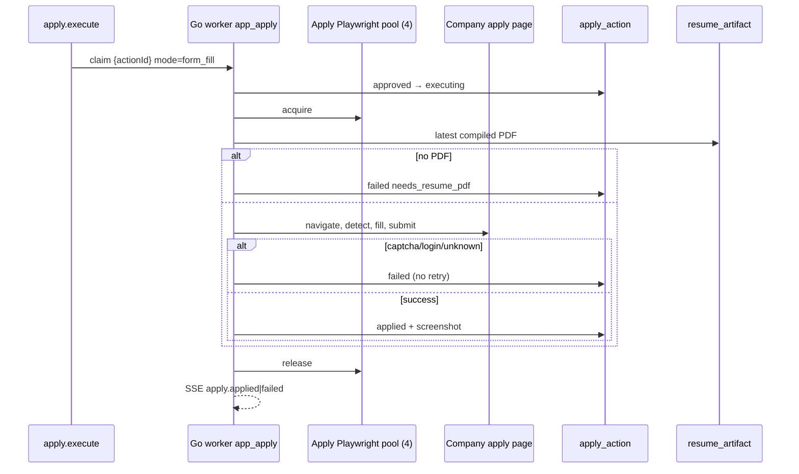
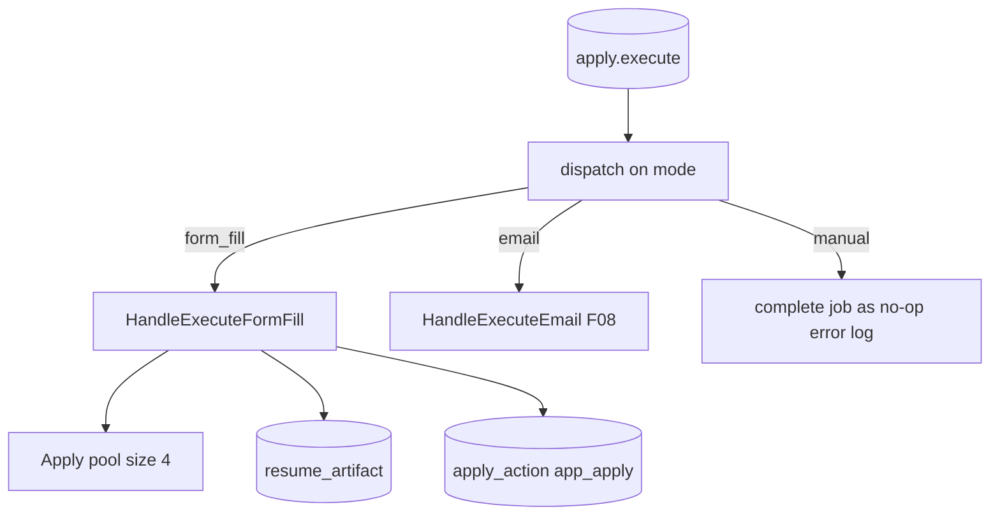

# F07 — Auto-Apply Form-Fill

> Seventh per-feature spec. Depends on F06 (`status=approved`, `mode=form_fill`) and F04 (Playwright pool + apply URL). Executes. Does not draft or send email. Does not touch `manual` rows.

---

## 1. Feature Summary

F07 is the form-fill executor: it claims `apply.execute` jobs for `mode=form_fill`, opens the posting's `apply_url` in a **separate Playwright pool** from F04's crawler pool, fills the 3–5 common ATS/generic shapes, uploads the candidate's latest compiled resume PDF, submits, stores a confirmation screenshot, and moves `approved → executing → applied | failed`. CAPTCHA, OTP, login walls, and unknown forms fail closed and notify — they never get "best-effort" submits. v1 still requires F06 approval unless `auto_apply_enabled` already flipped the row to `approved`.

## 2. Dependencies

| Concern | Existing | Reuse |
|---|---|---|
| Queue row | F06 `apply_action` | F07 only UPDATEs via `app_apply` |
| State machine | F06 `CanTransition` | `approved→executing→applied\|failed`; `failed→executing` capped |
| Browser | F04 `internal/crawler/pool.go` | **Second pool**, size 4. Do not share F04's 8-slot crawl pool — a 30s apply must not starve crawls and a crawl OOM must not take applies with it |
| Resume PDF | `resume_artifact.pdf_bytes` (0008), `apps/tailor` compile | If no compiled PDF, fail `needs_resume_pdf` — do not submit without the file |
| Profile fields | `LoadCandidateFacts` + `candidate_profile` | name, email, phone for inputs |
| Events | F06 catalog | `apply.executing`, `apply.applied`, `apply.failed` + `unappliedCount` |

**What's new:** `HandleExecuteFormFill`, field-detection heuristics, screenshot bytes, a form-fill daily cap (20, distinct from F08's email cap). **Not new:** a second Playwright library, Tier C, LinkedIn Easy Apply.

**Conflict with LLD §3.2:** "fills detected schema from proposal-time `form_field_map`." F06 does not detect fields (it has no browser). F07 detects at execute time and *then* writes `form_field_map` as the audit of what it actually filled. Proposal-time maps would be stale by crawl-interval.

## 3. Complete User Journey

1. F06 approve (or auto_apply) enqueues `apply.execute {actionId}`.
2. Worker claims, loads action; if mode ≠ `form_fill` it returns the job to the queue unhandled (F08's handler is registered on the same name and dispatches on mode — **one queue, switch on mode**, not two queues that can desync).
3. `CanTransition(approved, executing)`; set executing, `attempts++`, publish `apply.executing`.
4. Acquire apply-pool slot (4). Navigate `apply_url` with a real headed-equivalent fingerprint (Playwright default Chromium, same F04 bot-detection short-circuit).
5. Detect shape: Greenhouse (`#first_name` / boards.greenhouse.io), Lever, Ashby, or generic (`input[type=email]`, `input[type=file]`, name-ish text input). Unknown → `failed` / `unknown_form`.
6. Fill name, email, phone from profile. Attach latest `resume_artifact` where `status='compiled'` (or v1 equivalent compiled PDF). Cover letter: only if a visible required textarea exists; then a short grounded blurb from `skills_matched`, not an LLM novel. Submit.
7. Success heuristic: URL contains `confirmation`/`thank`/`submitted`, or a known ATS success node, plus screenshot. → `applied`, store screenshot.
8. CAPTCHA iframe / SSO login / OTP field → `failed` with `captcha_required` | `login_walled` | `otp_required`. **Do not retry those** (dead-letter). User is notified via F09; F10 lists the URL as manual.
9. Transient net error → `failed` with retry via `queue.Fail` up to 3, then dead. `CanTransition(failed, executing)` only when `attempts < 3` and reason is transient.



## 4. Architecture & Flow



Manual jobs must never be enqueued (F06 AC4). If one arrives, mark `failed` / `invalid_mode` and complete — do not open a browser.

## 5. Data Model

No new table. F07 uses 0023 columns: `form_field_map`, `confirmation_screenshot`, `attempts`, `last_error`.

Optional: `ALTER TABLE candidate_profile ADD COLUMN daily_form_fill_cap integer NOT NULL DEFAULT 20 CHECK (daily_form_fill_cap BETWEEN 1 AND 50);` in a 0023 follow-on statement if not already present — **add it in 0023 via F06 amendment** rather than a new number: F06's settings PATCH already exists; extend body with `dailyFormFillCap`. Recorded here: F06 migration gains this column; F07 enforces it.

Cap query: `count(*) WHERE account_id=$1 AND mode='form_fill' AND status='applied' AND executed_at >= date_trunc('day', now())`. Checked at execute, not approve (proposals may pile). Exceeded → `failed` / `DAILY_CAP_EXCEEDED`, no retry.

## 6. API Contract

No new user-facing routes. Internal queue only. Failures surface through existing GET apply-actions (`lastError`, `status`).

Error codes written to `last_error`: `needs_resume_pdf`, `unknown_form`, `captcha_required`, `login_walled`, `otp_required`, `bot_detected`, `submit_timeout`, `DAILY_CAP_EXCEEDED`, `invalid_mode`.

## 7. Backend Implementation

`internal/apply/formfill.go` — detect → fill → submit. Detection is CSS/URL heuristics, tested against **fixture HTML** in-repo (`testdata/forms/{greenhouse,lever,ashby,generic,captcha}.html`), never live Greenhouse in CI.

Fill uses `page.Locator` with timeouts; every field miss that is `required` fails the job rather than submitting a half-empty form.

Screenshot: `page.Screenshot()` → `confirmation_screenshot` bytea. Same D-24 "bytes in Postgres" cost as `resume_artifact.pdf_bytes`. Cap image at ~500KB JPEG.

Pool: `applyPool := crawler.NewPool(4)` in `cmd/worker`. Distinct variable from crawl pool.

Dispatch in one handler:

```go
func HandleApplyExecute(...) error {
    action, err := repo.GetApplyAction(...)
    switch action.Mode {
    case "form_fill":
        return HandleExecuteFormFill(...)
    case "email":
        return HandleExecuteEmail(...) // F08
    default:
        return markFailed(action, "invalid_mode")
    }
}
```

F08's function may be a stub returning `not_implemented` until F08 ships; F06 must not enqueue execute for email until F08 exists **or** F07's stub fails those jobs visibly. Prefer: register F08 handler in the same PR wave; if F07 ships first, email execute stays unqueued (F06 only enqueues execute for form_fill until F08's DoD). **F06 amendment:** enqueue `apply.execute` for `form_fill` only; email waits on F08 to enqueue from draft-complete or from approve once F08 is live. Simplest shipped sequence: F07 registers dispatch; email case returns `errEmailExecutorNotLoaded` until F08 adds the function in the same package.

## 8. Frontend

No new page. `/apply-queue` cards already show `lastError`. Add a "Open apply page" link on `failed` + `captcha_required`/`login_walled` so the user can finish by hand (that is the PRD stop). Screenshot: admin/debug only in F11, not the user card (PII-adjacent).

## 9. Acceptance Criteria

| # | Criterion |
|---|---|
| AC1 | `mode=email` or `manual` never drives Playwright in this handler |
| AC2 | CAPTCHA fixture → `captcha_required`, attempts not retried |
| AC3 | Missing compiled PDF → `needs_resume_pdf`, no navigation |
| AC4 | Daily cap: 21st success same UTC day fails `DAILY_CAP_EXCEEDED` |
| AC5 | Apply pool never exceeds 4 concurrent contexts |
| AC6 | Crawl pool (8) and apply pool (4) are distinct; saturating one does not acquire the other |
| AC7 | `form_field_map` written on success is the map actually used |
| AC8 | Unknown form → failed, not a guessed submit |
| AC9 | Cross-account: `app_apply` with RLS cannot update another account's row |

## 10. Test Plan

Go unit: detector against fixtures.  
Go integration: cap, PDF missing, invalid mode, pool bound (50 jobs, max-in-flight counter).  
E2E: local fixture server Greenhouse-like form → `applied` + screenshot non-null. Never CI against a real ATS.

## 11. Failure Modes

- **ATS redesign** — detector misses → `unknown_form`. Same silent-breakage class as F04; failed rows are the detector. Do not "just click the first button."
- **Half-filled required field** — fail before submit.
- **File input rejects PDF** — `failed` `upload_rejected`.
- **Success page never loads** — timeout → retry as transient, not `applied`.
- **ToS:** autofill on Greenhouse/Lever/Ashby is closer to intended use; generic HTML forms are gray. Stay inside detected shapes; no LinkedIn Easy Apply (Tier C).

## 12. Cost

4 Chromium contexts ≈ 0.4–1.2GB. Cadence is human-approved volume, not crawl volume — much smaller than F04. Screenshots: 500KB × actions; accept D-24, purge with D-31 if the account stops searching (add `apply_action` to the dormancy list in the same sweep that already deletes `job_match`).

## 13. What You'll Learn

- **Separate pools for separate SLAs.** Crawl is throughput; apply is correctness. Sharing a semaphore couples them.
- **Fail closed on unknown UI.** Automation that clicks "something" is how you spam a company and get the candidate banned.
- **Fixtures over live sites in CI.** F04 already said this; form-fill is even more true (CAPTCHA farms, ToS).
- **Caps at execute, not approve.** Approving 40 overnight then sending 40 at 00:01 still burns the cap; check when the side effect happens.

## 14. Definition of Done

- [ ] Dispatch handler + form-fill path; email path stub or F08
- [ ] Distinct apply pool size 4, AC5/AC6 tests
- [ ] Fixtures for 4 shapes + captcha
- [ ] PDF required, daily cap, screenshot on success
- [ ] Failed captcha/login not retried
- [ ] `apply_action` added to D-31 purge list
- [ ] No LinkedIn/Easy Apply code path

---

Next spec: **F08 — Auto-Email Outreach**.
