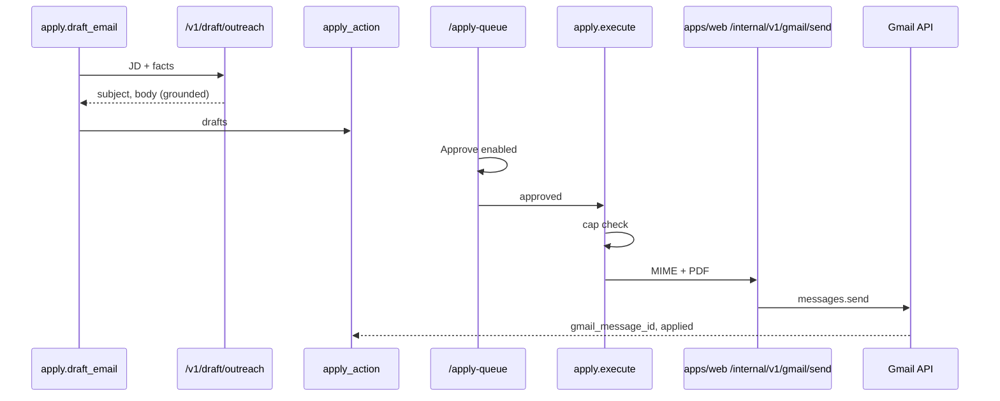
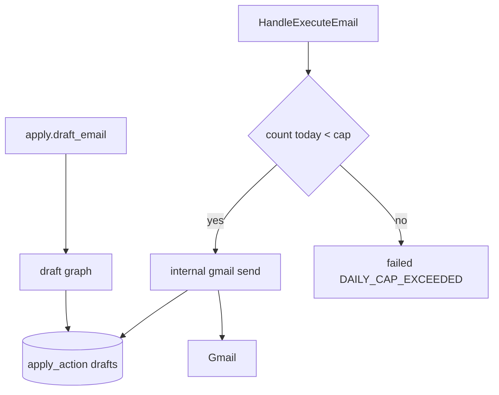

# F08 — Auto-Email Outreach

> Eighth per-feature spec. Depends on F06 (`mode=email`) and F02 (resume PDF). Reuses existing Gmail send. Hard daily cap, no disable toggle.

---

## 1. Feature Summary

F08 drafts and sends the email-mode apply path: an LLM writes a short human-sounding subject+body grounded in the JD + candidate facts, the existing Gmail MIME sender attaches the compiled resume PDF, and the worker moves `approved → executing → applied | failed`. Drafting happens **before** the user approves (so dry-run is real). Sending happens **only after** approve (or auto_apply) and **only if** today's send count is under `daily_email_cap` (default 25, max 50, min 1, **cannot be turned off**). This is the Gmail-account-survival feature. It does not fill forms.

## 2. Dependencies

| Concern | Existing | Reuse |
|---|---|---|
| Draft columns | F06 `draft_subject`, `draft_body`, `target_email` | F08 writes them |
| Send | [`apps/web/src/services/gmailSend.ts`](../../apps/web/src/services/gmailSend.ts) `buildMimeMessage` / `sendGmailMessage` | **Do not port MIME to Go.** Worker calls a new `POST /internal/v1/gmail/send` on `apps/web` (internal token), same as F02's extract-text hop |
| Gmail OAuth | `email_credential` (0017), `apps/web/src/services/gmail.ts` | Unverified against live Google — same disclosure as F01 OAuth. F08 ships the path + unit tests against fakes; live send is a DoD checkbox with real creds |
| Attachment | `resume_artifact.pdf_bytes` | Same "no PDF, no send" as F07 |
| Facts / JD | F02 facts, F05 `jd_extraction` | Draft graph input |
| Cap | F06 `candidate_profile.daily_email_cap` | Enforced here, at send, SQL count of `mode=email AND status=applied AND executed_at::date = today` |
| v1 outreach | `outreach_draft` (0017) | **Do not dual-write.** v1 is per-`job_application`; v2 is `apply_action`. Two tables, two UIs |

**What's new:** `apply.draft_email` handler, `POST /v1/draft/outreach` graph, internal Gmail send route, cap check in Go. **Not new:** a Go Gmail SDK, unlimited send, a toggle to disable the cap.

**LLD §3.3** `CanSendMoreToday` is kept, but count `executed_at >= date_trunc('day', now())` not `created_at` (proposals must not consume the cap). Cap is **not** a user-disableable flag.

## 3. Complete User Journey

1. F06 propose `mode=email` enqueues `apply.draft_email`.
2. Worker loads JD text + facts + company/title. Calls `POST /v1/draft/outreach`. Grounding: body may not introduce a company, employer, school, or metric that isn't in facts or JD (same fabrication_check as tailor). Subject ≤ 80 chars.
3. Writes `draft_subject`, `draft_body`, `target_email` (from `job_posting.contact_email`). Row stays `proposed`. Publish `apply.proposed` again so the UI enables Approve.
4. User edits? v1 dry-run: **no in-place editor in F08** (scope). They reject and apply manually, or approve the draft as-is. An editor is a later patch, not a silent extra surface.
5. Approve → `apply.execute`. Dispatch (F07) calls `HandleExecuteEmail`.
6. Cap check. If at cap → `failed` `DAILY_CAP_EXCEEDED`, no Gmail call, no retry until next UTC day (a scheduled requeue at 00:05 is optional; v1 just fails and the user retries).
7. No PDF → `needs_resume_pdf`. No `email_credential` → `gmail_not_linked` (dashboard already has Gmail link from v1 outreach).
8. Internal send with From = linked Gmail, To = `target_email`, attachment filename `Resume.pdf`. Store `gmail_message_id`. `applied`.
9. Gmail 429 / 5xx → retry via `queue.Fail`. Gmail 400 / policy → `failed` no retry (`gmail_rejected`).



## 4. Architecture & Flow



Draft LLM is **not** on the send path. Re-drafting at send would mean the user approved different words than went out.

## 5. Data Model

No new table. Uses 0023. Index for the cap:

```sql
CREATE INDEX apply_action_email_sent_day_idx
  ON apply_action (account_id, executed_at)
  WHERE mode = 'email' AND status = 'applied';
```

Add in 0023 (F06 amendment) or a tiny 0023b — prefer **same 0023** if not applied yet; if 0023 already landed in a branch, 0025 grant-fix style. Ledger: include this index under 0023.

`target_email` must match a simple addr regex at draft time; garbage from F04's regex → fail draft with `invalid_target_email`, stay proposed with last_error so the user can go manual.

## 6. API Contract

```
POST /internal/v1/gmail/send   (apps/web, X-Internal-Token, no cookie)
  body: { accountId, to, subject, bodyText, artifactId }
  → 200 { gmailMessageId }
  → 403 cap is NOT checked here — Go already did; this route still
     re-checks cap (defense in depth) and returns 429 DAILY_CAP_EXCEEDED
```

```
POST /v1/draft/outreach  (services/ai)
  { job, facts, company, applyUrl }
  → { subject, body, model, promptVersion }
```

PATCH settings cannot set `dailyEmailCap` null or 0 (F06 AC11). No `disableEmailCap` field, ever.

## 7. Backend Implementation

**Draft graph** `draft_outreach_graph.py`: `draft → fabrication_check → END`. Prompt: 120–180 words, first person, no "I am writing to express my interest" sludge if it can avoid it, must mention 1–2 `skills_matched` verbatim, must not claim skills in `skills_missing`.

**Cap** (Go, execute):

```go
func CanSendMoreToday(ctx context.Context, pool *pgxpool.Pool, accountID string, cap int) (bool, error) {
    var n int
    err := pool.QueryRow(ctx, `
      SELECT count(*) FROM apply_action
       WHERE account_id = $1 AND mode = 'email' AND status = 'applied'
         AND executed_at >= date_trunc('day', timezone('utc', now()))
    `, accountID).Scan(&n)
    return n < cap, err
}
```

Use UTC day so "daily" doesn't depend on the worker's local TZ.

**Send:** `apps/web` internal route loads `email_credential`, decrypts refresh token (existing), `sendGmailMessage`. Go does not see the refresh token.

## 8. Frontend

F06 email card shows subject/body. Add a "Gmail not linked" banner if execute failed `gmail_not_linked`, linking existing Gmail connect. Cap: show "12 / 25 sent today" on the queue header (GET apply-actions can include `emailSentToday`, `emailCap`).

## 9. Acceptance Criteria

| # | Criterion |
|---|---|
| AC1 | Cap is enforced in Go **and** in the internal send route; either alone is not enough |
| AC2 | There is no API field that sets cap to unlimited |
| AC3 | Draft fabrication of a missing skill is dropped / job fails closed, not sent |
| AC4 | Send uses the draft bytes on the row, not a second LLM call |
| AC5 | No PDF → no Gmail HTTP |
| AC6 | 25th send a day succeeds, 26th fails cap (default 25) |
| AC7 | `outreach_draft` row count unchanged by an F08 send |
| AC8 | Worker never logs raw refresh tokens |
| AC9 | `mode=form_fill` does not call Gmail |

## 10. Test Plan

Python: fabrication_check drops ungrounded employer/skill.  
Go: cap boundary 24/25/26, UTC midnight, `created_at` today but `executed_at` yesterday does not count.  
TS: `gmailSend.test.ts` already fakes send — add internal route tests, cap 429.  
Integration: draft then execute with fake Gmail; assert `gmail_message_id` and no `outreach_draft` insert.

## 11. Failure Modes

- **Google flags the account anyway** — cap is mitigation, not a guarantee. Copy in UI: "We cap sends to protect your Gmail. Cold volume can still trip filters."
- **Wrong contact_email** (F04 regex grabbed a CDN address) — `invalid_target_email` at draft. User goes manual.
- **User approved, then revoked Gmail** — `gmail_not_linked` at execute.
- **LLM drafts in another language** — constrain prompt to the JD's language; if detect mismatch, fail draft, don't send.
- **Attachment MIME too large** — Gmail 413 → no retry, `attachment_too_large`.

## 12. Cost

One draft LLM call per email proposal (not per send). Cap 25/day × 500 users = 12.5k sends theoretical max; real is far lower. Gmail quota is the binding constraint, which is why the cap exists.

## 13. What You'll Learn

- **Side-effect caps belong next to the side effect.** Checking at propose time lets 25 drafts become 25 sends after a quiet day of queueing.
- **Don't rewrite a working MIME builder** in a second language. Internal HTTP to the service that already has OAuth + tests is the strangler pattern F04 used with `runIngestion`.
- **Defense in depth on a dangerous API.** Go cap + TS cap. The internal route must not trust the worker blindly (`accountId` in the body is forgeable if the token leaks — still check cap and that the artifact belongs to that account).
- **Dry-run means the user saw the bytes that send.** Regenerating at send is a product lie.

## 14. Definition of Done

- [ ] Draft graph + `apply.draft_email` handler; Approve stays blocked until body exists (F06 AC5)
- [ ] `HandleExecuteEmail` + UTC cap + double-check on internal route
- [ ] Internal Gmail send reuses `gmailSend.ts`; artifact ownership checked
- [ ] No cap-disable field; AC2 test
- [ ] No `outreach_draft` writes; AC7
- [ ] Live Gmail still disclosed unverified until credentials exist — tests use fakes
- [ ] F06 enqueue execute for email once this handler exists

---

Next spec: **F09 — Notification System**.
