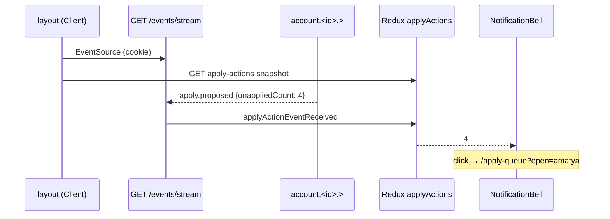
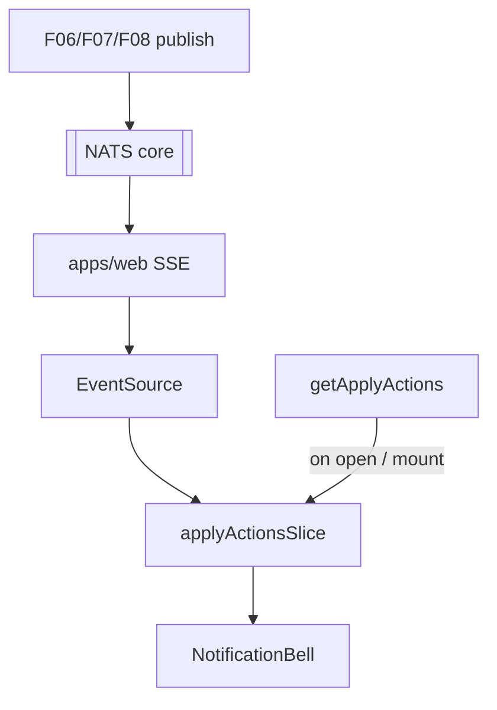

# F09 — Notification System

> Ninth per-feature spec. Depends on F01 (session cookie on SSE) and F06 (`apply.*` events with `unappliedCount`). F10 opens from the bell; this feature owns the count and the transport, not the chat.

---

## 1. Feature Summary

F09 makes the unapplied count correct on every page without polling: the server already pushes `unappliedCount` on every `apply.*` event (F06); this feature adds the Redux slice that **trusts that number**, the SSE client that dispatches it, and a `NotificationBell` in the shell. It does not compute the count in the reducer by incrementing. A missed event must not permanently desync the badge — reconnect refetches `GET /api/v1/apply-actions` and replaces the count.

## 2. Dependencies

| Concern | Existing | Reuse |
|---|---|---|
| SSE bridge | [`apps/web/src/routes/events.ts`](../../apps/web/src/routes/events.ts) | Cookie session, account-scoped NATS wildcard. **No new transport.** |
| Event payloads | F06 / `03-API-contracts.md` | `unappliedCount` already on `ApplyActionEvent` |
| Publisher | Go `internal/events` | F06/F07/F08 publish; F09 is the consumer |
| FE architecture | `04-FE-architecture.md` §3–4 | `packages/store` applyActionsSlice, bell → Amatya |
| Nav | [`apps/dashboard/src/app/NavBar.tsx`](../../apps/dashboard/src/app/NavBar.tsx) | Add bell; today it has no count |

**What's new:** `packages/store`, `lib/sse.ts`, `NotificationBell.tsx`, Provider in `layout.tsx`. **Not new:** WebSocket, polling interval, client-side increment.

**Interleave with F06:** F06 can ship events without a bell; the queue page can `router.refresh`. F09 is what makes the number global. Implementation may land F09 plumbing in the same PR as F06's publisher — spec order stays numeric.

## 3. Complete User Journey

1. Layout mounts Redux Provider + `useSse(accountId)` (client). EventSource `GET /api/v1/events/stream` (existing).
2. On connect, RTK Query `getApplyActions` hydrates `unappliedCount` + normalized actions (authoritative snapshot).
3. Each `apply.proposed|approved|rejected|applied|failed` → `applyActionEventReceived` sets `state.unappliedCount = payload.unappliedCount` and upserts that id.
4. Bell shows the number. `0` hides the badge, not the bell.
5. Click: opens Amatya slide-over (F10). Until F10, click routes to `/apply-queue` — **do not ship a dead button.** F09's bell `href` is `/apply-queue` with an optional `?open=amatya` that F10 honors.
6. Reconnect/tab sleep: EventSource retries; on `onopen`, refetch GET apply-actions (replace, don't merge counts).
7. Multi-tab: both tabs receive the same NATS fan-out. Both set the same server count. No lock.



## 4. Architecture & Flow



NATS core, not JetStream — same reasoning as `events-and-realtime.md`: a disconnected tab should not replay 400 proposed events.

## 5. Data Model

None. Count is `SELECT count(*) FROM apply_action WHERE account_id=$1 AND status='proposed'` at publish time (F06).

## 6. API Contract

No new endpoints. Consume existing SSE + GET apply-actions.

`packages/core` Events catalog gains the `apply.*` names if not already added by F06.

## 7. Backend Implementation

Almost none if F06 published correctly. F09 adds a **contract test**: given a propose, the SSE JSON has numeric `unappliedCount` equal to SQL count, not `payload.actions.length` from an in-memory slice.

Reject any publisher that sends a delta (`+1`).

## 8. Frontend Implementation

```
packages/store/src/
  index.ts
  applyActionsSlice.ts    # createEntityAdapter recommended
  amatyaSlice.ts          # empty until F10; export stub so bell can dispatch openPanel
apps/dashboard/src/
  app/layout.tsx          # Provider + <SseListener />
  lib/sse.ts
  components/notifications/NotificationBell.tsx
```

`SseListener` is a Client Component with no UI. Bell is Client, `useSelector`. Do **not** put EventSource in the Server Component layout body.

Until `packages/store` exists, do not invent a React context "just for now" — that becomes the permanent path. Ship the package.

Mobile: same slice, `react-native-sse` or fetch-stream; if EventSource is painful, F09 web ships first and mobile is a checklist item in F10/apps/mobile, not a blocker for dashboard DoD.

## 9. Acceptance Criteria

| # | Criterion |
|---|---|
| AC1 | Reducer assigns `unappliedCount` from payload; tests fail if a test increments |
| AC2 | Snapshot fetch after reconnect overwrites a stale 5 with server 0 |
| AC3 | Bell hidden on `/login` (NavBar already hides) |
| AC4 | Click with F10 absent still navigates to `/apply-queue` |
| AC5 | Two tabs both show the same count after one propose |
| AC6 | No `setInterval` fetch of apply-actions anywhere in dashboard |

## 10. Test Plan

Reducer unit tests (payload 7 → 7, then snapshot 0 → 0).  
Component: bell renders `7`, `0` has no numeric badge.  
E2E: propose in one tab, second tab badge updates (Playwright two pages) — optional if NATS in CI is heavy; then integration at the SSE JSON level is mandatory.

## 11. Failure Modes

- **NATS down** — worker already nil-safe; badge hydrates from GET only, updates on refresh. Copy: don't toast "realtime offline" unless it lasts >10s.
- **Increment bug** — the whole point of AC1.
- **SSE buffer / proxy** — `X-Accel-Buffering: no` already on the route. Keep it.
- **Count includes executing** — spec is `proposed` only. Approved-but-not-done is not "unapplied" in the PRD bell sense (user already clicked). Document that; changing it is a product call, not a silent off-by-one.

## 12. Cost

One SSE per open tab. Negligible at 500 users. GET on reconnect is the same list the queue page needs.

## 13. What You'll Learn

- **Server-authoritative derived state.** Unread badges that increment locally are a classic desync. Slack-style: server sends the number.
- **Hydrate on open, patch on event.** Event streams are not a source of truth; they are a cache invalidation with a payload.
- **Redux for cross-route live state**, `useState` for the rest — `04` §7.3. The bell on every page is why this isn't Zustand-in-one-component.
- **SSE vs WebSocket:** cookie on GET, server→client only. You already chose this in v1.

## 14. Definition of Done

- [ ] `packages/store` applyActionsSlice + AC1 tests
- [ ] `SseListener` + reconnect snapshot
- [ ] Bell in NavBar, AC3/AC4
- [ ] Publisher contract test for `unappliedCount`
- [ ] No polling (AC6)
- [ ] `amatyaSlice` stub exported; F10 fills it

---

Next spec: **F10 — Amatya Chatbot**.
