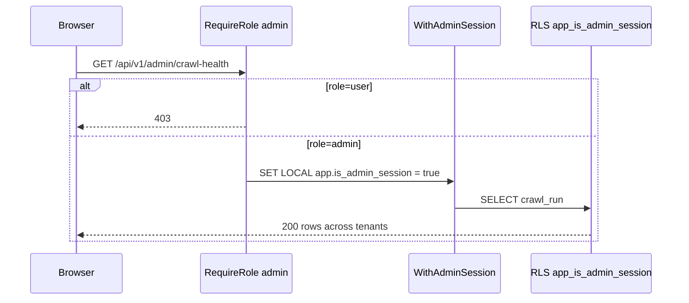
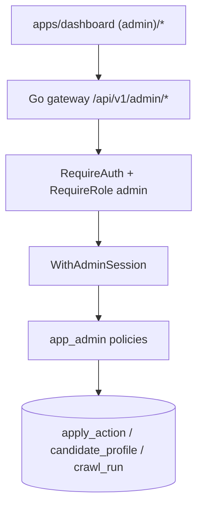

# F11 — Admin Console

> Eleventh and last per-feature spec. Depends on F01 (`RequireRole('admin')`, `WithAdminSession`), F04 (`crawl_run` health), F06–F08 (kill-switch `auto_apply_enabled`). Lives in `apps/dashboard/src/app/(admin)/`, not a second Next app (`specs/README.md` §1.2).

---

## 1. Feature Summary

F11 is three read-mostly screens for the single admin (you): all accounts, crawl health, and a kill-switch that turns off another user's `auto_apply_enabled`. It uses `app_admin` RLS policies (`app_is_admin_session()`), **never** `BYPASSRLS` on a request-serving role. Users hitting `/admin` get 404-or-redirect from middleware plus 403 from the API — UI hiding is not the boundary.

## 2. Dependencies

| Concern | Existing | Reuse |
|---|---|---|
| Role | F01 `account_member.role admin\|user`, `RequireRole` | Gate every admin route |
| Session flag | F01 `app_is_admin_session()` + `WithAdminSession` | SET LOCAL after verifying role server-side |
| Crawl health | F04 `crawl_run`, `career_source.consecutive_failures` | Read-only |
| Kill switch | F06 `candidate_profile.auto_apply_enabled` | Admin UPDATE that one column via a dedicated path |
| Layout | README: `(admin)` route group | Same dashboard, same login |

**What's new:** three pages, three API routes, admin SELECT policies on any table F01–F10 didn't already grant to `app_admin`. **Not new:** a second deployable, BYPASSRLS-for-convenience, impersonation ("log in as user").

## 3. Complete User Journey

1. Admin logs in through the normal `/login` (same user can also use `/apply-queue` as themselves).
2. Nav shows **Admin** link only if `GET /api/v1/me` says `role=admin` (cosmetic). Direct URL still hits middleware.
3. `/admin/accounts` — table: email, created_at, auto_apply_enabled, proposed count, last login if cheap. Click kill-switch → confirm modal → `POST .../kill-switch` `{autoApplyEnabled: false}` only (v1 cannot remotely turn it **on** — that's the user's toggle).
4. `/admin/crawls` — per `career_source`: last `crawl_run` status, failure_reason, consecutive_failures, degraded flag, last success. Filter degraded. No "run now" in v1 (that's a footgun); F04's scheduler is the only producer.
5. `/admin/kill-switches` can be the same as accounts with a filter; do not build a fourth page. Three routes: `accounts`, `crawls`, and maybe a tiny `page.tsx` that redirects to accounts.
6. A `role=user` requesting `GET /api/v1/admin/accounts` → **403** `FORBIDDEN`, not an empty list (empty list would be a confused admin or a leaky success).



## 4. Architecture & Flow



Dashboard still uses REST/`apiServer.ts`, not GraphQL (`04` §1.2 / README §1.2).

## 5. Data Model

No new tables. Grant whatever admin SELECT is still missing:

```sql
-- 0024 already has amatya admin SELECT. F11's migration 0025 is only
-- leftover GRANTs/policies, if any, plus a column-scoped kill-switch grant:

GRANT UPDATE (auto_apply_enabled) ON candidate_profile TO app_admin;
CREATE POLICY candidate_profile_admin_kill ON candidate_profile
  FOR UPDATE
  USING (app_is_admin_session())
  WITH CHECK (app_is_admin_session());
```

**Narrow this further in application code:** the handler only executes `UPDATE candidate_profile SET auto_apply_enabled = false WHERE account_id = $1`. It never sets true. A policy that allows any UPDATE on that column means a bug could turn auto-apply on; the handler is the second lock. Prefer a SQL function:

```sql
CREATE FUNCTION app_admin_kill_auto_apply(p_account uuid) RETURNS void AS $$
  UPDATE candidate_profile SET auto_apply_enabled = false WHERE account_id = p_account;
$$ LANGUAGE sql SECURITY DEFINER;
-- REVOKE from public; GRANT EXECUTE TO app_admin;
```

SECURITY DEFINER is easy to get wrong (search_path). Prefer the column grant + handler that only sends false, with a test that `SET auto_apply_enabled=true` via the admin route returns 400. Pick **handler constraint + 400**, not DEFINER, unless tests demand otherwise. Recorded: **no SECURITY DEFINER in v1.**

`crawl_run` is Layer-1 (no RLS). F04 already `GRANT SELECT ON crawl_run TO app_web, app_admin`. Admin health uses `app_web` or `app_admin`; either is fine if RequireRole passed. Prefer `app_admin` connection for symmetry.

## 6. API Contract

```
GET  /api/v1/admin/accounts
  → 200 { accounts: { id, email, role, autoApplyEnabled, proposedCount, createdAt }[] }
  → 403 if not admin

GET  /api/v1/admin/crawl-health
  → 200 { sources: { careerSourceId, atsType, status, consecutiveFailures, lastRun, lastError }[] }

POST /api/v1/admin/accounts/:id/kill-switch
  body: { autoApplyEnabled: false }   // true → 400
  → 200 { accountId, autoApplyEnabled: false }
```

`GET /api/v1/me` already returns role from F01.

## 7. Backend Implementation

`cmd/gateway` (F01) registers the three routes wrapped in `RequireAuth(..., RequireRole(RoleAdmin, ...))` and `db.WithAdminSession`. Kill-switch: if body is not exactly false, 400. Audit `audit_log` if the table exists (v1 has `audit-log.md`) — write one row `admin.kill_auto_apply`.

Do not add impersonation (`?asAccount=`).

## 8. Frontend

```
apps/dashboard/src/app/(admin)/
  layout.tsx          # RequireRole check via me; children
  admin/page.tsx      # redirect → /admin/accounts
  admin/accounts/page.tsx
  admin/crawls/page.tsx
```

Next.js route group `(admin)` does not affect the URL; use `app/admin/...` if that's simpler. README said `(admin)` for grouping + layout. Either:

`app/(admin)/admin/accounts/page.tsx` → URL `/admin/accounts`.

Middleware (existing `apps/dashboard/src/middleware.ts`): if path starts `/admin` and role cookie/jwt isn't admin — we may not have role in the session cookie today. **Don't trust a client cookie for role.** Middleware can only ensure logged-in; **layout is a Server Component that GET /me and `redirect`/`notFound()`**. API still 403. Defense in depth: layout + API, not middleware-alone.

Kill button: `window.confirm` is fine at this scale; no extra design system.

## 9. Acceptance Criteria

| # | Criterion |
|---|---|
| AC1 | `role=user` GET admin accounts → 403, not 200 `[]` |
| AC2 | Kill-switch body `true` → 400; `false` sets column false |
| AC3 | Admin can list another account's proposedCount without BYPASSRLS on `app_web` |
| AC4 | `/admin` layout `notFound` for users (no link leak of account emails in HTML) |
| AC5 | Crawl health shows a degraded F04 source |
| AC6 | No impersonation query param honored |
| AC7 | `app_admin` is not `BYPASSRLS` (information_schema / rolbypassrls) |

## 10. Test Plan

Go: AC1, AC2, AC7. Integration: two accounts, admin session sees both proposed counts, user session 403.  
E2E: login as user, visit `/admin/accounts`, no email from the other tenant in the document.

## 11. Failure Modes

- **Layout-only hide** — crawler still 403s. Both required.
- **Kill-switch as ON** — 400. Support "enable for user" is a different, dangerous product.
- **crawl_run grant missing** — empty health page; test AC5 against a seeded failure.
- **Admin is also a user** — kill-switch on **self** is allowed (you can turn your own auto-apply off from admin). Turning it on still only via `/profile`.

## 12. Cost

Three queries, <500 rows. Fine.

## 13. What You'll Learn

- **Admin ≠ BYPASSRLS.** A second session variable + policies is auditable; BYPASSRLS on the gateway is "every future bug is cross-tenant."
- **403 vs empty list.** Authorization failures should look like authorization failures.
- **Route groups vs second apps.** Three pages are not a deployable (`README` §1.2).
- **One-way kill switch.** Operational safety: the admin can stop a runaway auto-apply; they cannot silently start sending as that user.

## 14. Definition of Done

- [ ] `/admin/accounts` + `/admin/crawls` + kill-switch
- [ ] RequireRole + WithAdminSession on all three APIs
- [ ] AC1, AC2, AC7 tests
- [ ] Nav Admin link from `me.role`
- [ ] User HTML does not contain other tenants' emails
- [ ] No BYPASSRLS on `app_admin`
- [ ] No impersonation

---

This is the last F0N spec. Spec-writing for v2 features F01–F11 is complete. Implementation follows `specs/README.md` §5 (F09 plumbing may interleave with F06).
