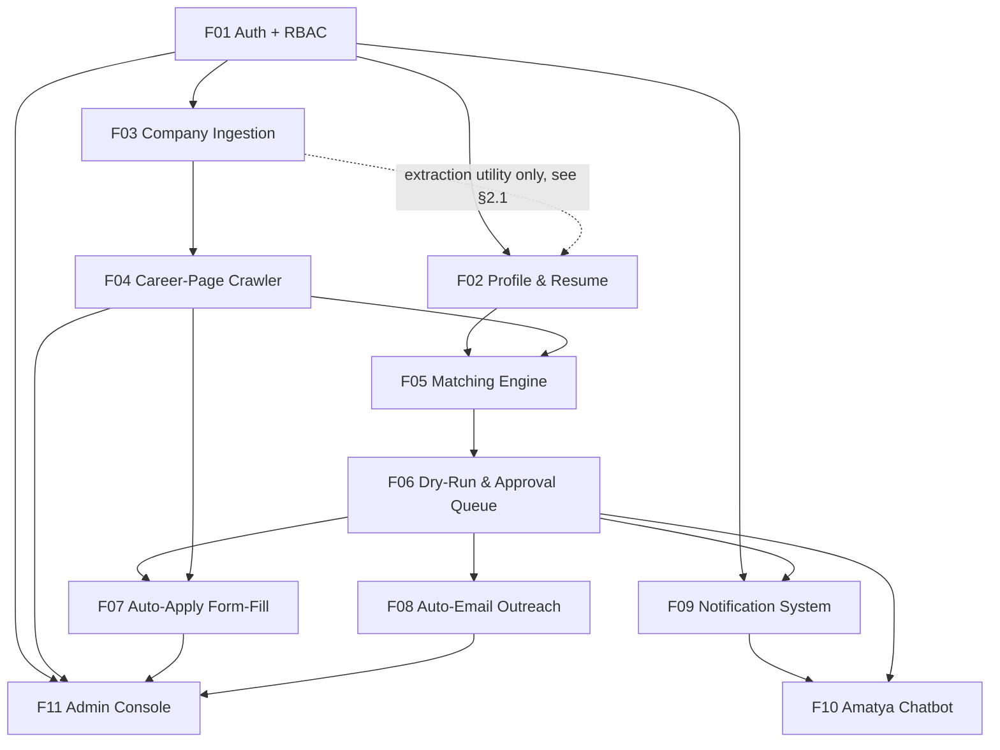

# Specs

End-to-end reference documentation, one file per feature or subsystem.
Different purpose from `docs/`:

| Directory | Answers |
|---|---|
| `docs/PRD.md` | What is this product, for whom, what's in/out of scope |
| `docs/ADR.md` | Which architectural decision, and why, numbered (D-01…) |
| `docs/CURRENT_STATE.md` | A point-in-time factual audit (may drift as code changes) |
| `docs/GAP_ANALYSIS.md` | Current vs. proposed, as of one specific audit |
| `docs/BUILD_PLAN.md` | The target architecture and phase sequence (Go/Python/k8s/NATS/LangGraph) — **start here for what's next and why**, then this directory for what's actually built |
| **`specs/*.md`** | **How one specific feature actually works, kept current as it changes** — schema, code paths, edge cases, known bugs found and how they were fixed, test coverage |

A spec is maintained, not archived: when a feature changes, its spec
changes in the same commit. If a spec and the code disagree, the code is
right and the spec is stale — fix the spec.

## Index

| Spec | Covers |
|---|---|
| [architecture.md](architecture.md) | System-wide shape: layers, services, languages, database roles, deployment target |
| [auth-and-identity.md](auth-and-identity.md) | Signup, login, logout, password reset, Google OAuth, rate limiting, health/readiness |
| [session-auth.md](session-auth.md) | How a session is **validated** on every request after login: the `js_session` cookie, the hash, cross-language parity (TS ↔ Go) |
| [audit-log.md](audit-log.md) | The append-only `audit_log` table: what's written, what isn't, why writes never block the action they're logging |
| [ingestion.md](ingestion.md) | ATS adapters, the job index, the Postgres queue, the scheduler |
| [profile-and-provenance.md](profile-and-provenance.md) | Candidate profile, skills, experience, the fact-provenance model (D-22) |
| [ephemeral-retention.md](ephemeral-retention.md) | Job search sessions, résumé storage, the D-31 purge mechanic |
| [matching-pipeline.md](matching-pipeline.md) | The Go matcher service: hard constraints, hybrid retrieval (RRF), structured ranking, `job_match` |
| [embeddings-and-explanation.md](embeddings-and-explanation.md) | The Python `services/ai`: real `fastembed` embeddings, LLM match explanations, the provenance gate |
| [resume-tailoring.md](resume-tailoring.md) | `packages/resume-core` (extracted LaTeX span surgery), `apps/tailor`, and LangGraph's Graph A (tailoring) / Graph B (match explanation, upgraded) |
| [events-and-realtime.md](events-and-realtime.md) | D-26's NATS core pub/sub + the `apps/web` SSE bridge: subject convention, the wired-vs-reserved event catalog, `match.computed` (Go) and `job_search.stopped` (TS) |
| [application-workspace.md](application-workspace.md) | The tracker (`job_application`), matches dismiss/track, resume tailoring's human-facing half (calling `services/ai` directly, reinject-against-the-original), outreach drafting, the Gmail link/send integration (code written, real credentials deferred), and Phase 8's event-triggered notification email |
| [dashboard.md](dashboard.md) | `apps/dashboard` (Next.js): the 5 screens, "zero auth code" via server-to-server calls only, the tailor panel's proper-noun-flags-block-compile gate, SSE live progress, the PWA app shell, and why Capacitor is scaffolded but not wrapped |

**Coverage status**: every phase through Phase 8, including the dashboard
(Phase 6), has a spec. Kubernetes deployment (Phase 5.0) is the one
remaining phase, deliberately skipped for now. Each gets a spec when it's
built, not before.

## Writing a new spec

One file per feature, not per phase or per PR. A feature spec should let
someone who has never read the code answer: what does this do, where does
the code live, what does the schema look like, what are the known sharp
edges, and how is it tested. Include real bugs found during development and
how they were actually fixed — that history is part of the feature's
end-to-end story, not a separate changelog.

---

# v2 planning & feature specs

Everything above this line describes the **shipped, working v1 product** —
kept current as it changes, per the rule above. Everything below describes
**v2, not yet built**: the forward-looking design docs (`00`–`06`, numbered,
same folder) and the per-feature implementation specs (`F01`–`F11`
subfolders, same folder) that turn that design into buildable work, one
feature at a time, before any v2 code is written. `00`–`06` and `F01`–`F11`
are intentionally excluded from the "Index" table above — that table is
for what's actually built; this section is the index for what's planned.

## Foundational docs (read in this order)

| Doc | Covers |
|---|---|
| [00-PRD-and-HLD.md](00-PRD-and-HLD.md) | Product vision, personas, user journey, non-goals, service boundaries, tech stack decisions |
| [01-LLD.md](01-LLD.md) | Crawler Svc, simplified Matcher, Apply Svc state machine, Amatya Svc LangGraph design |
| [02-DB-migrations.md](02-DB-migrations.md) | Migrations 0018–0023: new roles, `target_company`, `crawl_run`, `apply_action`, admin RLS, Amatya tables |
| [03-API-contracts.md](03-API-contracts.md) | REST additions, GraphQL BFF schema, SSE event payloads |
| [04-FE-architecture.md](04-FE-architecture.md) | Frontend folder structure, Redux design, styling — **amended below, see §1** |
| [05-F1-auth-rbac.md](05-F1-auth-rbac.md) | Original F1 draft — **superseded by `F01-auth-rbac/SPEC.md`**, upgraded to the 14-section format |
| [06-F3-company-ingestion.md](06-F3-company-ingestion.md) | Original F3 draft — **superseded by `F03-company-ingestion/SPEC.md`**, upgraded to the 14-section format |

I read the existing repo (`apps/`, `services/`, `packages/`) against these docs before writing anything below — the "what already exists" claims in `00`/`01`/`05`/`06` check out against the codebase as it stands today.

## 1. Decisions locked in conversation (amend the docs above — read before any F0N spec)

### 1.1 Backend: reuse-first, confirmed (no change from `00`/`01`/`05`)

`apps/web` (Fastify/TS) keeps running unchanged for what it already does — session auth, profile, matches, applications, artifacts, outreach. F01–F11 add **new Go services alongside it** (API gateway + RBAC, Crawler Svc, simplified Matcher, Apply Svc, Amatya Svc), per the HLD §7.1 diagram. Nothing here is a full rewrite. A full Go port of `apps/web` is a possible future migration, not part of F01–F11.

### 1.2 Frontend: two client surfaces — **corrects an earlier draft of this section, which wrongly proposed three**

An earlier pass of this decision record proposed splitting into `apps/dashboard` (repurposed admin-only) + a new `apps/user-web` built from scratch. **That was wrong and has been reverted.** `apps/dashboard` already IS the user app — per the codebase audit it already has real, working `/matches`, `/pipeline`, `/profile`, `/applications/[id]`, and the full auth flow. Rebuilding those screens in a second app would mean shipping the same functionality twice for no benefit.

**Corrected decision — amends `04-FE-architecture.md`:**

1. **`apps/dashboard`** (existing Next.js, unchanged tech) stays the **single web app for both roles**. No `apps/user-web`.
2. Admin surfaces live in a route group inside it: `apps/dashboard/src/app/(admin)/`, gated by the `RequireRole('admin')` middleware from F01 (checked server-side, via the role already returned by `GET /api/v1/me`).
3. **`apps/mobile`** (Expo/RN, per `04` §2) → unchanged: mobile + PWA via `react-native-web`. This remains the only genuinely separate client — different runtime, no server hop, which is the actual justification for its different fetch strategy (GraphQL BFF vs. `apiServer.ts` REST) per `04` §2.1.

**Why a route group beats a second Next app here:**
1. F11 is a handful of read-only admin pages (accounts list, crawl health, kill-switch). A whole second Next.js app — second auth wiring, second build pipeline, second deploy target, second Tailwind config — for a few pages is pure overhead at <500 users with one admin.
2. The security argument for physical separation doesn't hold under App Router: route-level code splitting means a user who never navigates to `/admin` never downloads that bundle, and admin pages are Server Components anyway (zero JS shipped for them). The real access boundary is the `RequireRole` middleware + the admin-session RLS mechanism (migration 0018, per-table policies added incrementally per §2) — both server-side, both already specced — not which repo folder a page's source lives in.
3. The admin (you) is also a user. Two apps means logging into two places to use one product.

**Consequence for API access pattern**, unchanged from the reasoning in `04` §2.1: `apps/dashboard` (including its `(admin)` route group) is a Next.js app with a server hop, so it uses the existing REST-via-`apiServer.ts` pattern against `apps/web`/the new Go gateway. The GraphQL BFF stays justified specifically for `apps/mobile`, which has no server hop — introducing GraphQL into `apps/dashboard` would contradict `04`'s own stated reasoning for why GraphQL exists in this stack at all.

### 1.3 Spec format: the 14-section structure, for everything, including F01/F03

`05`/`06`'s lighter 7-section format is retired. Every `SPEC.md` in this folder — including the upgrades of F01 and F03 — follows the 14-section structure from your instructions verbatim: Feature Summary, Dependencies, Complete User Journey (+ mermaid sequence diagram), Architecture & Flow (+ mermaid flowchart), Data Model, API Contract, Backend Implementation, Frontend Implementation, Acceptance Criteria, Test Plan, Failure Modes & Edge Cases, Cost & Performance Notes, What You'll Learn Building This, Definition of Done.

### 1.4 Location: everything lives under `specs/`, not `docs/specs/`

An earlier pass created `docs/specs/README.md`. That was wrong too — the v2 planning docs (`00`–`06`) already live in this `specs/` folder, so the per-feature specs (`F01`–`F11` subfolders) live here alongside them, not in a separate `docs/specs/` tree. `docs/specs/` has been removed.

### 1.5 Decisions locked in F06–F11 (do not drift)

- **Three apply modes**, not two: `form_fill | email | manual`. PRD journey step 5 wins over LLD/API drafts that omitted `manual`.
- **Always write `proposed`**, then auto-transition if `auto_apply_enabled`. Skipping the row would break F09/F10/F11 audit.
- **`app_apply` ≠ `app_amatya`.** Execute vs chat are different GRANT surfaces.
- **Gmail cap cannot be disabled.** Enforced at send (UTC day), in Go and again on the internal TS route.
- **Form-fill and crawl Playwright pools are distinct** (4 vs 8).
- **Do not dual-write `outreach_draft`.** v2 source of truth is `apply_action`.
- **Why-answers read `gated_match`, not v1 `job_match`.**
- **Admin kill-switch is off-only.** No impersonation, no `BYPASSRLS` on `app_admin`.

## 2. Migration ledger

**Numbering rule, corrected once already, recorded here so it doesn't drift again: migration numbers follow real build order (F01, F02, F03, …), not `02-DB-migrations.md`'s original speculative pre-assignment.** `02` was written before implementation order was locked, and pre-assigned 0018–0023 to content for F03/F04/F07/F08/F10 as if those would be the first new migrations. They aren't — F01 and F02 ship first, and since *nothing past 0017 has actually been applied to any real database yet*, there's no real constraint forcing F01/F02 to take higher numbers than F03's. Renumbering now (while everything is still a doc, not a checksummed migration file) is cheap; doing it after 0018 exists for real would not be. `02-DB-migrations.md` itself carries a notice explaining this — its section numbers are a content reference (what each migration needs to contain), not the literal numbers to apply.

| # | Owner doc | Content |
|---|---|---|
| 0001–0017 | existing (v1, already applied) | identity, sessions, RLS foundation, job index, queue, profile/provenance, embeddings, matching, application workspace |
| 0018 | `F01-auth-rbac/SPEC.md` §5 | collapses `account_member.role` to `admin\|user`; adds `app_is_admin_session()` function + `app_admin` role (mechanism only — no per-table policies yet) |
| 0019 | `F02-profile-resume/SPEC.md` §5 | `profile_fact_extraction` (audit + cost-avoidance for resume fact extraction); narrow `app_matcher` grants: `INSERT` on `profile_skill`/`profile_experience`, column-scoped `UPDATE` on `candidate_profile` |
| 0020 | `F03-company-ingestion/SPEC.md` §5 | `target_company` only — its RLS, `app_web` grants, and its own admin-`SELECT` policy (colocated, not centralized — see the deferred-items note below). **Not** `app_crawler` or `crawl_run`: F03 never touches either, so both move to F04's migration instead of being pre-batched here (a second application of the same just-in-time fix F01 already made once for roles). |
| 0021 | `F04-career-page-crawler/SPEC.md` §5 | `app_crawler` role (`BYPASSRLS`, narrow and explicit — see §5's own reasoning there); `company_resolution` (new — the account-independent resolution cache that makes "company-level, never per-user" a real guarantee, not just a queue dedup); `crawl_run` (audits only the browser/extraction phase — the upsert phase is already covered by the existing `scrape_run`, not duplicated); `company_resolution.resolution_confidence`; `target_company.needs_confirmation` |
| 0022 | `F05-matching-engine/SPEC.md` §5 | `gated_match` (sibling of `job_match` — 2-axis apply-gate, not an ALTER of the v1 RRF table); `GRANT SELECT ON target_company TO app_matcher`; `GRANT SELECT, INSERT ON jd_extraction TO app_matcher` |
| 0023 | `F06-dryrun-approval-queue/SPEC.md` §5 | `apply_action` (modes `form_fill\|email\|manual`); `CREATE ROLE app_apply` (**not** `app_amatya` — fixes the copy-paste `02` flagged); `candidate_profile.auto_apply_enabled` / `daily_email_cap` / `daily_form_fill_cap`; `job_posting.apply_form_detected` / `contact_email`; cap index for F08 |
| 0024 | `F10-amatya-chatbot/SPEC.md` §5 | `amatya_thread` / `amatya_message`; `CREATE ROLE app_amatya` (separate from `app_apply`); one thread per account |
| 0025 | `F11-admin-console/SPEC.md` §5 | leftover `app_admin` GRANTs/policies (kill-switch `UPDATE (auto_apply_enabled)`); grant-fix slot if integration tests demand it — same 0012–0016 pattern |

**Deferred, not forgotten — content that `02-DB-migrations.md` describes but isn't scheduled to a real number yet:**
- Per-table admin-`SELECT` policies (using `app_is_admin_session()`, mechanism live since 0018) on remaining tables (`apply_action`, etc.) — added by whichever migration creates each table, colocated with it, not centralized in one migration far away. `target_company`'s own policy shipped this way in 0020, the first real application of the fix.
- A grant-fix migration is expected once real integration tests run against 0018+ — same pattern as the existing 0012–0016 — reserve the next available number for it *when it's actually found*, don't pre-number it.
- The `app_amatya`/`app_apply` role-naming bug `02` flagged in its old "0020": **fixed in 0023** — `app_apply` owns execute grants on `apply_action`; `app_amatya` is created in 0024 for chat only.
- `app_crawler_tier_c`: still unnumbered, still out of F04, still later.

## 2.1 Decision: resume file upload (PDF/DOCX) — in scope, home is F02

Flagged as a real conflict, not a nitpick: `00-PRD-and-HLD.md` §3's locked journey step 1 says the user uploads a resume as "PDF/LaTeX source," and F08 needs a resume PDF to attach to outreach email. `F02-profile-resume/SPEC.md` as first written kept today's paste-text-only behavior unchanged and scoped PDF/DOCX upload out — which contradicts the locked journey. Resolved as follows:

- **PDF/DOCX (and `.txt`) resume upload is in scope. F02 owns it** — same reasoning as it already owns skills/experience extraction, this is the same "turn a resume into usable data" feature, not a separate one.
- **The file→text extraction utility itself is specified and owned by F03** (`F03-company-ingestion/SPEC.md` §7.1), since F03 needs identical PDF/DOCX/TXT parsing for company lists and was already building it. F02 consumes it as a shared Go package (in-process where possible) plus one small internal HTTP endpoint on the Go gateway, for `apps/web` (a separate TS process) to call.
- **This is a dependency edge, not a scope transfer**, per the correction: F03's spec document is where the utility's design lives, but because F02 ships *before* F03 in build order, the utility itself is implemented as part of F02's build work — F03 reuses the already-built utility when it ships, rather than F02 waiting on F03. The dependency graph below shows this as a dashed edge (F03 → F02, utility only), distinct from the solid build-order edges.
- Full detail — the new endpoint, the multipart handling added to `apps/web`, the acceptance criteria — lives in `F02-profile-resume/SPEC.md` §§2–10 (updated) and `F03-company-ingestion/SPEC.md` §7.1 (utility definition).

## 3. Feature index

| # | Folder | One-liner | Depends on |
|---|---|---|---|
| F01 | `F01-auth-rbac/` | Admin/User RBAC on top of existing session auth; closes the unverified-Google-OAuth gap | — (foundational) |
| F02 | `F02-profile-resume/` | Resume upload (text/PDF/DOCX) → structured facts, reusing the existing tailor pipeline | F01; F03 (extraction utility only, see §2.1) |
| F03 | `F03-company-ingestion/` | Upload/paste company list → LLM-assisted parse → `target_company` rows; builds the shared file-extraction utility | F01 |
| F04 | `F04-career-page-crawler/` | Tiered resolver: known-ATS lookup → generic Playwright+LLM crawl | F03 |
| F05 | `F05-matching-engine/` | Deterministic 2-axis (skill % + experience fit) matcher; sibling `gated_match` table; skips unconfirmed companies | F02, F04 |
| F06 | `F06-dryrun-approval-queue/` | Proposed `apply_action` rows (`form_fill\|email\|manual`), approve/reject/bulk; always persists `proposed` even when auto-apply is on | F05 |
| F07 | `F07-auto-apply-formfill/` | Playwright form-fill, separate 4-slot pool, captcha fails closed | F06, F04 |
| F08 | `F08-auto-email-outreach/` | Grounded LLM draft + existing `gmailSend.ts`; hard daily cap, no disable | F06, F02 |
| F09 | `F09-notification-system/` | Server-authoritative `unappliedCount` on SSE; Redux slice; bell | F01, F06 |
| F10 | `F10-amatya-chatbot/` | Why/list/general chat grounded in `gated_match`; 202 + SSE tokens | F06, F09 |
| F11 | `F11-admin-console/` | `/admin` in the same dashboard; crawl health; one-way kill-switch | F01, F04, F06 |

## 4. Dependency graph

## 5. Build order

**Spec-writing order** (numeric, one at a time, stop after each): F01 → F02 → F03 → F04 → F05 → F06 → F07 → F08 → F09 → F10 → F11.

**Real implementation order will differ slightly**: F09's plumbing (SSE event shapes, the Redux slice, the `unappliedCount`-rides-every-event contract from `03-API-contracts.md`) is genuinely needed *before* F06 can be considered "done end-to-end," even though F06 is spec'd and probably buildable first in isolation. Not a blocker for spec-writing order — just don't be surprised if implementation interleaves F06/F09. **Same caveat, more concretely, for F02/F03 per §2.1**: the shared file-extraction utility (spec'd in F03 §7.1) is built as part of implementing F02, ahead of the rest of F03's own scope (company resolution) — so "implement F02" really means "implement F02 plus F03 §7.1," even though F03's document as a whole is written and built later.

## 6. Non-goals reminder (from `00` §4 — still true, not revisited per-feature)

No direct LinkedIn/Naukri/AngelList/YC scraping in v1 (legal risk, out of scope until an isolated Tier-C crawler exists, off by default). Not a general job board. Dry-run gate mandatory for v1. Hard daily email cap, server-enforced, non-negotiable.

## 7. Git workflow (recorded, not yet acted on)

The user has asked for a commit-by-commit dev workflow (each spec's implementation as its own commit sequence), a decision on when to cut `dev` from `main` and later merge back once stable, and an audit-spec format comparing each feature's `SPEC.md` against its actual implementation once built. Deferred until spec-writing finishes and real implementation starts — noted here so it isn't lost, not designed yet.

## What's next

**v2 spec-writing for F01–F11 is complete.** Implementation follows §5: start at F01, remember F02 includes F03's `fileextract`, F06/F09 may interleave, F04 must persist `apply_form_detected`/`contact_email` for F06 classification to work.

Tooling (Husky, golangci-lint, Docusaurus for these specs) is still the deferred item in `00-PRD-and-HLD.md` §8.6 / this README §7 — not a feature spec.
